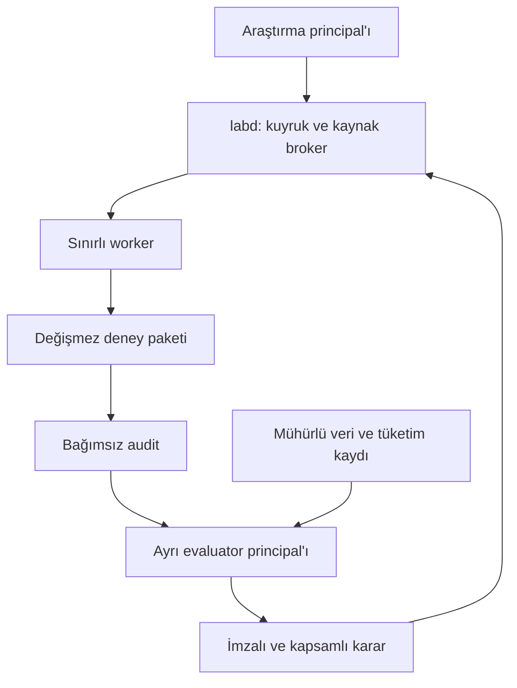
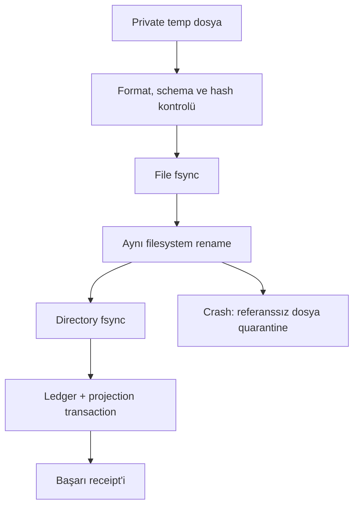

# QUANT EDGE LAB — Uygulama Monografı v1.1

**Bilimsel Mimari Monografı v1.0 için normatif uygulama uzantısı**  
Tarih: 8 Kasım 2026 · Dil: Türkçe · Belirtim sürümü: `1.1.0`

Bu belge laboratuvarın uygulaması değildir. Üretim kodu, motor uyumluluk sertifikası, çalıştırılmış piyasa deneyi, performans sonucu veya kârlılık kanıtı içermez. Ekli doğrulama aracı yalnızca mimari paketinin biçimsel ve bağlantısal tutarlılığını denetler. İlerleyen bölümlerdeki kabul hedefleri, gerçekleşmiş sonuç olarak okunmamalıdır.

Makine giriş noktası: [spec/architecture.json](spec/architecture.json). Tip sözleşmeleri: [schemas/runtime.schema.json](schemas/runtime.schema.json). Belirtimin yapısal şeması: [schemas/architecture.schema.json](schemas/architecture.schema.json). Somut test girdileri: [fixtures/conformance.json](fixtures/conformance.json). İzlenebilirlik ve gerçek doğrulama çıktısı ayrı raporlardadır.

<a id="sec-00"></a>
## H-00 · Belge otoritesi ve kanıt sınırı

### 0.1 Değişmez temel

v1.0 bütün bölümleri, tabloları, ekleri ve 58 kaynak bağlantısıyla okunmuştur. Orijinal dosya yeniden yazılmamıştır; paketteki `baseline/QUANT_EDGE_LAB_MONOGRAPH_v1_0_TR.html` yüklenen dosyanın byte düzeyinde kopyasıdır. SHA-256:

```text
71628e4b4ceceac3447759cdabab131e16237aff9fd7569a09f1bc61e4d70d06
```

Bu uzantı v1.0’ın yerine geçmez. V1.0 devralınan bilimsel gereksinimlerin otoritesidir. Uygulamacı önce temeli uygular, sonra yalnız açıkça belirtilen kapsamda amendment veya kesinleştirmeyi uygular. İnsan metniyle makine sözleşmesi uyuşmazsa uygun görünen yorum seçilmez: ilgili iş `SPEC_CONFLICT` ile durur ve sürümlü düzeltme gerekir. Bir değerlendiricinin kendi yorumuyla terfi koşulu değiştirmesi yasaktır.

### 0.2 Kanıt sınıfları

| Sınıf | Anlam | Paket içindeki karşılığı |
| --- | --- | --- |
| Devralınan | v1.0’ın kararı veya gereksinimi | `baseline_refs`, `INHERITED_ELABORATED` |
| Yeni karar | Bu uzantının uygulama tercihi | ADR, normatif alan ve kabul koşulu |
| Amendment | Temelin belirli ifadesine açık değişiklik | `kind=AMENDMENT`; eski ve yeni anlam birlikte açıklanır |
| Dışarıdan doğrulanmış | Resmi belgenin 8 Kasım 2026’da incelenen iddiası | `EXT-*`, `EXTERNALLY_VERIFIED_DOCUMENTATION` |
| Doğrulanmamış | Runtime, veri, model veya işletim varsayımı | `OPEN_UNVERIFIED`, `UNVERIFIED`, `NOT_RUN` |
| Bu pakette doğrulanan | Şema, kimlik, referans, DAG, altın örnek aritmetiği | `validation/validation_report.json` |

Bir resmi dokümanda fonksiyonun bulunması, seçilecek Rust sürümündeki erişilebilirliğini veya bu laboratuvarın bütçesine uygunluğunu kanıtlamaz. Bir native testin geçmesi de fill modelinin piyasa doğruluğunu kanıtlamaz. Yazılım, muhasebe, veri, model ve istatistik doğruluğu ayrı kanıt zincirleridir.

### 0.3 Normatif dil

“Zorunludur” bir `MUST` gereksinimidir. Bir gereksinim her koşulda uygulanmıyorsa kapsamı capability, veri profili veya deney türüyle belirlenir. `NOT_APPLICABLE`, gerekçeli ve hash bağlı olmalıdır; başarısız testi gizleme yolu değildir. Karar `PASS`, koşulun kanıtı olmadan üretilemez. Yalnız kod derlenmesi, güzel rapor veya pozitif backtest yeterli değildir.

<a id="sec-01"></a>
## H-01 · Kararlar, düzeltmeler ve kapsam

### 1.1 Korunan çekirdek

Go `labd`, Parquet/Arrow verisi, SQLite ledger, önceden derlenmiş Rust/Nautilus finalist runner ve ayrı Python istatistik/muhasebe denetçisi korunur. HftBacktest ikinci ve koşullu uzman doğrulayıcıdır. Kubernetes, broker kümesi, ayrı vektör veritabanı, genel amaçlı yeni exchange motoru veya yeni bir araştırma dili eklenmez. Uzak LLM araştırma aracıdır; canlı karar döngüsünün parçası değildir.

Başlangıç sertifikasyon alanı tek venue, linear perpetual, single collateral, NETTING ve isolated hesaptır. Spot, inverse, hedge mode, cross margin, ADL ve insurance ayrıntıları kapsama kendiliğinden girmez. Market, limit, stop-market, stop-limit, GTC/IOC/FOK, post-only, reduce-only ve composite politikaları ayrı testlerle açılır. “Motor bu enum’u tanıyor” sertifika değildir.

### 1.2 Temele açık değişiklikler

**ADR-04 — OOS tüketim otoritesi.** V1.0’ın ayrı OOS principal’ı ile tek ledger writer’ı birlikte uygulandığında tek SQLite dosyasındaki satırlara Unix izinleriyle ayrı gizlilik sağlanamaz. `research.sqlite` ve yalnız evaluator’ın sahip olduğu `sealed.sqlite` kullanılır. Her dosyanın tek writer’ı vardır. İkinci dosya bir servis veya yeni veritabanı teknolojisi değildir; güven sınırını taşıyan küçük consumption/alpha kaydıdır. Kamuya açık araştırma ledger’ı evaluator imzalı kararların aynasını tutar. Günlük hash anchor, tüketilmiş holdout’un eski backup’tan tekrar açılmasını tek başına engellemez; OOS erişiminden önce ayrıca bağımsız receipt anchor gerekir.

**ADR-15 — İptal miktarı.** V1.0 §12.1’deki `filled + leaves = accepted` ifadesi, çalışan ve iptal edilmemiş revision için korunur. Genel özdeşlik:

\[
q_{accepted}=q_{filled}+q_{leaves}+q_{canceled}.
\]

Örnek: 2 birim kabul, 1 fill, kalan 1 iptal ⇒ `2=1+0+1`. `leaves=1` bırakmak hayalet açık miktar üretir. Replace, etkili kabul miktarını ve revision’ı değiştirir; önceki revision kaydı korunur. Bu düzeltme F05 ve F31’in doğrudan oracle’ıdır.

### 1.3 Kesinleştirmeler

ADR-01–ADR-15 kataloğu H-20’de eksiksizdir. Önemli ayrımlar şunlardır: fiziki venue muhasebesi ve FIFO strateji attribution’ı ayrıdır; terminal açık envanter gelecekteki veriyle kapatılmaz; 64 byte replay düzeni zorunlu canonical format değildir; sıfır gecikme geçmiş hacmi yeniden kullanamaz; tüketilmiş test crash sonrasında geri verilmez. Bunlar amaç değişikliği değildir; uygulanabilir davranışın kesinleştirilmesidir.

Runtime sürümleri bilerek uydurulmamıştır. M0’ın native feasibility işi tek source commit, toolchain ve bağımlılık kilidini gerçek deneyle seçer. Bunun yerine rastgele bir sürüm numarası yazmak uygulamaya hazırlık değil, doğrulanmamış uyumluluk iddiası olur. `UNRESOLVED` lock ile çalışır araştırma işi veya OOS teyidi açılamaz; yalnız feasibility işi açılabilir.

<a id="sec-02"></a>
## H-02 · Topoloji, güven sınırları ve teslim birimleri



Oklar bütün dosyaları okuma yetkisi anlamına gelmez. Kontrol taşıması küçük JSON, büyük girdiler ise içerik hash’ine bağlı artifact capability’sidir. Uygulama bağımlılık DAG’ı, araştırmanın geri besleme döngüsünden ayrıdır: örneğin `C-EVALUATOR`, `C-NATIVE` ve `C-STATS` sözleşmelerine bağımlıdır; bunlar evaluator’ın kararına compile bağımlılığı taşımaz.

### 2.1 Süreç ve kullanıcı modeli

`qel-labd` sürekli çalışan tek supervisor’dır. Collector ihtiyaç süresince açık kalabilir; prepare, replay, queue, statistics ve audit tek işlik süreçlerdir. `qel-research` yalnız kendi worktree’sini ve development sonuçlarını değiştirir. Worker yalnız atanan read-only girdiyi ve kendisine ait çıktı dizinini görür. Audit checker farklı kullanıcı ve paketle çalışır. Evaluator, kendi private veri mount’u ve kendi sertifikalı binary diziniyle başlatılır; araştırmacının shell’i, worktree’si veya environment’ı bu sürece aktarılmaz.

Kullanıcı ayrımı bir kez işletim kurulumunda hazırlanır. Ajanlara root veya genel systemd/sudo yetkisi verilmez. Worker başlatıcı yalnız önceden tanımlanmış unit şablonunu, içerik hash’i doğrulanmış binary’yi ve izinli çıktı dizinini kabul eder. Research principal’ın evaluator socket’ine ulaşamaması gerçek UID/mount/socket testleriyle doğrulanır. Mantıksal rol adları, ayrı işletim sistemi yetkisi yerine geçmez.

### 2.2 Bağımlılık sınırı

`C-CONTRACT` her uygulamanın kullandığı sürümlü schema/hash sözleşmesidir. `C-POLICY` yalnız teslim edilmiş görünümden intent üretir. Matching ve fiziki hesap `C-NATIVE` içindeki hazır motor/adaptörün işidir; `C-ACCOUNT` sonuçları bağımsız yeniden kurar. `C-STATS` fill icat etmez; muhasebe çıktısından çıkarım yapar. `C-AUDIT` bozuk paketi düzeltip aynı paket hash’ini onaylayamaz. `C-EVALUATOR` bütün bu sabit araçlarla terfi kuralını uygular. `C-EXPORT` yalnız onaylı kapsamdan bot paketi üretir.

H-20’deki bileşen kataloğu sorumluluk, giriş/çıkış kontratı ve görev kimliğini bağlar. Hiçbir bileşenin “kendi PASS’ını verme” yetkisi yoktur.

<a id="sec-03"></a>
## H-03 · Kimlik, tür, hash ve uyumluluk

### 3.1 Üç kimlik

`trial_id` ekonomik seçim/arama birimidir; `run_key` bütün anlamlı girdilerin deterministik kimliğidir; `attempt_id` aynı run’ın işletim denemesidir. Aynı binary, veri, politika, seed ve protokolle crash tekrarında trial değişmez. Kod, exit, universe veya seçim ölçütü değişmiş onarım yeni finansal varyanttır. Bütçe, yapılan değişikliği “bugfix” diye adlandırarak aşılmaz. Kontrol için önceden dondurulmuş 1.000 seed, seçilip elenen 1.000 sinyal değildir; her replication kaydedilir, fakat önceden sabit kontrol ortalamasının üyeleri finansal varyant bütçesini tüketmez. Kontrol seed’lerini sonuca göre seçmek yeni adaptif seçimdir ve yasaktır.

### 3.2 Canonical serialization

Wire ve manifest JSON’dur; YAML’ın örtük tarih/sayı türleri ve alias davranışları bu kritik sözleşmeye alınmaz. JCS/RFC 8785 kullanılır. Şema anahtarları ASCII’dir. Kullanıcı metni NFC olmak zorundadır; raw bytes normalize edilmez. JCS’nin kendisi Unicode normalizasyonu yapmaz; NFC kontrolü bu laboratuvarın ek koşuludur. Yinelenen anahtar, invalid UTF-8, NaN/Infinity, tanınmayan alan veya enum reddedilir.

64/128 bit finansal katsayılar ve ns zamanları JSON’da kanonik ondalık **string** olarak taşınır. `"9007199254740993"` bir JavaScript Number’a çevrilmez. Başta `+`, gereksiz sıfır, `-0`, scientific notation ve ondalıkta sonda gereksiz sıfır yasaktır. Küçük sayaç ve sınırlar en çok `2^53−1` JSON integer’dır. `Rational={num,den}` paydası pozitif exact kesirdir. Para birimi, fiyat ve miktar ölçeği registry’den çözülür; farklı `scale_id` katsayıları doğrudan toplanmaz.

`Ns` kayıpsız unsigned wire alanıdır; bu sürümün simülasyon takvimi `0..2^63−1` ns ile sınırlandırılır. Price/qty int64, para signed int128 katsayıdır. Çarpımlar checked geniş ara tipte yapılır; taşma `NUMERIC_OVERFLOW` üretir. “Daha sonra float’a çeviririz” muhasebe için geçerli bir kurtarma değildir.

### 3.3 Hash sözleşmesi

\[
run\_key=SHA256(\texttt{QEL.RUN.1.1\0}\parallel JCS(identity\_object)).
\]

Nesne; code tree, dependency lock, binary, dataset, strategy, venue, split, seed protocol, environment, statistical protocol, capital, latency ve control hash’lerini içerir. Bir string birleştirmesindeki alan sınırı belirsizliği böylece oluşmaz. Attempt, makine saati, dosya adı ve rapor süresi run kimliğine girmez.

İki farklı hash saklanır: fiziksel dosyanın SHA-256’sı bütünlük içindir; canonical ekonomik olay dizisinin semantic hash’i chunk/file/codec parity içindir. Parquet metadata’sının aynı byte olması ekonomik eşitlik şartı değildir. Semantic dizide fill/order/hesap kimliği, exact miktar/fiyat, nedensel sıra, kaynak türü ve model profili bulunur; attempt/wallclock/çıktı dosya adı bulunmaz.

### 3.4 Rastgelelik

`HMAC_SHA256_COUNTER_V1`: 32-byte root seed, JCS ile encode edilmiş `[run_key,component_label,event_id,replication_id,counter]` mesajına HMAC-SHA256 uygulanır. İlk 8 byte big-endian unsigned `u64` verir. `n` elemanlı örnek için `u < floor(2^64/n)*n` koşulu sağlanana kadar counter artırılır; sonuç `u mod n` olur. Bu, modulo bias’ı önler. Uniform gerçek için `u/2^64`, olasılık eşikleri için exact rational karşılaştırması kullanılır. Labels kontrol, latency, queue, bootstrap ve rescue arasında ayrılır. İşlerin başlatılma sırası çekilişi değiştirmez. Kalibre dağılım dönüşümü ve SciPy/Numpy sürümü ayrıca lock’a girer.

### 3.5 Sürümleme

Bütün kontratlar `1.1.0`’dır. Major değişimi kırıcı; minor yeni opt-in capability; patch yalnız anlamı değiştirmeyen düzeltmedir. Ek alanı görmezden gelen tüketici bu profilde yoktur; sürüm pazarlığı önceden yapılır. Operator anlamı, rounding, timestamp precedence veya accounting basis değişirse yeni semantic sürüm ve dependent certificate iptali gerekir. Aynı ortamda bit determinism hedeflenir. F64 feature sonuçlarının farklı CPU/libm üzerinde byte eşitliği kanıtlanmış değildir; ortam hash’i bu nedenle zorunludur.

<a id="sec-04"></a>
## H-04 · Veri edinme, bitemporal kayıt ve kalite

### 4.1 Veri yolu ve fiziksel türler

Kaynak bytes → mühürlü raw segment → normalizasyon → kalite belgesi → dataset manifest → türetilmiş feature/replay cache sırası zorunludur. Normalizer raw kaydı overwrite edemez. Her satır raw hash/offset, session ve ingest sıra numarasına bağlanır. Yinelenen aynı mesaj dedup edilebilir; farklı içeriğe sahip aynı kaynak kimliği conflict olarak quarantine edilir. Kaynak sıra bilgisi olmayan event’e uydurma exchange sequence verilmez; ingest sıra bilgisi ayrı kalır.

Raw segment sınırı 128 MiB veya 15 dakikadır. Canonical analitik format typed Parquet, başlangıç codec’i Zstd level 1’dir. Row group en fazla 32 MiB açılmış veri veya 65.536 satır hedefler. Atomic mesaj bölünmez; 8 MiB üstü mesaj ve 64 MiB üstü aynı-zaman grubu bu varsayılan profilde açık limit hatası verir. Bu limitler piyasa semantiği değiştirilerek aşılmaz; gerekiyorsa yeni kaynak profili ve benchmark gerekir. Arrow IPC replay cache sıkıştırılmamış, sürümlü ve yeniden üretilebilirdir. “Zero-copy” bütün pipeline için vaat değildir. B2 corpus’unda8/32/64MiB açılmış row group ve LZ4/Zstd1 matrisi ölçülür; aynı semantikle hız kazandıran seçim yeni cache format sürümüyle açılır.

### 4.2 Olay sözleşmesi

`EventHeader`, sekiz discriminant (`Quote`, `Trade`, `BookBatch`, `Bar`, `Mark`, `Funding`, `RuleChange`, `Gap`) ile birleşir. Header’da exchange/receive/available/simulation zamanları, atomic batch kimliği, kaynak sıra bilgisi ve kalite bayrakları vardır. Mesaj içindeki bütün seviyeler tek `BookBatch` payload’ıdır. L3 order ID alanları kaynak gerçekten veriyorsa kullanılır. Unknown aggressor ayrı değerdir; tahmin edilmiş flag observed diye etiketlenmez.

Bar close aralığı `[open,close)`’dur; ancak final bar ve onun yayın/teslim olayı görüldükten sonra karar alınabilir. Aynı kapanış zamanına ait trade’in barın içine girip girmediği normalizer’ın bu yarı açık aralık kuralıyla belirlenir. OHLC yolunun bilinmediği durumda intrabar execution kesinleştirilemez. Mark/index trade price yerine otomatik geçirilemez.

### 4.3 Binance USD-M book bootstrap

```text
state = BUFFERING; begin bounded atomic-message buffer
obtain snapshot(anchor = lastUpdateId)
drop buffered event where u < anchor
find first event with U <= anchor <= u
apply complete snapshot; apply that complete first event
for each subsequent event in source receive/sequence order:
    if pu != previous_u: emit GAP; invalidate book; restart snapshot
    else apply all rows atomically as absolute quantities
    qty == 0 removes level; removing absent level is allowed
    match existing orders only after full message apply
```

Spot için görülebilen `lastUpdateId+1` kuralı futures’a kopyalanmaz. Bu profil `EXT-05`’in incelenen sürümüne bağlıdır. Buffer taşarsa veri kaybı kaydedilir; eski deltalardan sessizce “yeni snapshot” üretilmez. Snapshot’ın taşıdığı derinlik kapsamı korunur; dışında sınırsız likidite varsayılmaz.

### 4.4 PIT evren ve reference data

Varsayılan geniş tarama üst sınırı 40 eligible kontrat, ilk L2 capture kapsamı 2 kontrattır; kaynak bütçesiyle 2–4’e çıkabilir. Minimum listeleme geçmişi yeni uygulama varsayılanı olarak 30 gündür. Sıralama önceki tamamlanmış UTC gününün quote hacmiyle, eşitlikte instrument ID ile yapılır. Bu seçim parametreleri hash’e girer ve araştırma varyantı sayılır.

Instrument, fee, margin ve trading status kayıtları iki yarı açık aralık taşır: `[valid_from,valid_to)` ve `[known_from,known_to)`. Gerçekçi join, karar zamanında hem geçerli hem bilinen tek kaydı seçer. Birden fazla eşleşme conflict, sıfır eşleşme missing rule’dur. Forensic revizyon ayrı dataset ve karar türüdür. Güncel sembol listesini geçmiş evrene taşımak yasaktır. Delist/symbol-change üyeliği bulunmuyorsa ilgili cross-sectional iddia `UNIVERSE_UNVERIFIED` kapsamındadır.

### 4.5 Kalite ve düzeltme

QualityCertificate; raw/normalizer hash’leri, açılmış satır ve atomic mesaj sayıları, exchange/receive/availability aralıkları, gap’ler, duplicate/conflict sayıları, timestamp birimi, clock uncertainty, snapshot anchor ve coverage maskesini taşır. Checksum tek başına completeness değildir. Arızalı veri, onu kullanan run ve kararların descendants’ını quarantine eder; yeni temiz veri revizyonu ve tekrar çalışma eski imzayı sessizce iyileştirmez. Sealed kalite taramasını trusted principal yapabilir; araştırmacıya kârla ilişkili aralık seçme bilgisi sızdırmaz.

<a id="sec-05"></a>
## H-05 · Streaming, feature DAG ve strateji dili

### 5.1 Belleğin sınırı

Merge, her stream için bir head ve byte sınırlı bir batch, streamler arasında min-heap tutar. Karmaşıklık `O(N log K)`; veri buffer’ı `O(KB)`’dir. Book, feature ve active execution state ayrıca bütçelenir. İki milyon satırlık bir mesajın “tek event” olması RAM hesabından kaçmasına izin vermez. Aynı timestamp grubu bütün gerekli kaynakların watermark’ı o zamanı geçince kapanır. Sınırsız bekleyen watermark veya sınırsız timestamp bucket yoktur; timeout/byte sınırı açık kaynak hatasına dönüşür.

Batch bitince yalnız bitmiş input buffer’ı serbest bırakılır. Pozisyon, açık emir, causal scheduler, funding timer, queue ve feature state korunur. Engine finalizasyonu gerçek run sonunda bir kez yapılır. Dosya/gün değişimi strateji reset noktası değildir. Native dokümandaki `run(streaming=True)`, `clear_data()` ve `end()` ayrımı bir kavramsal referanstır; bu Python örneğinin aynı imzalarla Rust API’sinde bulunduğu iddia edilmez. TASK-08 gerçek Rust yolunu kanıtlar.

Kapalı emir/fill geçmişi dayanıklı çıktı olarak mühürlendikten sonra supported purge uygulanabilir. Açık epoch’un backend’de biriken fill geçmişi güvenle budanamıyorsa maksimum epoch execution sayısı uygulanır ve `RESOURCE_LIMIT` döner. Bellek hedefini tutturmak için pozisyon kapatılıp yeniden açılamaz. B4’te büyüme ölçümü yalnız input buffer’ını değil bu durumu da kapsar.

### 5.2 Derleme ve type-check

StrategySpec genel kod değildir. Bir parser şu sırayı izler:

```text
validate JSON version and numeric domains
resolve every operator against exact operator-set version
check unique node IDs; resolve input references; topological type-check
validate operator-specific parameters and output unit/type
count stateful nodes, windows, free search dimensions and projected bytes
validate decision,entry,exit,sizing,risk,venue and latency references
resolve required capabilities against certificate scope
freeze canonical policy hash; admit only if every check succeeds
```

Node listesi topolojik sıradadır; daha sonra tanımlanmış node’a referans kabul edilmez. `F64`, `BOOL`, `PRICE`, `QTY`, `MONEY`, `TIMESTAMP` ayrılır. İlk operator setinin sayısal feature çekirdeği F64’tür; para/qty matching’i buna karıştırılmaz. İzinli input alanı LocalView’den gelir. Dosya okuma, import, network, tarihsel tüm sütuna erişim veya evaluator çağrısı operator değildir.

### 5.3 Operator semantiği

Operatorların tamamı makine kaydında arity, parametre JSON Schema’sı, statefulness, warm-up ve null davranışıyla tanımlıdır. Aritmetik/karşılaştırma/boolean operatorlara ek olarak INPUT, CONST, LAG, SMA, SUM, MIN, MAX, EMA, STD, ER, PIVOT ve exact QUANTILE bulunur. Bu sınırlı set başlangıç deneyini karşılar; her indicator için yeni framework kurmaz.

- EMA(n), ilk n tamamlanmış gözlemin basit ortalamasıyla başlar; sonra `alpha=2/(n+1)` uygular.
- STD(n), `ddof=1` örnek standard deviation’dır. Null atlanmaz; pencere tamamlanmamışsa null’dır. Rolling implementasyon bağımsız centered two-pass referansla `abs(error) <= 1e-12 + 1e-10*abs(reference)` toleransını geçer. Negatif variance’ı keyfi sıfıra kırpmak yasaktır.
- LAG(p), p tamamlanmış gözlem geriye bakar; ilk p sonuç null’dır. Bar süresi sabitse zaman ve gözlem uzunluğu ilişkisi açık olur; düzensiz tick serisinde “96 gözlem” 96 dakika değildir.
- ER(n), `abs(x[t]−x[t−n]) / sum(abs(diff(x)))`; payda sıfırsa abstain eder.
- PIVOT(left,right), sağ onay gözlemleri tamamlanınca yayınlanır. Strict extremum kullanır; eşitlik pivot değildir. Orijinal pivot zamanına geriye feature yazmaz.
- QUANTILE, `h=(n−1)p` ve komşu order statistic’ler arasında doğrusal interpolation kullanır; `0<=p<=1` zorunludur. Yaklaşık quantile ilk operator setinde kapalıdır.

Null, stale veri, sigma sıfır veya warm-up eksikliği yeni entry’yi engeller ve nedeni kaydeder. Risk/stop yönetimi feature warm-up’ından bağımsız sürer. Aritmetik null’ı gizlice 0’a çevirmek yasaktır. Feature gap sonrasında sürekli örnek varsayan ring buffer yeniden warm-up ister; pozisyon ve venue risk state resetlenmez.

### 5.4 Fit ve cache

Fit gerektiren normalizer/model bu küçük operator setinin dışında ayrı sürümlü model artifact’ıdır. Fit aralığı, training maskesi, algoritma ve seed hash’i zorunludur. Fold başlangıcında yeniden fit edilir; validation/sealed üzerinde fit yoktur. Geçmiş training verisiyle causal warm-up yapılabilir. Feature cache anahtarı node/DAG + params + dataset + as-of + fit interval/model + operator version içerir. Cache hit bu alanların exact eşleşmesidir; dosya adına güvenilmez.

<a id="sec-06"></a>
## H-06 · Nedensel simülasyon ve native adapter

### 6.1 İki ayrı bilgi dünyası

Exchange state `X` doğru piyasa/hesap olaylarını, LocalView `Y` yalnız teslim edilmiş olayları tutar. Market exchange’e uygulandığında strateji doğrudan engine cache’inden onu okuyamaz. Fill oluştuğunda gerçek hesap değişir; strateji ancak response delivery sonrasında öğrenir. Local equity de teslim edilmiş account olaylarından oluşur. Gerçek exchange risk motoru fill/funding/mark ile daha önce tepki verebilir.

\[
t_{seen}=t_{exchange}+L_{feed},\quad
 t_{arrive}=t_{decision}+L_{compute}+L_{order},\quad
 t_{known}=t_{venue\_response}+L_{response}.
\]

Receive zamanı gerçekten capture noktasındaki gözlemi temsil ediyorsa `t_seen=ts_receive` kullanılır; aynı feed delay ikinci kez eklenmez. Vendor host’u ile hedef VPS arasındaki fark ayrı kalibrasyon konusudur. Exchange zamanı bulunmuyorsa receive-axis profil kullanılabilir fakat exchange/latency boyutu `assumed` veya `missing` kalır. Negatif delay veya sequence ile çelişen zaman, clock hatasıdır; sessiz clamp/sort ile onarılmaz.

### 6.2 Olay sırası

Scheduler anahtarı `(sim_ns,microstep,phase,venue_rank,stream_rank,source_seq_or_ingest_seq,insertion_id)`’dir. Sıralanmamış ham timestamp’lere karşı kaynak sequence üstünlüğü normalizasyonda korunur. Aynı kaynakta geriye giden corrected clock varsa latency sertifikası engellenir; desteklenmeyen bir kronoloji uydurulmaz. Cross-source belirsizlik için frozen alternatif sıralama stresleri ayrı run’dır.

| Phase | Olay | Zorunlu davranış |
| --- | --- | --- |
| 0 | Rule/settlement boundary | Venue precedence açık; aynı-zaman giriş/çıkış dahil |
| 10 | Atomic dış piyasa mesajı | Tam mesaj uygulanır, önceki resting emirler eşleşir |
| 20 | Önceden yoldaki submit/cancel/replace | Gerçek arrival ve kaynak sırası |
| 30 | Posting, risk, rejection, forced close | Nedensel parent sırasını koru |
| 40 | Yerel feed/response, feature, decision | Yalnız teslim edilmiş state |
| 50 / sonraki microstep | Kararın ürettiği sıfır-delay komut | Parent trade hacmine geriye gidemez |

Aynı zamanlı cascade en fazla 10.000 microstep’tir; aşımı `CAUSAL_LOOP` duruşudur. Bu, keyfi event düşürme değildir. Yeni pasif emir, kendisini doğuran trade’in hacmini kullanamaz: `fill.trade_causal_key > order.accept_causal_key`. Marketable yeni emir mevcut gözlenen book’tan ancak ortak consumption budget içinde alabilir; geçmiş trade hacmini kullanmaz.

### 6.3 Native entegrasyon yapılabilirlik kapısı

Nautilus API’sinin mevcut olması yeterli değildir. TASK-08 aşağıdakileri küçük gerçek native programlarla kanıtlar: pure Rust build; input streaming/finalization; event/policy callback sırası; LocalView izolasyonu; gerçek fill’in gecikmeli yayınını kontrol edebilme; tek funding owner; exact qty/money dönüşümü; open state korunumu; purge sonrası bağımsız audit; B4 kaynak zarfı.

Gerekli hook public API’de yoksa rapor exact commit, eksik trait/fonksiyon ve başarısız fixture’ı gösterir. Çözüm, upstream destek veya açık ADR ile adapter/backend değişimidir. Bu belge bir API icat etmez, motoru fork etmeyi veya monkey patch’i varsayılan yapmaz. Capability `UNVERIFIED` veya `BLOCKED_BACKEND` kalır. Daha düşük fidelity’yi aynı sertifika diye sunmak yasaktır.

### 6.4 Fidelity vektörü

Fiyat yolu, book kapsamı, queue bilgisi, feed/order/response latency, fees, funding, margin/liquidation, impact, ortak portföy ve forward calibration ayrı alanlardır. Değerler `observed`, `calibrated`, `assumed`, `missing`, `unsupported`’dır. Bir stratejinin gerektirdiği boyutlardan biri missing ise G3 geçmez. L2 queue tahmini L3-exact değildir. Bar fixture’ının başarılı olması mark tabanlı liquidation sertifikası değildir. Sertifika binary + venue + dataset schema + fixture corpus + kaynak profiline bağlanır.

<a id="sec-07"></a>
## H-07 · Emirler, queue ve composite yaşam döngüsü

### 7.1 Exchange state ve yerel görünüm

Exchange makinesi CREATED → IN_FLIGHT → WORKING/PARTIAL → FILLED/CANCELED/EXPIRED veya REJECTED’dır. Cancel-pending ve replace-pending yerel epistemik bayraklardır; exchange terminal state değildir. ACK gelmeden fill gelebilir. `venue_event_seq` ve fill ID ile local reducer geçmiş ACK’in state’i geriye almasını önler. Aynı fill’in tekrar teslimi fee veya qty’yi ikinci kez uygulamaz. Eski revision kabul mesajı yalnız eksik metadata’yı tamamlayabilir.

Submit/cancel/replace intent’inde command ID, client ID, account/instrument/strategy, position epoch, group/parent, karar kaynağı, arrival, side/type/TIF, qty ve fiyat/trigger bulunur. Fiyat veya qty değişimi bir revision olayıdır. Qty artışında ve fiyat değişiminde priority reset profil alanıyla belirlenir; qty azalışı kendiliğinden reset varsayılmaz. Bilinmeyen venue davranışı certify edilmez.

### 7.2 Taker ve likidite tüketimi

Market ve marketable limit, arrival anındaki karşı seviyeleri exact tick fiyatıyla yürür. Limit sınırının ötesine geçmez. FOK önce bütün miktar + fee + risk yeterliliğini kontrol eder; başarısızsa sıfır fill ve tamamı iptal. IOC görünen uygun miktarı alır, kalanını iptal eder. Post-only arrival anında crossing ise venue profilindeki reject/cancel olur; maker fill’e çevrilmez. Certified L2 profilinde görünmeyen derinliğe yapay fiyat eklenmez.

Bütün own emirler aynı simüle venue/level revision’ının tüketim bütçesini paylaşır. Bir 10 birim ask’e arka arkaya 6+6 gönderilirse en çok 10 fill olur. Bütçe, o fiyat seviyesine yeni dış absolute depth update geldiğinde yenilenir; timer veya aynı trade’in yeniden işlenmesiyle yenilenmez. Bu dış yenilemenin bizim impact’imizden etkilenmediği bir model varsayımıdır; gerçek piyasa garantisi değildir. Trade ve depth mesajlarındaki aynı azalma iki kez likidite veya queue ilerlemesi sayılmaz.

### 7.3 Passive queue

Sertifikalı başlangıçta tek fiziki hesap vardır. Bir account/instrument/side/price için en çok bir own resting pasif emir olabilir. Aynı hesabı paylaşan iki stratejinin ikinci emri reject edilir veya ortak order intent’ine birleştirilir; independent queue kopyası açılamaz. Çok hesaplı ortak own-queue bu sürümün sertifika kapsamı dışındadır.

Başlangıç ahead, acceptance anındaki public displayed qty’dir. Risk-averse modelde iptaller behind olur; ahead yalnız uygun trade ile azalır. Base modelde iptalin ahead payı frozen pro-rata modelidir; calibrated model ayrı fitted artifact’tır. Book azalışı için önce o seviyede önceki update’ten beri zaten işlenen trade miktarı çıkarılır:

\[
c_{unexplained}=\max(0,Q_{old}-Q_{new}-V_{already\ processed}).
\]

Yenileme/iptal karışımı L2’de gözlenmediğinden bu bir modeldir. İptal lokasyonu gözlenmiş gibi raporlanmaz. Eski ahead `a`, uygun trade `v` için `fill=min(leaves,max(0,v−a))`; ahead sonra `max(0,a−v)` olur. İptal ayrı ve doğru sırada uygulanır. F02’de ahead100, trade80 sonra30 ⇒ son olayda yalnız10 fill. Touch veya unknown aggressor tek başına pasif fill kanıtı değildir.

Queue modelleri PnL’yi monoton sıralamaz. Daha az fill, adverse-selection kaybını da azaltabilir. Farklar fill probability, quantity, time-to-fill ve markout ile ekonomik sonuçta birlikte gösterilir.

### 7.4 Bracket, stop ve partial entry

Bracket kimliği `(account,instrument,position_epoch,group_id)`’dir. Flat→nonzero ve sign reversal yeni epoch üretir; reversal önce eskiyi kapatır sonra yeniyi açar. Eski stop yeni epoch’u kapatamaz. Reduce-only ve epoch kontrolü ikisi birden gerekir.

Partial entry’de yalnız gerçekleşen miktar korunur. Stop qty toplam filled entry kadar; partial hedef lot’a aşağı yuvarlanır, kalanı diğer child’a gider. Stop ile TP birbirinin aynı pozisyonu kapatan alternatif emirleri olduğundan exit reservation toplamları körlemesine iki kat collateral sayılmaz; OCO türü ve overfill riski açık modellenir. Client-managed OCO cancel latency nedeniyle iki kardeşin uygun olması mümkündür. Venue reduce-only uygularsa fazla reduce reddedilir; uygulamıyorsa ortaya çıkan reverse exposure gizlenmez. Native atomic OCO ayrı sertifikadır.

Stop trigger anı ile execution ayrıdır. Stop-market trigger sonrası command latency ve depth ile yürür. Stop-limit gap yüzünden hiç dolmayabilir. Entry/exit quantity rounding, trigger source (mark/last/index), child activation ve replace precedence venue sözleşmesine bağlıdır. Stop uzaklaştırma ve loss sonrası otomatik bahis büyütme yoktur. TP1 sonrası BE+cost seçilirse cost hesabı exact realized fees ve kalan beklenen exit maliyetiyle dondurulur; kârı artırmak için geçmiş stop’a uygulanamaz.

Limit entry için BUY fiyatı teslim edilmiş bid−offset×tick, SELL fiyatı ask+offset×tick’tir. TTL local submit’ten başlar; dolmadan geçen TTL normal gecikmeli cancel gönderir. Refresh açıksa eski order terminal olmadan yeni priority varsayılmaz. Signal kapanır veya yön değişirse remainder iptal edilir; terminal yanıt beklenir. Holding saati ilk entry fill’in exchange zamanından başlar. Süre dolunca kalan entry iptal edilir ve mevcut filled qty normal close lifecycle’ına girer.

TP modu SIGNAL_ONLY, FIXED_R veya PARTIAL_FIXED_R’dir. `R=abs(entry−stop_trigger)`; long hedef `ceil_tick(entry+rR)`, short hedef `floor_tick(entry−rR)` olur. Partial modda `r2>r1>0`, fraction(0,1) ve lot rounding zorunludur; alanı belirsiz “karşı zone” hedefi bu operator setinde yoktur. Stop-limit long fiyatı trigger−offset×tick, short fiyatı trigger+offset×tick’tir; nonpositive fiyat reddedilir. Triggered stop-market gözlenen likiditede IOC gibi yürür; kalan açık pozisyon REDUCING ve reconciliation konusu olarak görünür kalır.

### 7.5 Capacity zarfı

Başlangıç screening sınırları, order notional / son15dakikadaki tamamlanmış LocalView trade notional oranı<=0.001 ve order notional / teslim edilmiş karşı book ilk10seviyesinin notional oranı<=0.01’dir. Eksik volume/depth, sıfır payda veya stale view yeni entry’yi engeller. Arrival anındaki gerçek exchange depth oranı ayrıca ex-post raporlanır; entry gelecekte gerçekleşecek volume ile boyutlanmaz. Bu eşikler impact yokluğunu kanıtlamaz. Sermaye grid’i büyüdükçe risk/fee/fill yeniden replay edilir; büyük order ve karşı taraf tepkisi için replay dışı model ve gerçek execution kanıtı gerekir.

<a id="sec-08"></a>
## H-08 · Muhasebe, funding, margin ve risk

### 8.1 Fiziki hesap ve sanal lotlar

Linear perpetual’da alım notional’ı spot satın alma gibi cash’ten düşülmez. Collateral ayrılır; gerçekleşen PnL, komisyon, funding ve liquidation maliyeti wallet’ı değiştirir. Bir fiziksel hesap, bir collateral ve her enstrüman için ayrı isolated bucket vardır.

\[
E=C_{free}+\sum_i C_{isolated,i}+\sum_i U_i,\qquad
available_{new}=C_{free}-R_{unallocated}.
\]

Isolated wallet, başka coin’e teminat olamaz. Zaten isolated’a aktarılmış initial margin bir kez daha free cash’ten düşülmez. Reservation yalnız henüz ayrılmamış ek margin, worst fee ve kayıtlı buffer içindir. Order reject/cancel/fill ile açıkça çözülür. İç transfer dengeli posting’dir; PnL değildir.

Fiziki pozisyonun realized hesabı venue profilindeki basis ile, başlangıç adapter’ında doğrulanmış weighted average ile yapılır. FIFO virtual lot’lar strateji/epoch attribution içindir. Ortalama giriş ve FIFO basis, partial close sırasında farklı realized ve unrealized alt toplamlar üretebilir; **aynı basis’in native/checker bakiyesi** ve **toplam marked equity** uzlaştırılır. Flat olduğunda toplam realized farkı kalmaz. Attribution’ın önceki cash’i ikinci kez harcaması yasaktır.

### 8.2 Posting ve bağımsız uzlaşma

Her para biriminde debit toplamı credit toplamına eşittir. Hesap kodları runtime şemasında kapalı enum’dur. Fee ödemesi FEES debit / CASH_ISOLATED credit; negatif maker fee ters yönlü rebate’tir. Funding ödemesi FUNDING debit / CASH_ISOLATED credit; receipt ters yönlüdür. Mark-to-market noncash posting’i wallet bakiyesine eklenmez; rapor equity’sine girer. Terminal close-cost provision noncash değerlendirme kalemidir, gerçekleşmiş fee veya fill değildir.

\[
E_{end}-E_{start}-F_{external}
=PnL_{price,realized}+\Delta U+F_{funding}-Fees-LiqCosts.
\]

Fill fiyatında spread/slippage varsa tekrar düşülmez. İşletme giderleri bu özdeşliğin dışında tutulur. Checker aynı fill tape’ten fiziki cash, pozisyon basis’i, FIFO attribution ve rezervleri bağımsız integer algoritmayla kurar; native accounting modülünü import etmez. Açıklanamayan tolerans **0 currency coefficient**’tir. Bilinen rounding farkı ayrı posting ve source rule ile açıklanmalıdır; keyfi eps bütçesi yoktur.

F23 altın örneği: başlangıç1000, 2@100 alım fee0.20, 1@110 satış fee0.11, funding−0.50 ve kalan1’in mark105’i ⇒ cash1009.19, U5, equity1014.19. Isolated’a300 ayrılmışsa free700 ve isolated309.19’dur. 200 notional’ı ayrıca wallet’tan düşmek veya slippage eklemek bu fixture’ı bozar.

### 8.3 Funding zamanı ve sahipliği

\[
F=-q(t_f^*)\,m\,P_{settlement}(t_f)\,r(t_f).
\]

Pozitif rate long’dan ödeme alıyorsa işaret budur. `t_f*` aynı timestamp’teki giriş/çıkış precedence’ına bağlıdır. Rate’in stratejiye `available_at` zamanı ile exchange’in settlement bilgisi ayrıdır. Tarihsel tam tape’te economic settlement sınırında uygulanır; sonradan alınmış kaydın capture/receipt bilgisi ayrı tutulur. Late funding eski epoch’a aittir. Yeni short pozisyona yanlış funding credit yazılmaz.

Native veya harici posting mekanizmasından yalnız biri economics owner’dır. `(venue,account,settlement_id,epoch)` bir kez uygulanır. Native funding + post-process nakit düşüşü bir arada açılamaz. Backtest’te tüm trusted settlement tape’i baştan derlenebilir; bu bilginin policy’ye erken görünmesi yasaktır. Canlı gecikmiş receipt geçmiş kararları yeniden yazmaz: mevcut venue hesabı uzlaştırılır, effective epoch attribution düzeltilir, önemli risk farkı varsa yeni risk durur.

Settlement mark’ın actual source referansı tercih edilir. Önceden bilinen mark ancak açık staleness/venue kabul kuralıyla ve eksik boyut etiketiyle kullanılabilir. Nearest-future join hiçbir profilde geçerli değildir. Gerekli mark yoksa F10’da `MISSING_SETTLEMENT_MARK`, candidate’da MODEL_UNIDENTIFIABLE oluşur. Sabit8saat schedule kod içine gömülmez.

### 8.4 Isolated margin ve liquidation

\[
N=|q m P_{mark}|,\quad MM=N r_{maintenance}-deduction,\quad
E_{iso}=C_{iso}+U.
\]

Tier aralıkları floor-inclusive/cap-exclusive’tir; son cap ayrıca kayıtlıdır. Deduction, nonnegative venue alanının sürümlü işaretiyle çıkarılır. Tetik `E_iso <= MM + liquidation_fee_reserve` olarak profil tarafından tanımlanır. Venue’nin gerçek partial liquidation, penalty, forced order ve bankruptcy davranışı ayrı kanıt gerektirir. Bu formül generic fixture profilidir; tarihsel Binance parity’si diye sunulmaz.

Risk kontrolü mark, fill, fee, funding, collateral transfer ve rule değişiminden sonra çalışır. F12’de isolated5.10, qty1, mark100, MM5 ve funding−0.20 ⇒ equity4.90; fiyat değişmeden liquidation trigger olur. Quote/trade/bar’ı mark saymak yasaktır. F11’de mark path destekli, salt quote path mark sertifikası açısından eksik olabilir; tutarsız tetik testte görünür. Tarihsel tier yoksa leveraged teyit bloklanır; bugünün bracket’ı geçmişe taşınamaz. ADL/insurance unknown ise tam venue fidelity etiketi verilmez.

### 8.5 Sizing ve risk state

Stop-risk sizing maliyet buffer’ını equity risk bütçesinden düşer; `floor_to_lot((E*r−buffer)/(|entry−stop|*m))` uygular. Tick rounding long stop’u aşağı, short stop’u yukarı taşır ve risk yeniden hesaplanır. Qty, notional, leverage, reserve ve minimum order birlikte doğrulanır. Stop risk gerçek gap-loss upper bound değildir. F32’de20USDT, r0.005, stop mesafesi1 ve minimum lot1 ⇒ minimum risk1, bütçe0.10; emir reddedilir. Sermaye otomatik1000’e çıkarılmaz.

RUNNING yeni risk açabilir. Stale/gap, daily-loss veya reconciliation sorunu REDUCING’e; kill, drawdown veya yetki ihlali HALTED’a götürür. REDUCING yalnız riski azaltır. Yeni RUNNING için yetkili ve gerekçeli reconciliation/reset gerekir. Günlük sınır UTC day-start equity’sine, drawdown external-flow-neutral high water’a bağlıdır; restart sayaçları temizlemez. Deployment başlangıç varsayılanları r0.005, açık stop riski0.02, günlük kayıp0.03, DD halt0.10 ve max leverage3’tür. Araştırma kaldıraçlı sonuçları unlevered karşılaştırmayla karıştırılmaz.

### 8.6 Fold sonu

Bütün fold’lar flat başlar; yalnız causal feature warm-up geçmişten gelir. Fold sonunda açık pozisyon gerçekte açık olarak raporlanır. Son geçerli mark ve önceden dondurulmuş yürütülebilir close-cost provision ile terminal endpoint hesaplanır. Bunun için future quote/mark veya gerçekleşmemiş iyi fiyatlı fill yoktur. F24’te q1@100, cutoff öncesi mark105, close-cost0.20 ⇒ endpoint equity1004.80; cutoff sonrası mark110 okunmaz. Gün/dosya sonunda forced flat yapılmaz. Eksik/stale terminal mark veya bilinmeyen depth endpoint’i tanımlanamaz hale getirirse test çıkarımı durur.

<a id="sec-09"></a>
## H-09 · Araştırma protokolü ve istatistik

### 9.1 Takvim ve örneklem

Dataset sınırları tamamlanmış UTC günlerinden seçilir. Son `ceil(0.30 * gün_sayısı)` gün sealed’dır; yuvarlama sonucu nominal %30’dan en fazla bir gün farklıdır. Bu deterministik kural split dondurulurken uygulanır, performansa göre kaydırılmaz. Bütün coin’ler aynı takvim sınırlarını paylaşır. İlk discovery içinde 12 takvim ayı expanding train, takip eden3 ay validation,3 ay stride kullanılır. Takvim ayı ekleme UTC’de, ayın sonuna taşmada son geçerli güne clamp ile yapılır. Discovery bu pencereyi taşımıyorsa örneklem yetersizdir; test kesimi küçültülmez.

Her sample’ın inclusive bilgi/label aralığı `[feature_available,label_end]`’dir. `label_end >= validation_start` olan train sample purge edilir. Ek gap/embargo alt sınırı max label horizon + declared latency uncertainty’dir. Sadece geçmiş lookback için validation öncesi warm-up mümkündür; fit ve model seçimi train-only’dir. Overlap’lı validation analizi veya yeniden kullanım varsa embargo kuralı ayrıca dondurulur.

Birincil seri, daily marked net PnL’nin **başlangıç sermayesine** bölünmesidir. Bu seri bileşik yatırım getirisi diye etiketlenmez. Sabit denominator, aday ve kontrolleri aynı sermaye ölçeğinde eşler. Hiç işlem olmayan günler sıfırla seride kalır. Missing mark yüzünden bilinmeyen gün sıfır değildir; imputation ile kurtarılamaz. Ortak coin şokları birlikte tutulur. Trade’ler ayrı bağımsız gözlemler sayılmaz.

### 9.2 Kontrolün uygulanabilir tanımı

Birincil kontrol random-entry + aynı exit/risk/execution ailesidir. Saat UTC, train’de dondurulmuş volatility regime ve side strata kullanılır. Her stratum’da entry olasılığı training candidate entry sayısı / training eligible clock sayısı; side olasılığı training long sayısı / toplam training entry sayısıdır. Payda sıfırsa o stratum’da no-entry kullanılır. Validation/sealed sonucu bu olasılıkları değiştiremez.

Seed listesi0..999, eligibility, stratejiyle aynı risk sizing ve kapalı pozisyon koşulu önceden dondurulur. Her kontrol kendi fiziksel hesap yolunu simüle eder; candidate ile aynı anda cash paylaşmaz. Kontrolün önceden dondurulmuş günlük PnL ortalaması birincil karşılaştırmadır. Adayın gelecekteki trade zamanları veya fill sayısı kontrol girişlerini seçemez. Rejected random order’lar görünürdür; trade sayısı zorla eşitlenmez. Batch/sequential seed yürütmesi aynı semantic sonucu üretir; peak bellek için seed batch’i sınırlanır. 1.000 seed’in maliyeti CPU bütçesine dahildir; bütçe bitince seed sayısı sessizce azaltılamaz.

İkincil basit trend/pullback kontrolü, tamamlanmış log-mid için EMA24 ve EMA96 kullanır: EMA24>EMA96, önceki close<=öncekiEMA24 ve yeni close>EMA24 ise long; simetrik şartlarla short. Entry execution ve candidate’ın stop/risk/holding exit ailesi korunur; bunun bir entry katkısı karşılaştırması olduğu raporlanır. ER filtresini kaldırma ablation’ı ayrı frozen tanıdır. Sonradan en kolay yenilen kontrolü seçmek yasaktır.

### 9.3 İki ekonomik koşul

`x_t` candidate günlük normalize PnL, `c_t` frozen kontrol ortalaması, `d_t=x_t−c_t` olsun. Ön kayıt `delta_profit` ve `delta_control` değerlerini taşır:

\[
H_{0,p}:E[x]\le\delta_p,\qquad H_{0,c}:E[d]\le\delta_c.
\]

Candidate’ın iki koşulu da geçmesi gerekir. IUT için `p_candidate=max(p_profit,p_control)` kullanılır; teyitte aşağıdaki Monte Carlo üst sınırlarıyla hesaplanır. Bir testin çok iyi olması diğerinin başarısızlığını telafi etmez.

Örnek ailede yalnız tasarım değeri olarak `delta_profit=0.0001` günlük PnL/C0 ve `delta_control=0` kullanılır. Bunlar piyasa bulgusu değildir; işletme gideri başa baş hesabı ayrıca yapılır. Yeni aile ekonomik minimumunu maliyet/sermaye gerekçesiyle ön kayıtlar. Unknown LLM/data bütçesinden kârlılık eşiği uydurulmaz.

### 9.4 Dependent bootstrap’ın exact prosedürü

Başlangıç profilinde primary `L=5` gün, sensitivity `L=10` gün ve HAC lag `q=5` kullanılır; development gerekçesiyle başka değer seçilirse sealed öncesi dondurulur. `floor(n/L)>=50` ve `q<n−1` gereklidir. Stationary circular bootstrap’ta ilk indeks uniform0..n−1’dir. Sonraki indeks olasılık1/L ile yeni uniform başlangıç, aksi halde `(önceki+1) mod n`’dir. Aynı indeks dizisi bütün coin’ler ve iki endpoint için kullanılır.

Her endpoint için:

\[
\gamma_k=\frac1n\sum_{t=k+1}^{n}(x_t-\bar x)(x_{t-k}-\bar x),
\quad \widehat{SE}^2=\frac{\gamma_0+2\sum_{k=1}^{q}(1-k/(q+1))\gamma_k}{n}.
\]

\[
T_{obs}=(\bar x-\delta)/\widehat{SE}(x).
\]

`z=x−mean(x)` null sınırına merkezlenir. Her resample için `T*=mean(z*)/SE_HAC(z*)` yeniden hesaplanır; orijinal SE bütün bootstraplara kopyalanmaz. Pozitif olmayan variance veya degenerate bootstrap `DEGENERATE_VARIANCE` / INSUFFICIENT_EVIDENCE’dir; otomatik p0 veya p1 değildir. Sayısal roundoff şüphesinde bağımsız referansla yeniden hesaplanır. Primary CI studentized quantile’lardan; sensitivity CI ayrı raporlanır. Daha iyi sonucu veren block length sonradan primary yapılamaz.

`k = count(T*>=Tobs)` için `p_raw=(k+1)/(B+1)`. MC uncertainty için endpoint başına hata `0.01/(2m)` olan one-sided Clopper–Pearson üst bound kullanılır: `q_upper=BetaQuantile(1−error,k+1,B−k)`; k=B ise1. `p_upper=max(p_raw,(1+B*q_upper)/(B+1))`. Teyit `max(p_upper_profit,p_upper_control)` ile yapılır. Bu konservatif ek şart, dependent bootstrap’ı exact sonlu-örneklem garantisine dönüştürmez.

En fazla64 resample’lık batch tutulur; bütün `B*n*m` matrisi RAM’e alınmaz. Quantile için yalnız gerekli scalar statistic dizileri disk/bounded array olarak tutulabilir. Bütün replicate IDs ve method hash’i çıktıya girer.

Stationarity varsayımı için frozen iki-yarı diagnostic uygulanır: `abs(mean(first)−mean(second))/sqrt(HAC_SE(first)^2+HAC_SE(second)^2)>3.29` veya iki varyansın büyük/küçük oranı>4 ise NONSTATIONARY incelemesi gerekir. Her yarıda en az50 gözlem aranır; degenerate payda yetersiz kanıttır. Bu bir tasarım alarmıdır; geçmesi stationarity ispatı değildir ve threshold OOS sonucuna göre ayarlanamaz.

### 9.5 Selection, Holm ve kesintisiz alpha

Development araması keşifseldir. Seçim skoru, valid pooled validation takviminde `min(T_profit,T_control)`’dür; eşitlikte policy hash küçük olan seçilir. Degenerate skor aday olamaz. Development destek koşulu, iki endpoint’in one-sided95% studentized alt sınırının ilgili minimumun üzerinde olmasıdır; bu seçilimden arınmış teyit diye sunulmaz. G2 ayrıca frozen dört komşuluk ve drawdown koşulunu ister. İyi development sonucu sealed’a erişim hakkı yaratmaz; yalnız cohort’a aday olabilir.

Program genelinde `alpha_j=0.05/2^(j+1)`, j0’dan başlar. İlk cohort alpha0.025’tir. Frozen cohort en fazla8 adaydır. Birleşik p_upper küçükten büyüğe, eşitlikte candidate hash ile sıralanır. Rank i’de eşik `alpha_j/(m−i+1)`’dir. İlk başarısızlıkta sonraki retler durur. Sonradan invalid olan frozen aday m’den çıkarılmaz; p1 ile kalır ve yerine yeni aday alınmaz. Alpha aynı veri/program soyunda isim değiştirerek sıfırlanamaz.

`B+1>=max(10000,ceil(20m/alpha_j))`. Varsayılan B üst sınırı1.000.000’dur. F28’de j8,m8 ⇒ B en az1.638.399; default compute envelope yetmez. Sonuç WAITING_COMPUTE_BUDGET’tır; alpha gevşetilmez, project yeniden adlandırılmaz. Daha fazla kaynak veya farklı yöntem yalnız sonuç açılmadan ayrı yöntem kararıyla mümkündür.

### 9.6 Güç ve kararın anlamı

MDE, dependent SE ve ön kayıtlı güç hedefi0.8 ile development üzerinde planlanır; injected-effect simülasyonuyla kontrol edilir. n_eff ve ACF tanıdır; trade sayısı kanıt değildir. En az50 blok yalnız eligibility koşuludur. Nonsignificance ve düşük güç INSUFFICIENT_EVIDENCE’dir.

NO_EDGE, belirtilen aday/sermaye/model kapsamındaki ekonomik minimumun desteklenmediğine dair ön kayıtlı negatif veya equivalence gerekçesidir. Örneğin geçerli one-sided95% üst CI minimumun altında kalırsa o endpoint için olumsuz kanıt vardır. Bir ailenin bütün olası varyantlarında yokluk iddiası bununla kurulamaz; family-wide iddia için ön kayıtlı eşzamanlı coverage gerekir. PBO/DSR, PF1.2 veya parametre komşuluğu tek başına G4 değildir. Sharpe annualization, beta/exposure, net-R, capacity, fee/funding, tail ve drawdown birlikte raporlanır.

<a id="sec-10"></a>
## H-10 · Mühürlü değerlendirme ve karar kapıları

### 10.1 Custodial erişim ile deneysel tüketim

ADR-16 iki erişimi ayırır. İzole evaluator principal’ının frozen schema normalizasyonu, nonfinancial kalite kontrolü, checksum ve backup işlemleri custodial erişimdir. Her erişim kaydedilir; strateji çalıştırmaz, feature/outcome seçmez ve kârla ilişkili alt dönem özetini araştırmacıya vermez. Önceden dondurulmuş kalite kuralına göre yalnız bütün pencerenin eligibility’si ve commitment yayınlanabilir. Böylece veri hazırlanabilir; kötü görünen dönemler sonradan sessizce değiştirilmez.

Candidate policy execution, analytical feature erişimi veya sonuç geri beslemesi deneysel erişimdir. İlk deneysel byte okunmadan window ve cohort alpha’sı tüketilir, receipt bağımsız yere anchor edilir. Yetkisiz erişim hangi amaçla olursa olsun contamination’dır. Dosya izni, LLM’nin daha önce kamuya açık piyasa tarihini öğrenmediğini kanıtlamaz. Masking ve gateway cutoff riski azaltır; fresh forward zaman esas bağımsızlık kanıtıdır.

### 10.2 Freeze ve consume transaction’ı

```text
validate program lineage,unused window,protocol and<=8 candidate hashes
verify all required certificates and immutable audited packages
BEGIN private SQLite transaction
    CAS program generation; reserve cohort index
    persist frozen input commitment; sign freeze record
COMMIT FULL
before experimental read:
    BEGIN private transaction
        mark window consumed; spend exactly alpha_j; create signed receipt
    COMMIT FULL; persist independent anchor receipt
    if anchor acknowledgment missing: DO NOT READ SEALED INPUT
execute only frozen trusted binary/policies; audit all results privately
release one signed cohort result batch after all candidates finish
```

Buradaki iki yerel commit ve uzak anchor tek distributed transaction değildir. Yerel spend olmuş ama anchor cevabı alınamamışsa erişim bekler; exact receipt idempotent olarak tekrar anchor edilebilir. Başarısız/timeout anchor için pencere sessizce “kullanılmamış” yapılamaz. Remote receipt bilinmiyorsa reconciliation gerekir. Çok muhafazakâr alpha tüketimi, daha az kullanılabilirlik pahasına bilimsel güvenliği korur.

### 10.3 Crash, retry ve release

Frozen girişlerle exact retry aynı consumed cohort içinde yapılır; yeni alpha harcamaz. Ara sonuçlar ajanlara açılmaz. Verifier/policy değişikliği, sızıntı veya unauthorized read TAINTED durumudur; aynı aralık yeni teyit olamaz. Bir aday runtime hatası alırsa cohort’tan çıkarılıp daha iyi aday eklenmez. Cohort’a ait bütün sonuçlar tamamlanmadan tek adayın performansı açık edilmez.

Host restore sonrasında private DB’nin cohort index’i ve consumed window set’i en son bağımsız anchor’dan geri olamaz. Eski backup daha temiz görünse de registry ileri uzlaştırılmadan evaluation açılmaz. Bilinmeyen durumda WAITING_FRESH_OOS uygulanır. Günlük metadata backup RPO’su, holdout’u yeniden kullanılabilir kılmaz.

### 10.4 Otomatik teyit yetkisi

Research director freeze önerisi oluşturabilir; kendisine evaluator yetkisi veremez. İmzalı program charter; program soyu, bütçe, protocol ve window eligibility kurallarıyla otomatik confirmation’ı önceden yetkilendirebilir. Bu durumda trusted evaluator kendi kurallarıyla freeze/evaluate eder. Charter yoksa development devam eder, teyit yetkili cohort bekler. Bu ayrım, canlı sermaye izninden bağımsızdır. Research agent’a trading key verilmez.

### 10.5 Kapıların uygulanması

G0 ekonomi/veri, G1 correctness, G2 development, G3 gerekli fidelity, G4 frozen confirmation, G5 forward, G6 deployment’tır. Her gate machine kaydındaki `all_conditions` ile AND uygulanır; missing metric BLOCK’tur. İşletim durumları (`FAILED`, `RESOURCE_LIMIT`, `WAITING_DATA`) bilimsel verdict’le karıştırılmaz. G3’te execution doğrulanmamışsa reason `EXECUTION_UNVERIFIED`, verdict INSUFFICIENT_EVIDENCE veya MODEL_UNIDENTIFIABLE olabilir.

CANDIDATE_EDGE yalnız G0–G4’ün ilgili frozen kapsamda geçmesidir. FORWARD_VALIDATED G5’i ayrıca gerektirir. G6 sermaye/hesap yetkisi ve bot paketi ister. Her Decision; scope hash, evidence hash’leri, gate sonuçları, source, signing key ve imza taşır. OperatorOverride orijinal verdict’i silmez; UI’da “bilimsel PASS” gibi görünmez.

<a id="sec-11"></a>
## H-11 · Ajan koordinasyonu ve dayanıklı hafıza

### 11.1 Rol ve araç sınırı

Director bütçeli yön seçer; scientist falsifier taşıyan HypothesisSpec üretir; implementer yalnız atanmış worktree’de politika/operator geliştirir; critic temiz context ile leakage ve alternatif açıklamayı arar; operator sabit tool API’sini yürütür; auditor bağımsız checker’ı çalıştırır; evaluator frozen kriteri uygular. Bu yedi ayrı sürekli model süreci değildir. 4GiB’de bir aktif LLM üreticisi ve sıralı critic; 8GiB’de en fazla iki bağımsız ağır tool işi vardır. İki LLM worker’ın eşzamanlı açılması B8 kanıtı gerektirir.

Tool çağrısı yalnız operation ID, typed body ve izinli artifact capability’leriyle yapılır. Research principal’ın shell üzerinden test runner, benchmark rubric veya trusted binary değiştirmesi engellenir. Yeni operator kodu P-RELEASE incelemesi ve sürümlü sertifikasyon gerektirir. Model çeşitliliği tek başına bağımsızlık sayılmaz; farklı yetki, checker algoritması, immutable input ve imzalı evidence gerekir.

### 11.2 Task claim ve handoff

Atama hash’i; component ID, spec sürümü, exact input hash’leri, izinli yollar, test ID’leri, kaynak zarfı ve parent task’ı içerir. Owner tekildir. `generation` CAS ile claim edilir; lease bitince process reconciliation tamamlanmadan ikinci owner verilmez. Ajan, başka bileşenin dosyasını değiştirmeyi gerekiyorsa ayrı dependency işi olarak önerir. Ortak kontrat değişikliği, sessiz yerel typedef değişikliği olamaz.

Teslim immutable package hash + test raporları + resource usage’dır. Reviewer aynı mutable dizini izleyerek onay vermez; frozen package’ı okur. Onarım yeni hash ve yeni audit’tir. Stale assignment’ın sonucu doğru görünse bile current generation’a commit edilemez. Alınan her başarısız sonuç ve reddedilen öneri bütçe/soy kaydında kalır.

### 11.3 Döngü ve bütçe

Ledger retrieval → en fazla3 mekanizma → tek seçim → ön kayıt ve trial reservation → implementer → critic → L0/L1 → gerektiğindeL2/L3 → independent audit → development continue/pivot/retire → uygunsa frozen cohort önerisi → bütün sonuçların hafızaya işlenmesi.

Aile varsayılanı16 finansal varyant,7200 CPU-saniye ve varyant başına en çok3 code repair denemesidir. Data preparation ve calibration ayrı bütçe kalemidir; bunlar görünmez maliyet değildir. Budget artırımı actor/reason/önceki-yeni sınır olayı ister; family rename sayaç sıfırlamaz. Paid LLM çağrısından önce maksimum token/para rezervasyonu yapılır. Aylık parasal limit verilmemişse ücretsiz deterministik işler ilerleyebilir, ücretli çağrı açılamaz. Provider’ın gerçek usage’ı sonradan idempotent cost correction ile uzlaştırılır.

Queue önceliği correctness/data blocker, audit bekleyen finalist ve development sırasıdır. Aynı sınıfta beş0..3 kategorinin eşit ağırlıklı toplamı estimated cost’a bölünür, `min(wait_hours,24)/24` aging eklenir; eşitlikte job ID kullanılır. Kategoriler uncertainty çözümü, pahalı aileyi eleme, reproducibility, veri ihtiyacını azaltma ve düşük korelasyonlu mekanizmadır. LLM’nin tahmini kârı veya OOS skoru scheduler girdisi değildir. 60/25/15 bütçe payları başlangıç tercihleridir. İlk100 tamamlanmış development işinden önce bandit challenger gerekmez.

### 11.4 Screening hatası ve novelty

Geçerli L1 reject’ler onluk gruplara ayrılır; frozen family seed ile reservoir uniform tek rescue seçilir. Invalid veri/implementasyon reject’i bu paydaya girmez. Rescue daha yüksek fidelity ile development’ta çalışır; OOS sınırını açmaz. Kaçırılan candidate ve rescue maliyeti raporlanır.

AST hash, operator-tree yakınlığı, development output correlation, trade overlap ve exposure benzerliği tutulur. Ad değişikliği yeni mekanizma değildir; dedup yapılan trial’ı kayıttan silmez. Araştırma hafızası SQLite FTS5 + structured tags + parent/child graph’tır. Claim, ledger event hash’leri taşır. Yanlış summary supersede edilir; olumsuz eski sonuç değiştirilmez. İndeks bozulursa ledger’dan yeniden yapılır. Ayrı vector DB yoktur; optional embedding cache otorite değildir.

<a id="sec-12"></a>
## H-12 · Kontrol API, kuyruk ve artifact transaction

### 12.1 Taşıma ve doğrulama

Worker Unix socket mesajı dört-byte big-endian payload length + UTF-8 JSON’dur. Limit1.048.576 byte; başlık uzunluğu bu sayıya dahil değildir. Sıfır uzunluk, invalid UTF-8, fazla byte, unknown version ve deadline aşımı reddedilir. Peer principal SO_PEERCRED ve unit/mount bağlamıyla doğrulanır; body içindeki actor string’ine güvenilmez. `WireRequest.body`, operation kaydındaki input schema’ya ayrıca doğrulanır; generic envelope doğrulaması tek başına yeterli değildir.

HTTP façade localhost’ta aynı operation ID’lerine normalize eder. POST için idempotency key ve request ID header’dan; GET için path/query (`id`, `cursor`, `limit`) üzerinden ReadRequest oluşturulur. Sisteme ait read scope `SYSTEM`, kayıtlı program veya job ID’sidir; arbitrary filesystem path scope değildir. Worker ve evaluator socket’leri farklıdır. UI, operator komutunda kendi daemon kimliğini kullanarak yetki yükseltmez; authenticated caller principal’ını taşır.

Uzun iş çağrısı en fazla5saniyede admission receipt üretir; simulation’ın bittiğini söylemez. Bitince worker JobResult gönderir; job GET state ve artifact refs verir. SSE en az1saniye aralıkla redacted summary yayınlar. `Last-Event-ID` cursor’u retained aralıkta değilse snapshot+fresh cursor gerekir; data history web’e taşınmaz. Ledger sayfası en fazla200 olaydır.

### 12.2 Idempotency ve fencing

Idempotency key + canonical semantic body hash tekildir. Aynı key/aynı body aynı receipt’i döndürür; aynı key/farklı body IDEMPOTENCY_CONFLICT’tir. Gönderim at-least-once olabilir. Scientific karar ve cost kaydı ikinci kez commit edilemez. Lease generation, worker PID/starttime/boot ID/cgroup ve heartbeat birlikte tutulur.5s heartbeat,30s lease kullanılır. Zaman aşımı simülasyon saatinden değil monotonic wall clock’tandır.

Child’ın öldüğü doğrulanmadan retry başlatılmaz. Eski generation’dan sonuç gelirse artifact bütünlüğü olsa bile commit reddedilir. Yeni finansal seçim yoksa retry aynı trial/run key ve yeni attempt kullanır. Process failure, OOM, missing data, compute budget ve authorization bekleyişi bilimsel NO_EDGE değildir. SM-JOB bu yan durumları ayrı saklar.

### 12.3 Büyük artifact ve capability

ArtifactRef içerik hash’i, byte büyüklüğü, schema ID/version, media type ve visibility taşır. Dosya yolu body’den serbestçe açılmaz. Trusted registry hash’i izinli root altında çözer; worker’a yalnız o inode/dirfd veya immutable read-only mount capability’si verilir. Symlink ve path traversal reddedilir; seal sırasında dosya türü/owner/size/inode kontrol edilir. Bir worker’ın output path’ini immutable input’a çevirmesine izin verilmez.

Typed record stream’in schema sürümü file manifest’inde ve batch metadata’sında bulunur; her hot-path satırına aynı uzun schema string’i yazmak zorunlu değildir. JSON export’taki header veya operation schema’sı aynı ayrımı korur. Empty Fill tape geçerli olabilir, fakat onu yok saymak değildir: row_count0 ve doğru schema manifest’i gerekir. Job türüne göre gerekli payload’lar `artifact_payloads` tablosundadır.

### 12.4 Yayın ve SQLite commit



Temp final isim alamadan partial kalır. Rename sonrası ama ledger öncesi crash orphan üretir; bu bir completed run değildir. Ledger’ın işaret ettiği dosya kayıpsa karar ve descendants invalid olur. Aynı filesystem atomic rename ve gerçek fsync semantiği kullanılan host’ta test edilir. Network filesystem’e yerel POSIX davranışı yakıştırılmaz.

`ledger_events` INSERT-only’dir. Event ve jobs/leases/trial/artifact/cost projection güncellemesi aynı SQLite transaction’dadır. Payload canonical JSON’u ve payload hash’i saklanır. Event discriminant → exact payload schema eşleşmesi `ledger_payload_registry` kaydındadır; büyük payload aynı schema ID ile artifact’a taşınır. Ledger event hash’i `event_hash` alanı hariç canonical event + previous hash ile hesaplanır. Fiziksel append-only veritabanı veya kötü niyetli root’a karşı değişmezlik iddiası yoktur. İmzalı bağımsız anchor dış doğrulama sağlar.

Operational event’in market ortamı yoksa `record_scope=OPERATIONS, source=null` kullanılır. Experiment event’inde source zorunlu olarak backtest/shadow/testnet/live’dır. Bu ayrım sistem restart’ını “live piyasa gözlemi” gibi etiketlemeyi önler; experiment tape içinde source kaybolamaz.

### 12.5 Tablolar, imza ve release

Logical DDL makinedeki `tables` kataloğundadır: primary/unique keys, indeksler, nullability, mutation politikası ve database owner belirtilidir. Foreign key’ler schema migration’ında açılır; event hash’iyle ilişkili projection transaction dışında değiştirilemez. FTS5 ve arama cache’i yeniden üretilebilirdir. Sealed consumption ve alpha tablosu araştırma kullanıcısına görünmez.

İmza tercihi Ed25519’dur; payload hash SHA-256/JCS’dir. İmzalanacak mesaj `UTF8(QEL.SIGN.1.1\0) || UTF8(schema_id) || NUL || SHA256(JCS(unsigned_object))` biçimindedir; `\0` gerçek NUL byte’ıdır. `signature` ve `signed_hash` unsigned object’ten çıkarılır; schema ID imzayı nesne türüne bağlar. Private release, scientific decision ve operator authorization anahtarları farklı sahiplerdedir. Signature base64url padding’siz taşınır. Public key fingerprint/validity registry’ye pinlenir; key revocation yeni ledger olayıdır. Anahtar iptali eski evidence’ı silmez; compromise kapsamı açıkça gösterilir. Trusted release, exact source/dependency lock, critical fixture evidence ve bağımsız review olmadan dağıtılamaz. Bitwise reproducible binary iddiası ancak gerçek yeniden derleme kanıtıyla yapılır; semantic replay parity her durumda zorunludur.

<a id="sec-13"></a>
## H-13 · Kaynak yönetimi ve sürekli işletim

### 13.1 Admission bütçesi

| Alan | RP-4G | RP-8G |
| --- | ---: | ---: |
| Nominal host MiB |4096|8192|
| Host rezervi |1024|2048|
| Lab parent hard max |3072|6144|
| Lab parent high |2764|5529|
| Supervisor hard max |384|512|
| Collector hard max |256|512|
| Ağır worker havuzu |1792|4096|
| Worker başına üst sınır |1792|2048|
| En fazla ağır worker |1|2|
| Parent içi esneklik |640|1024|

Etkili parent sınırı `min(profile_limit, min(MemTotal,ancestor_memory_max)−host_reserve)`’dır. Negatif/sıfır alan admission’ı kapatır. Rezervasyon toplamı, slack ayrıldıktan sonra etkili parent’a sığmalıdır. Aynı anda iki iş açılması8GiB’de otomatik hak değildir; CPU, gerçek ancestor limitleri ve disk de uygun olmalıdır. Referans CPU2vCPU’dur; supervisor250, collector250, heavy pool1500 millicore başlangıç rezervasyonu kullanır. Idle rezervler scheduler tarafından açıkça iade edilebilir; hidden overcommit yoktur.

Child cgroup memory anon/native/charged page cache’i kapsar; RSS+cache’i iki kez toplamaz. SwapMax0’dır. Pids64, fd256, worker threads2 ve stdout16MiB başlangıç üst sınırlarıdır. Duvar süresi varsayılan1800s, terminate grace5s’dir; job daha sıkı limit bildirebilir. DuckDB512/768MiB memory limit ve1/2 thread kullanır;4GiB spill kotası ayrıca vardır. GOMEMLIMIT supervisor’da256/320MiB soft hedeftir; native worker’ı yönetmez. Cgroup hard limit geçerlidir.

Release build, replay, büyük DuckDB/Python veya local inference aynı heavy token’larını tüketir. Küçük host’a sığmayan release build doğrulanmış CI artifact’ıyla yapılabilir; CI süresi/gideri kaybolmaz. Yerel büyük LLM varsayılan değildir. Evaluator private worker’ları da kaynak broker’dan token alır; yalnız resource metriği paylaşılır, sealed PnL değil.

### 13.2 Disk ve garbage collection

60GiB örneği: metadata2, rapor/log1, raw staging8, normalized20, replay cache8, binary/cache2, spill4, boş15GiB. Bu kapasite iddiası değil admission örneğidir. Yeni download üst byte tahmini veya segment reservation olmadan başlayamaz.512MiB acil metadata alanı korunur.

%75 doluluk download/sweep’i yavaşlatır; %85 yalnız unpinned derivable cache GC; %90 yeni heavy job durur. Pinned kökler sealed dataset, karar paketleri, aktif lease girdileri, yeniden edinilemeyen raw ve uzakta doğrulanmamış evidence’dır. GC transitive manifest references + live lease ile mark yapar; yalnız türetilmiş ve unpinned artifact’ı transactional tombstone sonrası siler. “Eski dosya” olmak yeterli değildir. Remote object storage kullanılabilir; küçük VPS üzerinde S3 server kurulmaz.

### 13.3 Recovery ve backup

SQLite WAL-reset düzeltmesini içeren3.51.3 veya doğrulanmış resmi backport gerekir. Startup actual `sqlite_version`, source ID, compile options, FTS5, WAL, foreign_keys ve integrity check kaydeder. Sistem Python/Go SQLite wrapper’ının adından alttaki sürüm tahmin edilmez. FULL synchronous,5s busy timeout,2s üstü read transaction uyarısı ve64MiB WAL checkpoint hedefi vardır; checkpoint aynı writer koordinasyonundadır.

Günlük consistent SQLite backup API çıktısı ve şifreli remote incremental backup, haftalık seçilmiş deney restore testi gerekir. Yerel crash altında acknowledged scientific decision RPO0 hedeflenir; host kaybında normal evidence RPO’su remote aralığıdır. Metadata/paket RTO hedefi60dakika; büyük raw yeniden indirme ayrıca raporlanır. OOS tüketim kaydı her durumda preaccess anchor’la uzlaştırılır.

Worker crash aynı immutable manifest’ten yeniden çalışma demektir. Genel native state checkpoint/restore varmış gibi davranılmaz. İleride checkpoint ancak uninterrupted replay ile parity’yi geçerse açılır. LLM sağlayıcısı kapalıyken yetkili deterministik işler sürebilir; yeni öneriler bekler. Clock jump ve bağlantı kaybı raw kanıtını korur, ilgili fidelity’yi engeller. Data loss “lossless” etiketine dönüşmez.

### 13.4 Gözlem ve işletme ekonomisi

En az1s örneklemeyle cgroup current/peak/stat/events, PSI, CPU throttling, I/O, disk free, WAL, lease age, gap ve queue wait ölçülür. Sealed private log’lar redacted release olmadan UI’ya çıkmaz. Log rotation byte sınırlıdır; secret yazılmaz. Harici bildirim yalnız önceden yetkilendirilmiş kanala gönderilir.

Trading net ile data/LLM/compute/CI/operations gideri ayrı görünür. Linear capacity gerçekten doğrulanmışsa, pozitif net günlük lower bound `mu` ve aylık lab gideriC için başa baş sermaye `C/(30*mu)` tanısal hesaplanabilir. Nonlinear fee/min-lot/impact varsa frozen sermaye grid’i yeniden replay edilir; lineer extrapolation yapılmaz. Lower bound<=0 ise desteklenen sonlu başa baş sermaye yoktur. Bu, gelecek gelir garantisi değildir.

<a id="sec-14"></a>
## H-14 · Doğrulama, fixture ve benchmark yöntemi

### 14.1 Üç oracle ve test türleri

Hand-derived exact fixture; bağımsız accounting/protocol implementasyonu; observed-market calibration ayrı oracle’lardır. Specification fixture’ının expected çıktısı implementation’dan alınamaz. F13/F23 gibi aritmetik goldens bu pakette kendi içinde kontrol edilebilir; native motorun aynı çıktıyı verdiği ancak ileride harness çalıştırılırsa söylenebilir. Test raporu input/corpus/binary/expected/actual hash ve actual resource usage taşır.

F01–F20 temelden gelir; F21–F35 bu uzantının integration sınırlarını kesinleştirir. Her fixture DSL’de setup, timestamp’li operation listesi ve exact expected metric’ler içerir. Örneğin F06 native atomic/client unsafe/client reduce-only olmak üzere üç ayrı senaryodur; F28 Holm stop ve MC cap dahil dört senaryodur. Fixture DSL bir üretim strateji dili değildir; test adapter’ı bunu native komutlara/veriye çevirir. Unknown operation veya gizli varsayılan kabul edilmez. Common defaults dosyanın başında açıktır.

Metamorphic testlerde chunk/file split, unrelated ayrı hesaplı instrument ve bağımsız worker sırası ekonomi hash’ini değiştiremez. Fee monotonicity yalnız command/fill tape dondurulmuşken exact maliyet farkını sınar; strateji serbest tepki veriyorsa toplam PnL monotonluğu şartı yoktur. HftBacktest differential yalnız ortak semantik kesişimde exact oracle’dır; farklı queue modeli altında trade-by-trade eşitlik beklenmez.

### 14.2 İstatistik prosedürünün testi

B6 her null generator için1.000 bağımsız tam araştırma programını, selection + kontrol + IUT + Holm + cohort alpha bütçesiyle simüle eder. Gaussian AR1, heavy-tail t5, ortak coin faktörü ve regime-shift negative control ayrılır. Nominal0.05 için yanlış terfi oranının95% exact binomial üst bound’u0.075’i aşmamalıdır. Regime shift, bozulan coverage’ı saklamak yerine block/failure sonucunu göstermelidir. Injected-effect grid’i power/MDE/coverage’ı üretir. Yalnız IID p-value testi yeterli değildir.

Bu pahalı test sequential ve64resample batch’iyle4GiB’a sığdırılabilir; çalışma süresinin kısa olduğu iddia edilmez. Performans optimizasyonu sonuç seçimini, resample sayısını veya null program sayısını azaltamaz. B6 geçmeyen evaluator’dan pozitif strateji terfisi çıkamaz.

### 14.3 Benchmarkların ölçüm sınırı

B0–B8’in workload recipe ve kabul hedefleri machine kaydındadır. B0 p90<=100ms; B1 warm p90<=10s; B2 warm p90<=30s; B3 p90<=120s hedefleri aynen korunur. B4 B2’nin100katı event sayısıyla peak ve state-growth ölçer. B5 restore, B6 istatistik, B7 24saat+7gün soak, B8 gerçek agent task completion deneyidir. Hiçbiri bu çalışma sırasında çalıştırılmış değildir.

İki RAM profili aynı2vCPU sınıfı, kernel/disk/toolchain/virtualization kaydıyla ölçülür. İki warm-up ve en az10 timed tekrar; median/p90, timeout/OOM dahil bütün denemeler ana rapordadır. “En iyi tekrar” ana skor olamaz. Cold page cache, warm OS cache, binary cache ve preprocessing ayrı koşullardır. Sadece10 whole-run süresinden p99.9 üretilmez. Per-event tail için yeterli gözlem ve clock doğruluğu gerekir.

Read/decode/merge/policy/risk/output/hash/fsync dahil end-to-end ölçülür. Bağımsız audit ve queue/LLM/build/repair süreleri task-time DAG’ında ayrıca yer alır. Duvar süresi critical path’tir; CPU-s toplamı değildir. B3 rows/s ile atomic messages/s birlikte verilir. Feature kapatan challenger ayrı fidelity sınıfıdır.

### 14.4 Optimizasyon ve challenger

Önce profile ve allocation/flamegraph; sonra quadratic prefix taramalarını incremental hale getirme, ortak DAG, bounded I/O ve cache; son aşamada SIMD/allocator/dil değişimi. Amdahl hesabı actual span paylarına uygulanır. Parametre değişiminde native/JIT compile sayısı0’dır; yeni operator source change’i release ister. Küçük Go edit→test→binary için warm p90<=5s, bir Rust operator modülünün incremental build’i için referans CI’da p90<=60s temelden devralınan hedeflerdir. Temiz dependency build download dahil/hariç, release/LTO ve optional JIT/cache deneyleri ayrı raporlanır.

Tek challenger finanse edilir. Semantik kaybı olmadan full decision median en az2x hız veya toplam giderde en az%30 azalma, p90 nonregression,4GiB ve7gün soak gerekir. Cold/warm build, dependency/binary boyutu, lisans, audit ve bakım gideri dahildir. Kernel-only tick/s bunu karşılamaz. Başarısız backend sonucu saklanır; daha iyimser fill veya yüksek fixture cash ile karşılaştırma kazanılamaz.

<a id="sec-15"></a>
## H-15 · Dikey dilim, işler ve milestone kapıları

### 15.1 En küçük bilimsel olarak geçerli bütün

M1; bir arşivlenmiş ve provenance’ı bilinen instrument, quote/trade ve gerekli mark/funding/rule tape’i, frozen taker politika, native replay, exact fill/order/account çıktısı, immutable manifest, ledger ve bağımsız accounting audit’idir. Fiilen sermayeye uymayan girdide INFEASIBLE veya yetersiz tarihte INSUFFICIENT_EVIDENCE de geçerli bitiştir. En az elle hesaplanan fixture’da gerçek order/fill zinciri geçmeden “boş rapor” dikey dilim sayılmaz.

Bu, tüm venue liquidation/queue yeteneklerinin tamamlandığı veya kâr teyidi alındığı anlamına gelmez. M1’in F02 testi küçük bağımsız queue oracle’ıdır; production passive sertifikası değildir. M2’de gerçek ön kayıtlı ekonomik aile ve kontroller eklenir. M3 istatistik/OOS authority’yi tamamlar. M4 L2/iki-dünya/queue/margin kapsamını açar. M5 otomasyonu ancak M3 evaluator sonrasında açar. HFT-sensitive candidate M4’ü atlayamaz; yavaş taker geliştirme M4’ün bitmesini beklemez.

### 15.2 İşlerin somut kontratı

32 bağımsız mühendislik işi `TASK-01`–`TASK-32` olarak atanmıştır. Her biri component owner, dependency listesi, izinli source yolları, girdi kontratları, gerekli model tanımları, somut deliverable, kabul testleri ve negatif senaryolar taşır. Bu yollar gelecekte kurulacak repository için normatif sahiplik sınırlarıdır; bu pakette laboratuvar source ağacı oluşturulmamıştır.

Görev sırası task DAG’ından çıkarılır. Milestone numarası bütün işleri zorunlu bir waterfall’a sokmaz: örneğin kaynak admission modülü daha önce hazırlanabilir; M4 performance evidence için kullanılabilir. T-NATIVE-SPIKE M0’da pahalıya geri dönen backend/ABI/streaming kararını erkenden çözer. Genel motor rewrite’ı yerine önce feasibility, sonra dar vertical slice yaklaşımı seçilmiştir çünkü yeniden doğrulanacak kod yüzeyini azaltır.

### 15.3 Done ve geçiş kanıtı

Bir görev ancak schema/type uyumu, applicable exact fixtures, bağımsız checker, failure/limit senaryoları, provenance, resource/task-time ölçümü ve immutable evidence ile kabul edilir. Fail olan testin kapsam dışı olması gerekçeli certificate matrisiyle gösterilir. Test edilmeyen özelliğe “tamamlandı” yazılmaz. Reviewer’ın üreticiden ayrı yetkisi ve frozen package hash’i gerekir.

M0–M8 tablosu ile bütün task teslimleri H-20’de makineden üretilmiştir. Her milestone sonucu evidence ID’leriyle kayıtlanır. M6 yeni OOS veya eligible candidate yokken WAITING_FRESH_OOS olabilir. M7 küçük gerçek emir ve sermaye izni olmadan FORWARD_VALIDATED olamaz. M8 isteğe bağlı genişlemedir; yeni ürün/venue mevcut sertifikayı otomatik genişletmez.

<a id="sec-16"></a>
## H-16 · Forward kalibrasyon ve bot dışa aktarımı

### 16.1 Dört kaynak türü

Historical replay model altında tarihsel sonuçtur; shadow gerçek zamanlı veri/sinyal/gecikme gözlemidir; testnet protokol ve reconnect testidir; live küçük gerçek emir gerçek fill/fee/markout gözlemidir. Bu seriler aynı equity grafiğinde birbirine eklenmez. Shadow’da emir gitmediği için gerçek passive queue doğrulanmış olamaz. Testnet likiditesi production gelir kanıtı değildir.

Calibration planı; sabit strateji/model/risk hash’i, order size dilimleri, market state/coin/volatility strata, clock uncertainty, gözlem süresi, abort sınırları ve ekonomik hata bütçesini içerir. Gerçek emir gönderme yetkisi ayrı capital authorization’dır; bu mimari paketin hazırlanması böyle bir yetki üretmez.

### 16.2 Kabul ve hata bütçesi

En az200 gerçek küçük emir,50 fill ve10 ayrı işlem günü başlangıç eşiğidir. Kritik stratum örneği yetersizse kapsam dar veya INSUFFICIENT_EVIDENCE kalır. Fill probability/Brier, time-to-fill survival, qty dağılımı, cancel race, maker/taker, feed/send/response tail,100ms/1s/10s markout ve hesap residual’ı incelenir.

Ön kayıtlı net edge bütçesiE için execution-model hata büyüklüğünün95% üst sınırı<=0.25E olmalıdır. Hem candidate hem control aynı para/notional ölçeğine taşınır; farklı units bölünmez. Bound block/stratum-aware resampling ile ön kayıtlı yöntemden gelir; az örnekte normal approximation kendiliğinden yeterli sayılmaz. Fee/funding/account unexplained residual0’dır. Calibration modelini aynı ileri dönem sonucuna göre değiştirip yeniden PASS verilemez; yeni model yeni fresh dönem ister.

G3, historical development içinde dondurulmuş base,2x fee,p95order/response latency, passive ise risk-averse queue ve geçerli alternatif olay sıralaması streslerini ister. Her senaryoda iki ekonomik minimum aşılır; modeller arası spread development edge lower bound’unun dörtte birini aşmamalıdır. Bu tasarım eşiğidir; gerçek impact kanıtı değildir. G5 gerçek emirlerle bu varsayımın daha güçlü gözlemsel sınamasıdır.

### 16.3 Bot sözleşmesi

BotPackage; frozen StrategySpec, feature/venue/risk/capital profilleri, binary ve runtime lock hash’i, data contract, fixture corpus, forward decision, rollback paketi ve capital authorization içerir. Bütün imzalar public key registry ile doğrulanır. Araştırma ajanı canlı loop’a LLM cevabı sokamaz; native deterministic policy karar verir.

Live adapter ile replay aynı intent/response sözleşmesidir. Reconnect’te open orders, fills, balance ve positions venue query ile uzlaştırılır. Unknown submit “iptal olmuştur” diye yorumlanmaz; yeni risk reconciliation’a kadar kapalıdır. Kill veya rollback, gerçek cancel/close lifecycle’ını izler; UI’daki HALTED etiketi venue’de pozisyonun kapandığı anlamına gelmez. Birden fazla stratejinin ortak hesabı portfolio/reservation/OCO testini yeniden geçer. Sermaye artırımı ayrı izin ve capacity eğrisidir.

<a id="sec-17"></a>
## H-17 · Örnek mean reversion deneyinin kesinleştirilmesi

Bu bölüm yalnız v1.0 §24 örneğini uygulanabilir hale getirir. İlk strateji seçimi veya alpha tavsiyesi değildir. Hazır typed DAG [examples/strategy_mr.json](examples/strategy_mr.json) dosyasındadır. Sıfır hash’ler açık unbound sentinel’dir; dosya type-check edilebilir, gerçek manifestler bağlanmadan çalıştırılamaz.

### 17.1 Matematik ve warm-up

15dakika quote-mid kapanışlarından `l_t=log(mid_t)`, EMA48 ve `x_t=l_t−EMA48(l)_t` hesaplanır. `sigma_t=STD96(x)_(t−1)`, ddof1; `z_t=x_t/sigma_t`. ER24 log-mid üzerinden hesaplanır. EMA ilk48 bar sonunda başlar; ilk96 residual ve bir lag tamamlandığında ilk karar144. tamamlanmış bardadır. Sigma0/null, stale mid veya tamamlanmamış bar abstain üretir.

Entry: ER24<=0.30 ve z<−k long; ER24<=0.30 ve z>k short. Long signal exit `z>=−b`, short exit `z<=b`’dir; sinyal exit yalnız karar clock’unda market intent üretir. Aynı barda exit sonrası re-entry yoktur. Max holding24bar=6saattir; funding ayrıca uygulanır.

Entry’de sigma dondurulur. Long stop `floor_tick(P_entry*exp(−s*sigma_entry))`, short stop `ceil_tick(P_entry*exp(s*sigma_entry))`’dir. En az bir tick mesafe ve exact risk yeniden hesaplanır. Kayıpla genişletme yoktur. Market entry fill’leri partial ise stop yalnız filled qty’ye kurulur; korunmasız geçen client response/order latency görünür kalır. Native contingent koruma yalnız venue sertifikası varsa seçilebilir.

### 17.2 Arama ve stability bütçesi

| Boyut | Değerler |
| --- | --- |
| k |1.5,2,2.5|
| b |0,0.5|
| s |1.5,2|
| Ana grid |12 varyant|
| Stability |Development’ta seçilen adayın k×0.8,k×1.2,s×0.8,s×1.2 komşuları; tek eksen değişir|
| Toplam finansal varyant |16|
| Exit band duyarlılığı |Ana grid’in0/0.5 karşılaştırması|

Komşu eşdeğer policy zaten denenmişse kanıt yeniden kullanılabilir; hiçbir denenmiş trial silinmez. Dört komşunun her birinde ortalama net profit>=delta_profit, kontrol farkı>=delta_control ve frozen drawdown cap şarttır. Bu katı başlangıç stability kuralı false negative üretebilir; geliştirme rescue bunu görünür kılar. Daha iyi komşu bulunursa frozen teyide aday policy değişimi bütün seçim kaydıyla yapılır; OOS açıldıktan sonra en iyi komşu seçilemez.

### 17.3 Sermaye ve model

`CAPITAL-TARGET20`20USDT hedefidir. `CAPITAL-FIXTURE1000` yalnız sentetik muhasebe testinin1000USDT referansıdır. Birindeki başarı diğerine transfer edilemez. Örnek sizing r0.005, leverage1 ve açık stop riski0.02’dir; venue min order uymazsa INFEASIBLE_CAPITAL kabul edilir. Başlangıç taker/maliyetli referanstır; passive sürüm yeni kayıtlı child/adaptif varyanttır. Bir yıllık volatility, OU half-life veya güzel reversal grafiği kendi başına ekonomik edge değildir. OU varsa train’de fit edilen yalnız tanıdır; future residual fit’i yapılamaz.

<a id="sec-18"></a>
## H-18 · Açık riskler, kanıt ve değişiklik yöntemi

### 18.1 Harici doğrulamanın sınırı

8 Kasım 2026’da resmi kaynaklarda native Rust yolu, streaming/finalization ayrımı, funding boundary davranışı, Binance USD-M sequence protokolü, SQLite WAL-reset düzeltmesi, HftBacktest replay sınırlaması, JCS ve JSON Schema2020-12 incelendi. Bu inceleme source code’un derlenmesi veya bütün sürümlerin compatibility testi değildir. Kaynakların `latest/develop` URL’leri değişkendir. Runtime source lock bütün crate’leri aynı exact Git object ID’ye bağlar; Git OID40/64hex ile SHA-256 artifact hash’i farklı türlerdir.

Nautilus’un incelenen Rust sayfasındaki0.66 örneği ile native backtest kılavuzundaki0.67 örneğinin bulunması, birini rastgele pinlemek için gerekçe değildir. TASK-08 public API kapsamını ve exact commit’i seçip kanıtlar. SQLite sürümünde yalnız “3.51.3’ten büyük” string karşılaştırması yapılmaz; gerçek source ID ve resmi düzeltme/backport kontrolü yapılır. Funding destek belgesi tarihsel venue kurallarının varlığını kanıtlamaz.

### 18.2 Sonuçlandırılması gereken belirsizlikler

RISK-01–RISK-14 kataloğunda owner, block edilen milestone/capability/gate, kapanış testi ve gerekli evidence vardır. Öne çıkanlar native hook ve open-epoch RAM, historical fee/tier/mark, L2 cancellation, clock point, istatistik varsayımları, public market bilgisi taşıyan LLM, remote anchor ve20USDT feasibility’dir. Risk “çözüldü” yapılmadan exact evidence hash’i ve kapsamı gerekir. Veri veya motor yetersizliği daha olumlu varsayıma sessizce dönüşmez.

Economic mechanism’in inandırıcılığı, iyi falsifier, literatür kalitesi, karşı-olgusal impact ve gelecekteki stationarity şemayla kanıtlanamaz. Makinedeki `non_executable_requirements` bunları ve zorunlu independent quant review/gözlem yöntemini açıkça ayırır. Schema PASS, bu nitel incelemenin yerine geçmez. İstatistiksel stationarity diagnostic’inin geçmesi de stationarity ispatı değildir.

### 18.3 Değişiklik protokolü

Değişiklik önerisi impacted requirement/contract/model/operator/capability/task ID’lerini, gerekçeyi, alternatifleri ve migration etkisini taşır. Bilimsel veri veya model yorumu değişirse yeni hash ve gerekirse yeni trial/program soy kaydı gerekir. Consumed OOS yeniden kullanılmaz. Source lock değişimi, ilgili certificate’ları yeniden doğrular. Superseding Decision eski sonucu korur. Yeni venue/asset veya challenger, ayrı conformance ve resource evidence olmadan incumbent kapsamını genişletemez.

<a id="sec-19"></a>
## H-19 · Makine belirtimi kullanımı ve doğrulama rehberi

### 19.1 Canonical paket

`spec/architecture.json` tek giriş noktasıdır. Topoloji, requirements, kararlar, interface registry, operator set, state machines, simulation/accounting/statistics kuralları, roles/resources, tables, fixtures, benchmarks, tasks, milestones, risks, sources ve izlenebilirlik bağlantılarını taşır. Büyük runtime tipleri `schemas/runtime.schema.json#/$defs/<Model>` ile; fixture grameri ayrı schema ile çözülür. Alan açıklaması gerektiğinde human section ve object anchor’a gidilir. Genel prose alanı yerine enum/type/list/constraint kullanılmıştır; ekonomik gerekçe ve ispatlanamayan yorum doğal dilde bırakılır.

Bir component alan ajan şu algoritmayı izler:

```text
read architecture meta and baseline hash
lookup component and assigned TASK IDs
walk depends_on until required upstream contract versions are known
load provided/consumed operation schemas and required artifact payloads
load required capability profiles, invariants and fixture inputs/oracles
read relevant requirement IDs, decision amendments and open blockers
implement only assigned paths against exact locked environment
run acceptance and negative cases; seal package and resource report
submit immutable evidence to independent reviewer; never self-promote
```

### 19.2 Tekrarlanabilir doğrulama

Paket kökünde Python3.12+ ve requirements dosyasındaki bağımlılıklar kullanılır:

```sh
python3 -m venv .spec-venv
.spec-venv/bin/python -m pip install -r validation/requirements.txt
.spec-venv/bin/python validation/validate_spec.py --root . --report /tmp/qel-spec-validation.json
```

Schema referansları yereldir; doğrulayıcı ağdan schema indirmez. Bağımlılık kurulumu dışında doğrulama offline’dır. JSON duplicate key/nonfinite/NFC, Draft2020-12 meta-schema, architecture ve fixture grameri, runtime example’lar, ID/schema-fragment çözümü, dependency DAG’ları, state transition erişilebilirliği, resource toplamları, typed DAG, baseline SHA-256, human anchors ve object trace kontrol edilir. Bilerek bozulmuş referans, döngü, yanlış sürüm/tür/parametre/bütçe/anchor ve unknown operation mutant’ları reddedilmelidir.

`x-qel-integer` ve `x-qel-decimal` tip anotasyonları exact string numeric domain’ini belirtir. Standart JSON Schema validator bu custom keyword’leri kendiliğinden yürütmez; SDK/type-checker bu alanları ve `runtime_semantic_rules`’ı ayrıca uygular. Bu paketin validator’ı typed örneklerin bu domain’lerini de denetler; bütün gelecekteki piyasa stream’lerinin üretim doğrulayıcısı değildir. Piyasa çapraz-field invariant’ları F/T kabul testlerinin konusudur.

### 19.3 Doğrulanan ve kalan

Gerçek sonuç `validation/validation_report.json` dosyasındadır. Paket oluşturma sonunda raporla eşleşen coverage/consistency raporu üretilir. Başarı yalnız belirtim düzeyindedir. Native feasibility, bütün gerçek backend conformance testleri, real-data coverage/lisans, B6 null kalibrasyonu, B0–B8 performans/soak ve forward execution bu görevde çalıştırılmamıştır. Bunlar implementation milestone kapılarıdır. Referans örneklerdeki sıfır hash’ler verified binary, veri veya imza değildir.

<a id="sec-20"></a>
## H-20 · Normatif nesne ve izlenebilirlik kataloğu

Aşağıdaki tablolar canonical makine kaydından üretilir. Her kimliğin `obj-*` anchor’ı, ilgili açıklama bölümü ve kaynak bölüm bağlantısı vardır. Bunlar v1.0’ın yeniden anlatımı değil, bu uzantının normatif uygulama kayıtlarıdır. Tam alan tipleri ve algoritmalar JSON dosyalarındadır; bu tablolar insana hızlı denetim ve ters izleme sağlar.

<!-- GENERATED_CATALOG_START -->

### 20.1 Bileşenler ve kontratlar

| Kimlik | Bileşen / uygulama | Bağımlılıklar | Üretilen modeller | Açıklama |
| --- | --- | --- | --- | --- |
| <a id="obj-c-contract"></a>`C-CONTRACT` | Sözleşme, hash ve type checker · GO_RUST_PYTHON | — | `StrategySpec`, `RuntimeLock` | [H-03](#sec-03) |
| <a id="obj-c-ledger"></a>`C-LEDGER` | Ledger writer ve artifact registry · GO_SQLITE | `C-CONTRACT` | `LedgerEvent`, `ArtifactManifest` | [H-12](#sec-12) |
| <a id="obj-c-labd"></a>`C-LABD` | Supervisor, kaynak broker ve kuyruk · GO | `C-LEDGER` | `JobEnvelope`, `JobResult`, `UsageReport` | [H-12](#sec-12) |
| <a id="obj-c-collect"></a>`C-COLLECT` | Raw capture ve download · GO | `C-CONTRACT` | `RawCaptureManifest` | [H-04](#sec-04) |
| <a id="obj-c-prepare"></a>`C-PREPARE` | Normalize, PIT universe ve feature cache · PYTHON_DUCKDB_ARROW | `C-CONTRACT` | `DatasetManifest`, `QualityCertificate` | [H-04](#sec-04) |
| <a id="obj-c-policy"></a>`C-POLICY` | Ortak typed feature ve politika semantiği · RUST | `C-CONTRACT` | `OrderIntent`, `FeatureTrace` | [H-05](#sec-05) |
| <a id="obj-c-native"></a>`C-NATIVE` | Nautilus finalist adapter · RUST_NAUTILUS | `C-POLICY` | `Fill`, `OrderEvent`, `JournalTransaction`, `AccountSnapshot` | [H-06](#sec-06) |
| <a id="obj-c-queue"></a>`C-QUEUE` | HftBacktest uzman adapter · RUST_HFTBACKTEST | `C-POLICY` | `QueueComparison`, `Fill` | [H-07](#sec-07) |
| <a id="obj-c-account"></a>`C-ACCOUNT` | Bağımsız muhasebe checker · PYTHON_EXACT_INTEGER | `C-CONTRACT` | `AuditReport`, `AccountSnapshot` | [H-08](#sec-08) |
| <a id="obj-c-stats"></a>`C-STATS` | Kontroller ve bağımlı istatistik · PYTHON_NUMPY_SCIPY | `C-CONTRACT` | `StatisticalResult`, `PowerReport` | [H-09](#sec-09) |
| <a id="obj-c-audit"></a>`C-AUDIT` | Protokol, lineage ve sonuç denetçisi · PYTHON | `C-ACCOUNT`, `C-CONTRACT` | `AuditReport` | [H-14](#sec-14) |
| <a id="obj-c-evaluator"></a>`C-EVALUATOR` | Mühürlü evaluator ve tüketim authority · GO_WITH_PINNED_WORKERS | `C-NATIVE`, `C-STATS`, `C-AUDIT`, `C-LEDGER` | `CohortFreeze`, `Decision`, `ConsumptionReceipt` | [H-10](#sec-10) |
| <a id="obj-c-memory"></a>`C-MEMORY` | Araştırma retrieval ve ajan iş akışı · GO_SQLITE_FTS5 | `C-LABD` | `MemoryClaim`, `AgentTask`, `ResearchSummary` | [H-11](#sec-11) |
| <a id="obj-c-ui"></a>`C-UI` | Gözetim dashboard ve HTTP façade · GO_STATIC_HTML | `C-LABD` | `DashboardSnapshot`, `ApiReceipt` | [H-12](#sec-12) |
| <a id="obj-c-export"></a>`C-EXPORT` | Forward kalibrasyon ve imzalı bot paketi · GO_RUST | `C-NATIVE`, `C-AUDIT`, `C-EVALUATOR` | `BotPackage`, `CalibrationReport` | [H-16](#sec-16) |

| Kontrat | İşlem / taşıma | Girdi → çıktı modeli | Sahip | Sürüm |
| --- | --- | --- | --- | --- |
| <a id="obj-api-validate"></a>`API-VALIDATE` | VALIDATE policy.validate · UNIX_FRAMED_JSON | StrategySpec → ApiReceipt | C-CONTRACT | 1.1.0 |
| <a id="obj-api-ledger"></a>`API-LEDGER` | GET /v1/ledger · LOCAL_HTTP_JSON | ReadRequest → LedgerPage | C-LEDGER | 1.1.0 |
| <a id="obj-api-artifact"></a>`API-ARTIFACT` | SEAL artifact.seal · UNIX_FRAMED_JSON | ArtifactManifest → ApiReceipt | C-LEDGER | 1.1.0 |
| <a id="obj-api-hypothesis"></a>`API-HYPOTHESIS` | POST /v1/hypotheses · LOCAL_HTTP_JSON | HypothesisSpec → ApiReceipt | C-LABD | 1.1.0 |
| <a id="obj-api-job-submit"></a>`API-JOB-SUBMIT` | POST /v1/jobs · LOCAL_HTTP_JSON | JobEnvelope → ApiReceipt | C-LABD | 1.1.0 |
| <a id="obj-api-job-get"></a>`API-JOB-GET` | GET /v1/jobs/{id} · LOCAL_HTTP_JSON | ReadRequest → JobStatus | C-LABD | 1.1.0 |
| <a id="obj-api-control"></a>`API-CONTROL` | POST /v1/controls · LOCAL_HTTP_JSON | ControlCommand → ApiReceipt | C-LABD | 1.1.0 |
| <a id="obj-api-worker-result"></a>`API-WORKER-RESULT` | RESULT worker.result · UNIX_FRAMED_JSON | JobResult → ApiReceipt | C-LABD | 1.1.0 |
| <a id="obj-api-capture"></a>`API-CAPTURE` | EXECUTE capture · UNIX_FRAMED_JSON | JobEnvelope → ApiReceipt | C-COLLECT | 1.1.0 |
| <a id="obj-api-prepare"></a>`API-PREPARE` | EXECUTE prepare · UNIX_FRAMED_JSON | JobEnvelope → ApiReceipt | C-PREPARE | 1.1.0 |
| <a id="obj-api-replay"></a>`API-REPLAY` | EXECUTE replay · UNIX_FRAMED_JSON | JobEnvelope → ApiReceipt | C-NATIVE | 1.1.0 |
| <a id="obj-api-queue-check"></a>`API-QUEUE-CHECK` | EXECUTE queue_check · UNIX_FRAMED_JSON | JobEnvelope → ApiReceipt | C-QUEUE | 1.1.0 |
| <a id="obj-api-statistics"></a>`API-STATISTICS` | EXECUTE statistics · UNIX_FRAMED_JSON | JobEnvelope → ApiReceipt | C-STATS | 1.1.0 |
| <a id="obj-api-account-audit"></a>`API-ACCOUNT-AUDIT` | EXECUTE account_audit · UNIX_FRAMED_JSON | JobEnvelope → ApiReceipt | C-ACCOUNT | 1.1.0 |
| <a id="obj-api-audit"></a>`API-AUDIT` | EXECUTE audit · UNIX_FRAMED_JSON | JobEnvelope → ApiReceipt | C-AUDIT | 1.1.0 |
| <a id="obj-api-forward"></a>`API-FORWARD` | EXECUTE forward · UNIX_FRAMED_JSON | JobEnvelope → ApiReceipt | C-EXPORT | 1.1.0 |
| <a id="obj-api-export"></a>`API-EXPORT` | EXECUTE export · UNIX_FRAMED_JSON | JobEnvelope → ApiReceipt | C-EXPORT | 1.1.0 |
| <a id="obj-api-policy-step"></a>`API-POLICY-STEP` | CALL policy.step · NATIVE_TYPED | PolicyStepInput → PolicyStepOutput | C-POLICY | 1.1.0 |
| <a id="obj-api-cohort-freeze"></a>`API-COHORT-FREEZE` | POST /v1/cohorts/freeze · EVALUATOR_SOCKET | CohortFreezeRequest → ApiReceipt | C-EVALUATOR | 1.1.0 |
| <a id="obj-api-cohort-evaluate"></a>`API-COHORT-EVALUATE` | POST /v1/cohorts/{id}/evaluate · EVALUATOR_SOCKET | ReadRequest → ApiReceipt | C-EVALUATOR | 1.1.0 |
| <a id="obj-api-memory"></a>`API-MEMORY` | GET /v1/memory · LOCAL_HTTP_JSON | ReadRequest → MemoryPage | C-MEMORY | 1.1.0 |
| <a id="obj-api-agent-task"></a>`API-AGENT-TASK` | ASSIGN agent.assign · UNIX_FRAMED_JSON | AgentTask → ApiReceipt | C-MEMORY | 1.1.0 |
| <a id="obj-api-events"></a>`API-EVENTS` | GET /v1/events · SSE | ReadRequest → SSESummary | C-UI | 1.1.0 |
| <a id="obj-api-dashboard"></a>`API-DASHBOARD` | GET /v1/dashboard · LOCAL_HTTP_JSON | ReadRequest → DashboardSnapshot | C-UI | 1.1.0 |

EXECUTE yanıtı admission receipt’idir; nihai payload `artifact_payloads` kaydına göre mühürlenir. `API-WORKER-RESULT` completion kontratıdır. NATIVE_TYPED per-tick JSON kullanmaz.

### 20.2 Karar kaydı

| ADR | Karar | Sınıf | v1.0 dayanak | Açıklama | Kapanış testi |
| --- | --- | --- | --- | --- | --- |
| <a id="obj-adr-01"></a>`ADR-01` | Hibrit omurganın korunması | INHERITED | `V10-06`, `V10-07`, `V10-27` | [H-02](#sec-02) | `T-NATIVE-SPIKE`, `B4` |
| <a id="obj-adr-02"></a>`ADR-02` | JSON ve iki schema katmanı | NEW | `V10-10`, `V10-A` | [H-03](#sec-03) | `V-SCHEMA`, `V-REFERENCES`, `V-TRACE` |
| <a id="obj-adr-03"></a>`ADR-03` | JCS sayı ve Unicode sözleşmesi | CLARIFICATION | `V10-10` | [H-03](#sec-03) | `F13`, `F21` |
| <a id="obj-adr-04"></a>`ADR-04` | OOS tüketim kaydının ayrı sahibi | AMENDMENT | `V10-07`, `V10-14`, `V10-17` | [H-10](#sec-10) | `F20`, `F25`, `F26` |
| <a id="obj-adr-05"></a>`ADR-05` | Native uyumluluk kanıttan önce açılmaz | CLARIFICATION | `V10-09`, `V10-11`, `V10-23` | [H-06](#sec-06) | `T-NATIVE-SPIKE`, `F01`, `F15`, `F22`, `B4` |
| <a id="obj-adr-06"></a>`ADR-06` | Wallet ve attribution temelleri | CLARIFICATION | `V10-13` | [H-08](#sec-08) | `F08`, `F09`, `F16`, `F23` |
| <a id="obj-adr-07"></a>`ADR-07` | Sabit uç nokta ve test ayrıntısı | NEW | `V10-14` | [H-09](#sec-09) | `B6`, `F27`, `F28` |
| <a id="obj-adr-08"></a>`ADR-08` | M1 ve M4 kapsam sınırı | CLARIFICATION | `V10-25` | [H-15](#sec-15) | `T-NATIVE-SPIKE`, `G3` |
| <a id="obj-adr-09"></a>`ADR-09` | Terminal açık pozisyon değerlemesi | NEW | `V10-13`, `V10-14` | [H-08](#sec-08) | `F24` |
| <a id="obj-adr-10"></a>`ADR-10` | 64 byte fiziksel hedef ertelenir | CLARIFICATION | `V10-09`, `V10-10` | [H-04](#sec-04) | `B3`, `B4` |
| <a id="obj-adr-11"></a>`ADR-11` | Mühürlü hata ve restore davranışı | NEW | `V10-14`, `V10-17`, `V10-19` | [H-10](#sec-10) | `F25`, `F26` |
| <a id="obj-adr-12"></a>`ADR-12` | Ortak likidite yenileme kuralı | NEW | `V10-12` | [H-07](#sec-07) | `F03`, `F29` |
| <a id="obj-adr-13"></a>`ADR-13` | Kontrol düzlemi iki taşıma | CLARIFICATION | `V10-07`, `V10-20`, `V10-A` | [H-12](#sec-12) | `F20`, `F30` |
| <a id="obj-adr-14"></a>`ADR-14` | Tier ve stop yetersizliğinde terfi | CLARIFICATION | `V10-13`, `V10-15` | [H-08](#sec-08) | `F11`, `F12`, `G3` |
| <a id="obj-adr-15"></a>`ADR-15` | Canceled remainder miktar özdeşliği | AMENDMENT | `V10-12` | [H-07](#sec-07) | `F04`, `F05`, `F31` |
| <a id="obj-adr-16"></a>`ADR-16` | Custodial ve experimental OOS erişimi | CLARIFICATION | `V10-08`, `V10-14`, `V10-16` | [H-10](#sec-10) | `F20`, `F25`, `T-ISOLATION` |

### 20.3 Normatif gereksinimler

| Gereksinim | Konu | Uygulama sahibi | Kabul kanıtı | Açıklama / v1.0 |
| --- | --- | --- | --- | --- |
| <a id="obj-req-001"></a>`REQ-001` | Bilimsel karar | `C-EVALUATOR` | `G0`, `G1`, `G2`, `G4` | [H-10](#sec-10) · `V10-01`, `V10-05`, `V10-15` |
| <a id="obj-req-002"></a>`REQ-002` | İki ekonomik hesap | `C-ACCOUNT`, `C-LABD` | `F23`, `T-ACCOUNT` | [H-08](#sec-08) · `V10-01`, `V10-13`, `V10-22` |
| <a id="obj-req-003"></a>`REQ-003` | Sermaye koşulu | `C-NATIVE`, `C-PREPARE` | `F16`, `F32` | [H-08](#sec-08) · `V10-13`, `V10-24` |
| <a id="obj-req-004"></a>`REQ-004` | Kaynak dürüstlüğü | `C-LABD`, `C-AUDIT` | `B0`, `B1`, `B2`, `B3`, `B4` | [H-14](#sec-14) · `V10-02`, `V10-21`, `V10-B` |
| <a id="obj-req-005"></a>`REQ-005` | Native seçim kapısı | `C-NATIVE` | `T-NATIVE-SPIKE`, `B4` | [H-06](#sec-06) · `V10-06`, `V10-23`, `V10-03`, `V10-27` |
| <a id="obj-req-006"></a>`REQ-006` | Parametre derlemesi | `C-POLICY` | `B0`, `T-RELEASE` | [H-05](#sec-05) · `V10-06`, `V10-10` |
| <a id="obj-req-007"></a>`REQ-007` | Unix sınırı | `C-LABD`, `C-EVALUATOR` | `F20`, `F25`, `T-ISOLATION` | [H-02](#sec-02) · `V10-07`, `V10-16` |
| <a id="obj-req-008"></a>`REQ-008` | Arbitrary code yasağı | `C-EVALUATOR` | `F18`, `F20` | [H-10](#sec-10) · `V10-10`, `V10-16` |
| <a id="obj-req-009"></a>`REQ-009` | Hash kimliği | `C-CONTRACT` | `F21`, `T-DEDUP` | [H-03](#sec-03) · `V10-10`, `V10-17`, `V10-A` |
| <a id="obj-req-010"></a>`REQ-010` | Exact finans | `C-CONTRACT`, `C-NATIVE`, `C-ACCOUNT` | `F13`, `F21` | [H-03](#sec-03) · `V10-10`, `V10-13` |
| <a id="obj-req-011"></a>`REQ-011` | Uyumluluk | `C-CONTRACT` | `V-SCHEMA`, `F30` | [H-03](#sec-03) · `V10-07`, `V10-10`, `V10-A` |
| <a id="obj-req-012"></a>`REQ-012` | Ham veri | `C-COLLECT`, `C-PREPARE` | `T-DATA-PROV`, `F14` | [H-04](#sec-04) · `V10-08`, `V10-09` |
| <a id="obj-req-013"></a>`REQ-013` | PIT evren | `C-PREPARE` | `T-DATA-PROV`, `F19` | [H-04](#sec-04) · `V10-08`, `V10-10` |
| <a id="obj-req-014"></a>`REQ-014` | Veri acquisition | `C-COLLECT` | `T-DATA-PROV`, `F14` | [H-04](#sec-04) · `V10-08` |
| <a id="obj-req-015"></a>`REQ-015` | Book bootstrap | `C-COLLECT`, `C-PREPARE` | `F14`, `F29` | [H-04](#sec-04) · `V10-08` |
| <a id="obj-req-016"></a>`REQ-016` | Atomic olay | `C-NATIVE`, `C-PREPARE` | `F01`, `F15`, `F29` | [H-06](#sec-06) · `V10-08`, `V10-09`, `V10-11` |
| <a id="obj-req-017"></a>`REQ-017` | Gap açık risk | `C-NATIVE` | `F14`, `F24` | [H-06](#sec-06) · `V10-08`, `V10-11` |
| <a id="obj-req-018"></a>`REQ-018` | Kalite sertifikası | `C-PREPARE` | `T-DATA-PROV`, `V-SCHEMA` | [H-04](#sec-04) · `V10-08` |
| <a id="obj-req-019"></a>`REQ-019` | Availability | `C-POLICY`, `C-NATIVE` | `F10`, `F18`, `F19` | [H-06](#sec-06) · `V10-10`, `V10-11` |
| <a id="obj-req-020"></a>`REQ-020` | İki dünya | `C-NATIVE` | `F01`, `F04`, `F22` | [H-06](#sec-06) · `V10-11` |
| <a id="obj-req-021"></a>`REQ-021` | Clock belirsizliği | `C-PREPARE`, `C-NATIVE` | `F22`, `T-DATA-PROV` | [H-06](#sec-06) · `V10-04`, `V10-11` |
| <a id="obj-req-022"></a>`REQ-022` | Deterministik olay sırası | `C-NATIVE` | `F01`, `F15`, `F22` | [H-06](#sec-06) · `V10-11` |
| <a id="obj-req-023"></a>`REQ-023` | Bounded streaming | `C-PREPARE`, `C-NATIVE` | `F15`, `B3`, `B4` | [H-05](#sec-05) · `V10-09` |
| <a id="obj-req-024"></a>`REQ-024` | Execution state sınırı | `C-NATIVE` | `B4`, `F17` | [H-05](#sec-05) · `V10-09` |
| <a id="obj-req-025"></a>`REQ-025` | Feature state | `C-POLICY` | `F18`, `F19`, `T-POLICY` | [H-05](#sec-05) · `V10-09`, `V10-10` |
| <a id="obj-req-026"></a>`REQ-026` | DSL limit | `C-CONTRACT`, `C-POLICY` | `B0`, `T-POLICY` | [H-05](#sec-05) · `V10-10` |
| <a id="obj-req-027"></a>`REQ-027` | Order revision miktarı | `C-NATIVE`, `C-ACCOUNT` | `F04`, `F05`, `F31` | [H-07](#sec-07) · `V10-12` |
| <a id="obj-req-028"></a>`REQ-028` | Order dedup | `C-NATIVE` | `F04`, `F31` | [H-07](#sec-07) · `V10-12` |
| <a id="obj-req-029"></a>`REQ-029` | Market yürütme | `C-NATIVE` | `F03`, `F29`, `F33` | [H-07](#sec-07) · `V10-12` |
| <a id="obj-req-030"></a>`REQ-030` | Queue ön varsayımı | `C-NATIVE`, `C-QUEUE` | `F02`, `F03`, `F29` | [H-07](#sec-07) · `V10-12` |
| <a id="obj-req-031"></a>`REQ-031` | Queue stresleri | `C-QUEUE`, `C-STATS` | `F02`, `T-QUEUE` | [H-07](#sec-07) · `V10-12` |
| <a id="obj-req-032"></a>`REQ-032` | Cancel race | `C-NATIVE` | `F04`, `F05`, `F22` | [H-07](#sec-07) · `V10-12` |
| <a id="obj-req-033"></a>`REQ-033` | Partial bracket | `C-NATIVE` | `F06`, `F07`, `F34` | [H-07](#sec-07) · `V10-12` |
| <a id="obj-req-034"></a>`REQ-034` | Stop semantiği | `C-NATIVE` | `F06`, `F11`, `F33` | [H-07](#sec-07) · `V10-12`, `V10-13` |
| <a id="obj-req-035"></a>`REQ-035` | Impact sınırı | `C-NATIVE`, `C-STATS` | `T-QUEUE`, `G3` | [H-07](#sec-07) · `V10-12` |
| <a id="obj-req-036"></a>`REQ-036` | Funding pozisyon anı | `C-NATIVE`, `C-ACCOUNT` | `F08`, `F09`, `F10` | [H-08](#sec-08) · `V10-13` |
| <a id="obj-req-037"></a>`REQ-037` | Funding tek uygulama | `C-NATIVE`, `C-ACCOUNT` | `F08`, `F09`, `F23` | [H-08](#sec-08) · `V10-13` |
| <a id="obj-req-038"></a>`REQ-038` | Double entry | `C-ACCOUNT`, `C-NATIVE` | `F13`, `F16`, `F23` | [H-08](#sec-08) · `V10-13`, `V10-18` |
| <a id="obj-req-039"></a>`REQ-039` | Reservation | `C-NATIVE`, `C-ACCOUNT` | `F16`, `F23` | [H-08](#sec-08) · `V10-13` |
| <a id="obj-req-040"></a>`REQ-040` | Tier tarihçesi | `C-PREPARE`, `C-NATIVE` | `F11`, `F12`, `F19` | [H-08](#sec-08) · `V10-13` |
| <a id="obj-req-041"></a>`REQ-041` | Risk yeniden hesabı | `C-NATIVE` | `F11`, `F12` | [H-08](#sec-08) · `V10-13` |
| <a id="obj-req-042"></a>`REQ-042` | Risk state | `C-LABD`, `C-NATIVE` | `F12`, `F16`, `F26` | [H-08](#sec-08) · `V10-13`, `V10-19` |
| <a id="obj-req-043"></a>`REQ-043` | Deployment varsayılanı | `C-EXPORT` | `F32`, `T-EXPORT` | [H-16](#sec-16) · `V10-13`, `V10-22` |
| <a id="obj-req-044"></a>`REQ-044` | Takvim split | `C-EVALUATOR`, `C-PREPARE` | `F18`, `F20`, `T-PROTOCOL` | [H-09](#sec-09) · `V10-14` |
| <a id="obj-req-045"></a>`REQ-045` | Purge embargo | `C-STATS`, `C-PREPARE` | `F18`, `F19`, `T-PROTOCOL` | [H-09](#sec-09) · `V10-14` |
| <a id="obj-req-046"></a>`REQ-046` | Daily endpoint | `C-STATS` | `F27`, `T-PROTOCOL` | [H-09](#sec-09) · `V10-14` |
| <a id="obj-req-047"></a>`REQ-047` | Random controls | `C-STATS`, `C-NATIVE` | `F27`, `T-PROTOCOL` | [H-09](#sec-09) · `V10-14` |
| <a id="obj-req-048"></a>`REQ-048` | IUT koşulu | `C-STATS`, `C-EVALUATOR` | `F27`, `F28`, `B6` | [H-09](#sec-09) · `V10-14` |
| <a id="obj-req-049"></a>`REQ-049` | Dependent bootstrap | `C-STATS` | `F27`, `B6` | [H-09](#sec-09) · `V10-14` |
| <a id="obj-req-050"></a>`REQ-050` | Güç | `C-STATS`, `C-EVALUATOR` | `F28`, `G2`, `G4` | [H-09](#sec-09) · `V10-14`, `V10-15` |
| <a id="obj-req-051"></a>`REQ-051` | Trial registry | `C-LABD`, `C-LEDGER` | `F26`, `T-DEDUP` | [H-11](#sec-11) · `V10-14`, `V10-17` |
| <a id="obj-req-052"></a>`REQ-052` | Sealed cohort | `C-EVALUATOR` | `F20`, `F25` | [H-10](#sec-10) · `V10-14` |
| <a id="obj-req-053"></a>`REQ-053` | Holm ve alpha | `C-EVALUATOR` | `F28`, `F25`, `B6` | [H-10](#sec-10) · `V10-14` |
| <a id="obj-req-054"></a>`REQ-054` | Monte Carlo | `C-STATS`, `C-EVALUATOR` | `F28`, `B6` | [H-09](#sec-09) · `V10-14` |
| <a id="obj-req-055"></a>`REQ-055` | OOS tüketim | `C-EVALUATOR` | `F25`, `F26` | [H-10](#sec-10) · `V10-14`, `V10-17` |
| <a id="obj-req-056"></a>`REQ-056` | OOS contaminated | `C-EVALUATOR` | `F20`, `F25`, `F26` | [H-10](#sec-10) · `V10-14`, `V10-16`, `V10-19` |
| <a id="obj-req-057"></a>`REQ-057` | Karar kapsamı | `C-EVALUATOR`, `C-EXPORT` | `G4`, `G5`, `G6` | [H-10](#sec-10) · `V10-15`, `V10-22` |
| <a id="obj-req-058"></a>`REQ-058` | Gider bütçesi | `C-LABD` | `T-RESOURCE`, `T-AGENT` | [H-13](#sec-13) · `V10-16`, `V10-22` |
| <a id="obj-req-059"></a>`REQ-059` | Ajan family bütçesi | `C-MEMORY`, `C-LABD` | `T-AGENT`, `T-DEDUP` | [H-11](#sec-11) · `V10-16` |
| <a id="obj-req-060"></a>`REQ-060` | Rol bağımsızlığı | `C-AUDIT`, `C-MEMORY` | `F18`, `F20`, `T-AGENT` | [H-11](#sec-11) · `V10-16`, `V10-18` |
| <a id="obj-req-061"></a>`REQ-061` | Özgünlük | `C-MEMORY` | `T-AGENT` | [H-11](#sec-11) · `V10-16` |
| <a id="obj-req-062"></a>`REQ-062` | Screen rescue | `C-MEMORY`, `C-STATS` | `T-AGENT` | [H-11](#sec-11) · `V10-07` |
| <a id="obj-req-063"></a>`REQ-063` | Ledger otoritesi | `C-LEDGER` | `F17`, `B5` | [H-12](#sec-12) · `V10-17` |
| <a id="obj-req-064"></a>`REQ-064` | Artifact publish | `C-LEDGER` | `F17`, `B5` | [H-12](#sec-12) · `V10-17` |
| <a id="obj-req-065"></a>`REQ-065` | SQLite ve backup | `C-LEDGER` | `B5`, `T-RECOVERY` | [H-13](#sec-13) · `V10-17` |
| <a id="obj-req-066"></a>`REQ-066` | Anchor tehdidi | `C-LEDGER`, `C-EVALUATOR` | `F25`, `T-RECOVERY` | [H-10](#sec-10) · `V10-17` |
| <a id="obj-req-067"></a>`REQ-067` | Memory rebuild | `C-MEMORY` | `T-AGENT`, `B5` | [H-11](#sec-11) · `V10-17` |
| <a id="obj-req-068"></a>`REQ-068` | Üç oracle | `C-AUDIT` | `T-ACCOUNT`, `T-QUEUE`, `T-FORWARD` | [H-14](#sec-14) · `V10-18` |
| <a id="obj-req-069"></a>`REQ-069` | Fixture zorunluluğu | `C-AUDIT`, `C-NATIVE` | `F01`, `F20`, `T-RELEASE` | [H-14](#sec-14) · `V10-18`, `V10-21` |
| <a id="obj-req-070"></a>`REQ-070` | Metamorphic parity | `C-AUDIT`, `C-NATIVE` | `F15`, `F23`, `F35` | [H-14](#sec-14) · `V10-18` |
| <a id="obj-req-071"></a>`REQ-071` | Null kalibrasyon | `C-STATS`, `C-EVALUATOR` | `B6` | [H-14](#sec-14) · `V10-18` |
| <a id="obj-req-072"></a>`REQ-072` | Lease fence | `C-LABD` | `F17`, `F26` | [H-12](#sec-12) · `V10-19` |
| <a id="obj-req-073"></a>`REQ-073` | İdempotent commit | `C-LABD`, `C-LEDGER` | `F26`, `F30` | [H-12](#sec-12) · `V10-19` |
| <a id="obj-req-074"></a>`REQ-074` | RAM admission | `C-LABD` | `B4`, `B7`, `T-RESOURCE` | [H-13](#sec-13) · `V10-19` |
| <a id="obj-req-075"></a>`REQ-075` | Hard limits | `C-LABD` | `F17`, `B7`, `T-RESOURCE` | [H-13](#sec-13) · `V10-19` |
| <a id="obj-req-076"></a>`REQ-076` | Disk koruması | `C-LABD`, `C-LEDGER` | `F17`, `T-RESOURCE` | [H-13](#sec-13) · `V10-19` |
| <a id="obj-req-077"></a>`REQ-077` | Recovery | `C-LABD`, `C-NATIVE` | `F15`, `F17`, `F26` | [H-13](#sec-13) · `V10-19` |
| <a id="obj-req-078"></a>`REQ-078` | Dashboard sınırı | `C-UI` | `F20`, `F30` | [H-12](#sec-12) · `V10-20` |
| <a id="obj-req-079"></a>`REQ-079` | Override | `C-UI`, `C-LEDGER` | `F30`, `T-ISOLATION` | [H-12](#sec-12) · `V10-20` |
| <a id="obj-req-080"></a>`REQ-080` | Benchmark düzeni | `C-LABD` | `B0`, `B1`, `B2`, `B3` | [H-14](#sec-14) · `V10-21`, `V10-B` |
| <a id="obj-req-081"></a>`REQ-081` | Task time | `C-LABD` | `B8`, `T-RESOURCE` | [H-14](#sec-14) · `V10-06`, `V10-21`, `V10-B` |
| <a id="obj-req-082"></a>`REQ-082` | Challenger | `C-LABD`, `C-AUDIT` | `B7`, `B8`, `T-RELEASE` | [H-14](#sec-14) · `V10-23` |
| <a id="obj-req-083"></a>`REQ-083` | Forward ayrımı | `C-EXPORT` | `T-FORWARD` | [H-16](#sec-16) · `V10-22` |
| <a id="obj-req-084"></a>`REQ-084` | Forward örnek | `C-EXPORT`, `C-STATS` | `T-FORWARD`, `G5` | [H-16](#sec-16) · `V10-22` |
| <a id="obj-req-085"></a>`REQ-085` | Canlı reconciliation | `C-EXPORT`, `C-NATIVE` | `F04`, `F07`, `F31`, `T-EXPORT` | [H-16](#sec-16) · `V10-22` |
| <a id="obj-req-086"></a>`REQ-086` | Signed export | `C-EXPORT` | `T-EXPORT`, `G6` | [H-16](#sec-16) · `V10-22` |
| <a id="obj-req-087"></a>`REQ-087` | Örnek deney | `C-POLICY`, `C-STATS` | `T-POLICY`, `T-PROTOCOL` | [H-17](#sec-17) · `V10-24` |
| <a id="obj-req-088"></a>`REQ-088` | M1 minimum | `C-NATIVE`, `C-ACCOUNT`, `C-LEDGER` | `T-NATIVE-SPIKE`, `T-ACCOUNT`, `G1` | [H-15](#sec-15) · `V10-25` |
| <a id="obj-req-089"></a>`REQ-089` | Milestone kanıtı | `C-AUDIT` | `T-RELEASE`, `B5` | [H-15](#sec-15) · `V10-25` |
| <a id="obj-req-090"></a>`REQ-090` | Belirsizlik kaydı | `C-AUDIT`, `C-NATIVE` | `T-NATIVE-SPIKE`, `V-REFERENCES` | [H-18](#sec-18) · `V10-26`, `V10-C` |
| <a id="obj-req-091"></a>`REQ-091` | Çift temsil | `C-CONTRACT` | `V-SCHEMA`, `V-REFERENCES`, `V-TRACE`, `V-NEGATIVE` | [H-19](#sec-19) · `V10-25`, `V10-A` |
| <a id="obj-req-092"></a>`REQ-092` | Sonsuz OOS yok | `C-EVALUATOR`, `C-MEMORY` | `F25`, `G4` | [H-10](#sec-10) · `V10-14` |
| <a id="obj-req-093"></a>`REQ-093` | Terminal kanıt | `C-NATIVE`, `C-ACCOUNT` | `F24` | [H-08](#sec-08) · `V10-09`, `V10-13`, `V10-14` |
| <a id="obj-req-094"></a>`REQ-094` | Girdi sızıntı denetimi | `C-EVALUATOR` | `F18`, `F20` | [H-10](#sec-10) · `V10-08`, `V10-14`, `V10-16` |
| <a id="obj-req-095"></a>`REQ-095` | Uyumsuzluk kapsamı | `C-NATIVE`, `C-EVALUATOR` | `G3`, `T-NATIVE-SPIKE` | [H-06](#sec-06) · `V10-23`, `V10-26` |
| <a id="obj-req-096"></a>`REQ-096` | OOS backup monotonluğu | `C-EVALUATOR`, `C-LEDGER` | `F25`, `F26` | [H-13](#sec-13) · `V10-17`, `V10-19` |

Her satır MUST’tır; tam normative statement canonical JSON’daki aynı ID’dedir. İlgili Türkçe bölüm sözleşmenin gerekçesini ve algoritmasını açıklar.

### 20.4 Yetki, operator ve invariant kayıtları

| Principal | Unix kimliği | İzinli yazma alanı | Yasak alan | Açıklama |
| --- | --- | --- | --- | --- |
| <a id="obj-p-labd"></a>`P-LABD` | qel-labd | `RESEARCH_DB`, `OPERATIONAL_QUEUE`, `PUBLIC_LEDGER` | `SEALED_DATA`, `EVALUATOR_KEY`, `SEALED_DB`, `TRADING_KEY` | [H-02](#sec-02) |
| <a id="obj-p-research"></a>`P-RESEARCH` | qel-research | `OWN_WORKTREE`, `SPEC_PROPOSALS` | `SEALED_DATA`, `SEALED_DB`, `TEST_VERIFIER_WRITE`, `RELEASE_BINARY_WRITE`, `TRADING_KEY`, `ROOT` | [H-11](#sec-11) |
| <a id="obj-p-worker"></a>`P-WORKER` | qel-worker | `ASSIGNED_OUTPUT_DIR` | `SEALED_DATA`, `DATABASE_WRITE`, `SIBLING_OUTPUT`, `TRADING_KEY` | [H-02](#sec-02) |
| <a id="obj-p-collect"></a>`P-COLLECT` | qel-collect | `RAW_STAGING` | `SEALED_DATA`, `RESEARCH_DB_WRITE`, `TRADING_KEY` | [H-04](#sec-04) |
| <a id="obj-p-audit"></a>`P-AUDIT` | qel-audit | `AUDIT_OUTPUT_DIR` | `STRATEGY_REPAIR`, `INPUT_MUTATION`, `EVALUATOR_KEY`, `TRADING_KEY` | [H-14](#sec-14) |
| <a id="obj-p-evaluator"></a>`P-EVALUATOR` | qel-eval | `SEALED_DB`, `PRIVATE_EVALUATION_OUTPUT`, `SIGNED_PUBLIC_DECISIONS` | `ARBITRARY_AGENT_CODE`, `RESEARCH_WORKTREE`, `TRADING_KEY` | [H-10](#sec-10) |
| <a id="obj-p-operator"></a>`P-OPERATOR` | qel-operator | `AUTHORIZED_CONTROL_REQUESTS`, `CAPITAL_AUTHORIZATION` | `SILENT_PASS_OVERRIDE`, `DELETE_EVIDENCE` | [H-12](#sec-12) |
| <a id="obj-p-release"></a>`P-RELEASE` | qel-release | `TRUSTED_BINARY_DIR`, `RELEASE_CERTIFICATES` | `SEALED_DATA`, `EVALUATOR_KEY`, `RESEARCH_SELF_APPROVAL`, `TRADING_KEY` | [H-02](#sec-02) |

| Rol | Principal | İzinli operation | Ürün |
| --- | --- | --- | --- |
| <a id="obj-role-director"></a>`ROLE-DIRECTOR` | P-RESEARCH | `API-MEMORY`, `API-HYPOTHESIS`, `API-JOB-SUBMIT` | `BUDGETED_DIRECTION`, `SELECT_ONE_MECHANISM` |
| <a id="obj-role-scientist"></a>`ROLE-SCIENTIST` | P-RESEARCH | `API-MEMORY`, `API-HYPOTHESIS` | `HypothesisSpec` |
| <a id="obj-role-implementer"></a>`ROLE-IMPLEMENTER` | P-RESEARCH | `API-VALIDATE`, `API-JOB-SUBMIT` | `StrategySpec`, `OPERATOR_DIFF` |
| <a id="obj-role-critic"></a>`ROLE-CRITIC` | P-RESEARCH | `API-MEMORY`, `API-JOB-GET` | `FALSIFIER_REVIEW`, `BIAS_TRAP_REPORT` |
| <a id="obj-role-operator"></a>`ROLE-OPERATOR` | P-LABD | `API-JOB-SUBMIT`, `API-WORKER-RESULT` | `JobEnvelope`, `UsageReport` |
| <a id="obj-role-auditor"></a>`ROLE-AUDITOR` | P-AUDIT | `API-AUDIT`, `API-ACCOUNT-AUDIT` | `AuditReport` |
| <a id="obj-role-evaluator"></a>`ROLE-EVALUATOR` | P-EVALUATOR | `API-COHORT-FREEZE`, `API-COHORT-EVALUATE` | `Decision`, `CohortFreeze` |

| Operator | Girdi → çıktı | State / lookback | Null davranışı |
| --- | --- | --- | --- |
| <a id="obj-op-add"></a>`OP-ADD` | F64,F64 → F64 | False / MAX_INPUT | PROPAGATE_ABSTAIN |
| <a id="obj-op-sub"></a>`OP-SUB` | F64,F64 → F64 | False / MAX_INPUT | PROPAGATE_ABSTAIN |
| <a id="obj-op-mul"></a>`OP-MUL` | F64,F64 → F64 | False / MAX_INPUT | PROPAGATE_ABSTAIN |
| <a id="obj-op-div"></a>`OP-DIV` | F64,F64 → F64 | False / MAX_INPUT | PROPAGATE_ABSTAIN |
| <a id="obj-op-log"></a>`OP-LOG` | F64 → F64 | False / MAX_INPUT | PROPAGATE_ABSTAIN |
| <a id="obj-op-exp"></a>`OP-EXP` | F64 → F64 | False / MAX_INPUT | PROPAGATE_ABSTAIN |
| <a id="obj-op-lt"></a>`OP-LT` | F64,F64 → BOOL | False / MAX_INPUT | PROPAGATE_ABSTAIN |
| <a id="obj-op-le"></a>`OP-LE` | F64,F64 → BOOL | False / MAX_INPUT | PROPAGATE_ABSTAIN |
| <a id="obj-op-gt"></a>`OP-GT` | F64,F64 → BOOL | False / MAX_INPUT | PROPAGATE_ABSTAIN |
| <a id="obj-op-ge"></a>`OP-GE` | F64,F64 → BOOL | False / MAX_INPUT | PROPAGATE_ABSTAIN |
| <a id="obj-op-and"></a>`OP-AND` | BOOL,BOOL → BOOL | False / MAX_INPUT | PROPAGATE_ABSTAIN |
| <a id="obj-op-or"></a>`OP-OR` | BOOL,BOOL → BOOL | False / MAX_INPUT | PROPAGATE_ABSTAIN |
| <a id="obj-op-not"></a>`OP-NOT` | BOOL → BOOL | False / MAX_INPUT | PROPAGATE_ABSTAIN |
| <a id="obj-op-abs"></a>`OP-ABS` | F64 → F64 | False / MAX_INPUT | PROPAGATE_ABSTAIN |
| <a id="obj-op-const"></a>`OP-CONST` |  → F64 | False / 0 | PROPAGATE_ABSTAIN |
| <a id="obj-op-input"></a>`OP-INPUT` |  → F64 | False / 0 | PROPAGATE_ABSTAIN |
| <a id="obj-op-lag"></a>`OP-LAG` | F64 → F64 | True / periods | PROPAGATE_ABSTAIN |
| <a id="obj-op-sma"></a>`OP-SMA` | F64 → F64 | True / window-1 | PROPAGATE_ABSTAIN |
| <a id="obj-op-sum"></a>`OP-SUM` | F64 → F64 | True / window-1 | PROPAGATE_ABSTAIN |
| <a id="obj-op-min"></a>`OP-MIN` | F64 → F64 | True / window-1 | PROPAGATE_ABSTAIN |
| <a id="obj-op-max"></a>`OP-MAX` | F64 → F64 | True / window-1 | PROPAGATE_ABSTAIN |
| <a id="obj-op-ema"></a>`OP-EMA` | F64 → F64 | True / window-1 | PROPAGATE_ABSTAIN |
| <a id="obj-op-std"></a>`OP-STD` | F64 → F64 | True / window-1 | PROPAGATE_ABSTAIN |
| <a id="obj-op-er"></a>`OP-ER` | F64 → F64 | True / window | PROPAGATE_ABSTAIN |
| <a id="obj-op-pivot"></a>`OP-PIVOT` | F64 → F64 | True / left+right | PROPAGATE_ABSTAIN |
| <a id="obj-op-quantile"></a>`OP-QUANTILE` | F64 → F64 | True / window-1 | PROPAGATE_ABSTAIN |

| Invariant | Kapsam / tetik | Doğrulama | Açıklama |
| --- | --- | --- | --- |
| <a id="obj-inv-01"></a>`INV-01` | ORDER_REVISION / ORDER_EVENT | `F05`, `F31` | [H-07](#sec-07) |
| <a id="obj-inv-02"></a>`INV-02` | JOURNAL_CURRENCY / POST_TRANSACTION | `F13`, `F23` | [H-08](#sec-08) |
| <a id="obj-inv-03"></a>`INV-03` | ACCOUNT / ACCOUNT_EVENT | `F16`, `F23` | [H-08](#sec-08) |
| <a id="obj-inv-04"></a>`INV-04` | LOCAL_VIEW / POLICY_READ | `F18`, `F19`, `F22` | [H-06](#sec-06) |
| <a id="obj-inv-05"></a>`INV-05` | FILL / PASSIVE_FILL | `F01` | [H-06](#sec-06) |
| <a id="obj-inv-06"></a>`INV-06` | LIQUIDITY_LEVEL_REVISION / FILL | `F03`, `F29` | [H-07](#sec-07) |
| <a id="obj-inv-07"></a>`INV-07` | BRACKET / CHILD_EXECUTION | `F07` | [H-07](#sec-07) |
| <a id="obj-inv-08"></a>`INV-08` | FUNDING_SETTLEMENT / POST_FUNDING | `F08`, `F09` | [H-08](#sec-08) |
| <a id="obj-inv-09"></a>`INV-09` | SEALED_WINDOW / OPEN_BYTE | `F20`, `F25` | [H-10](#sec-10) |
| <a id="obj-inv-10"></a>`INV-10` | PROGRAM / RESTORE | `F26` | [H-10](#sec-10) |
| <a id="obj-inv-11"></a>`INV-11` | ARTIFACT / DECISION_COMMIT | `F17` | [H-12](#sec-12) |
| <a id="obj-inv-12"></a>`INV-12` | JOB / RESULT_COMMIT | `F26` | [H-12](#sec-12) |
| <a id="obj-inv-13"></a>`INV-13` | PARENT_CGROUP / ADMISSION | `T-RESOURCE` | [H-13](#sec-13) |
| <a id="obj-inv-14"></a>`INV-14` | CAPITAL / NEW_ORDER | `F32` | [H-08](#sec-08) |
| <a id="obj-inv-15"></a>`INV-15` | FAMILY / TRIAL_RESERVE | `T-AGENT` | [H-11](#sec-11) |
| <a id="obj-inv-16"></a>`INV-16` | COHORT / CONFIRMATION | `F28`, `B6` | [H-09](#sec-09) |
| <a id="obj-inv-17"></a>`INV-17` | EXPERIMENT / REPLAY_VARIANTS | `F15` | [H-14](#sec-14) |
| <a id="obj-inv-18"></a>`INV-18` | LEDGER / APPEND | `B5` | [H-12](#sec-12) |

Invariant expression alanları `var/literal/op/args` AST’sidir; operand tipleri `invariant_symbols` kaydından çözülür. Bunlar paket doğrulamasında type-check edilir, runtime enforcement kabul testleri ayrıca çalıştırılır.

### 20.5 Durum makineleri ve kapılar

#### <a id="obj-sm-job"></a>`SM-JOB` · Durable job

Başlangıç: `QUEUED`. Terminal: `DECIDED`, `ABORTED`. Tanımsız state-changing transition reddedilir.

| Önce | Olay | Sonra | Guard / etki |
| --- | --- | --- | --- |
| QUEUED | ADMIT | LEASED | [{"field":"admission.ok","operator":"EQ","value":true}] · RESERVE_RESOURCE_TOKENS, ISSUE_FENCING_GENERATION |
| LEASED | CHILD_VERIFIED_STARTED | RUNNING | [] · APPEND_RUN_STARTED |
| RUNNING | OUTPUT_VALIDATED | OUTPUT_SEALED | [{"field":"output.complete","operator":"EQ","value":true}] · SEAL_MANIFEST |
| OUTPUT_SEALED | AUDIT_DISPATCH | AUDITING | [] · RUN_INDEPENDENT_CHECKER |
| AUDITING | SIGNED_DECISION | DECIDED | [{"field":"audit.finished","operator":"EQ","value":true}] · COMMIT_VERDICT_AND_RELEASE_TOKENS |
| RUNNING | PROCESS_FAILURE | FAILED | [] · SEAL_FAILURE_USAGE, RELEASE_AFTER_PROCESS_REAP |
| RUNNING | LIMIT_HIT | RESOURCE_LIMIT | [] · TERMINATE_CGROUP, SEAL_FAILURE_USAGE |
| RUNNING | DATA_MISSING | WAITING_DATA | [] · SEAL_BLOCK_REASON, RELEASE_AFTER_PROCESS_REAP |
| QUEUED | NO_FRESH_OOS | WAITING_FRESH_OOS | [] · PERSIST_WAIT_WITHOUT_ALPHA_RESET |
| WAITING_DATA | NEW_VERIFIED_DATA | QUEUED | [] · REVALIDATE_INPUT_IDENTITY |
| WAITING_FRESH_OOS | NEW_WINDOW_RESERVED | QUEUED | [] · APPEND_NEW_WINDOW_REFERENCE |
| FAILED | EXACT_RETRY | QUEUED | [{"field":"retry.same_run_key","operator":"EQ","value":true},{"field":"retry.process_reconciled","operator":"EQ","value":true}] · NEW_ATTEMPT_KEEP_TRIAL |
| RESOURCE_LIMIT | LIMIT_CHANGE_AUTHORIZED | QUEUED | [] · NEW_ENV_HASH_NEW_TRIAL_IF_FINANCIAL_SELECTION_CHANGED |
| QUEUED | OPERATOR_STOP | ABORTED | [] · APPEND_ABORT |
| LEASED | OPERATOR_STOP | ABORTED | [] · REAP_CHILD_RELEASE |
| RUNNING | OPERATOR_STOP | ABORTED | [] · TERMINATE_CGROUP_SEAL_ABORT |
| QUEUED | COMPUTE_BUDGET_TOO_SMALL | WAITING_COMPUTE_BUDGET | [] · PERSIST_REQUIRED_RESAMPLE_COUNT_NO_OOS_READ |
| WAITING_COMPUTE_BUDGET | AUTHORIZED_CAPACITY_AVAILABLE | QUEUED | [] · REVALIDATE_FROZEN_PROTOCOL |
| QUEUED | PROGRAM_CHARTER_MISSING | WAITING_AUTHORIZATION | [] · WAIT_DEVELOPMENT_CONTINUES |
| WAITING_AUTHORIZATION | CHARTER_VERIFIED | QUEUED | [] · REVALIDATE_AUTHORITY |
| LEASED | START_FAILURE | FAILED | [] · REAP_CHILD_SEAL_FAILURE |
| LEASED | LEASE_EXPIRED | FAILED | [] · RECONCILE_REAP_FENCE |
| RUNNING | LEASE_EXPIRED | FAILED | [] · RECONCILE_REAP_FENCE |
| AUDITING | AUDITOR_CRASH | FAILED | [] · PRESERVE_SEALED_OUTPUT_NO_PASS |
| OUTPUT_SEALED | AUDIT_START_FAILURE | FAILED | [] · PRESERVE_SEALED_OUTPUT_NO_PASS |
| OUTPUT_SEALED | OPERATOR_STOP | ABORTED | [] · RECONCILE_REAP_PERSIST_ABORT |
| AUDITING | OPERATOR_STOP | ABORTED | [] · RECONCILE_REAP_PERSIST_ABORT |
| WAITING_COMPUTE_BUDGET | OPERATOR_STOP | ABORTED | [] · RECONCILE_REAP_PERSIST_ABORT |
| WAITING_AUTHORIZATION | OPERATOR_STOP | ABORTED | [] · RECONCILE_REAP_PERSIST_ABORT |
| WAITING_DATA | OPERATOR_STOP | ABORTED | [] · RECONCILE_REAP_PERSIST_ABORT |
| WAITING_FRESH_OOS | OPERATOR_STOP | ABORTED | [] · RECONCILE_REAP_PERSIST_ABORT |

#### <a id="obj-sm-order"></a>`SM-ORDER` · Exchange order

Başlangıç: `CREATED`. Terminal: `FILLED`, `CANCELED`, `EXPIRED`, `REJECTED`. Tanımsız state-changing transition reddedilir.

| Önce | Olay | Sonra | Guard / etki |
| --- | --- | --- | --- |
| CREATED | SUBMIT_SENT | IN_FLIGHT | [] · SCHEDULE_ARRIVAL |
| IN_FLIGHT | VENUE_ACCEPT | WORKING | [] · RESERVE_QTY_SCHEDULE_ACK |
| IN_FLIGHT | VENUE_REJECT | REJECTED | [] · SCHEDULE_REJECT |
| WORKING | PARTIAL_FILL | PARTIAL | [] · POST_FILL_FEE_PROTECT_FILLED_QTY |
| PARTIAL | PARTIAL_FILL | PARTIAL | [] · POST_FILL_FEE_RESIZE_CHILD |
| WORKING | FULL_FILL | FILLED | [] · POST_FILL_FEE |
| PARTIAL | REMAINDER_FILL | FILLED | [] · POST_FILL_FEE |
| WORKING | CANCEL_ARRIVES | CANCELED | [] · MOVE_LEAVES_TO_CANCELED |
| PARTIAL | CANCEL_ARRIVES | CANCELED | [] · MOVE_LEAVES_TO_CANCELED |
| WORKING | TIF_EXPIRY | EXPIRED | [] · MOVE_LEAVES_TO_CANCELED |
| PARTIAL | TIF_EXPIRY | EXPIRED | [] · MOVE_LEAVES_TO_CANCELED |
| WORKING | REPLACE_ACCEPT | WORKING | [] · NEW_REVISION_RECOMPUTE_PRIORITY |
| PARTIAL | REPLACE_ACCEPT | PARTIAL | [] · NEW_REVISION_RECOMPUTE_PRIORITY |

#### <a id="obj-sm-risk"></a>`SM-RISK` · Risk state

Başlangıç: `RUNNING`. Terminal: —. Tanımsız state-changing transition reddedilir.

| Önce | Olay | Sonra | Guard / etki |
| --- | --- | --- | --- |
| RUNNING | STALE_OR_DAILY_LOSS_OR_RECONCILIATION | REDUCING | [] · BLOCK_NEW_RISK, RECONCILE_REDUCE_WITH_REAL_ORDERS |
| RUNNING | KILL_OR_DD_OR_ACCESS_VIOLATION | HALTED | [] · CANCEL_NEW_RISK_ALERT |
| REDUCING | KILL_OR_DD_OR_UNRESOLVED | HALTED | [] · PERSIST_HALT |
| REDUCING | AUTHORIZED_RECONCILED_RESET | RUNNING | [{"field":"reconciliation.valid","operator":"EQ","value":true}] · PERSIST_OPERATOR_RESET_NO_COUNTER_ERASURE |
| HALTED | AUTHORIZED_RECONCILED_RESET | RUNNING | [{"field":"reconciliation.valid","operator":"EQ","value":true},{"field":"operator.capital_scope_valid","operator":"EQ","value":true}] · PERSIST_OPERATOR_RESET |

#### <a id="obj-sm-cohort"></a>`SM-COHORT` · Sealed lifecycle

Başlangıç: `UNRESERVED`. Terminal: `RELEASED`, `TAINTED`. Tanımsız state-changing transition reddedilir.

| Önce | Olay | Sonra | Guard / etki |
| --- | --- | --- | --- |
| UNRESERVED | RESERVE_FRESH_WINDOW | RESERVED | [{"field":"window.previously_accessed","operator":"EQ","value":false}] · PRIVATE_REGISTRY_TRANSACTION |
| RESERVED | FREEZE_VALIDATED | FROZEN | [] · SIGN_CANDIDATE_PROTOCOL_COMMITMENT |
| FROZEN | BEGIN_ACCESS | CONSUMED_RUNNING | [{"field":"anchor.receipt_acknowledged","operator":"EQ","value":true}] · SPEND_WINDOW_AND_ALPHA_BEFORE_READ |
| CONSUMED_RUNNING | CRASH_EXACT_RETRY | CONSUMED_RUNNING | [{"field":"retry.same_frozen_inputs","operator":"EQ","value":true}] · KEEP_SPENT_RECEIPT_NO_AGENT_FEEDBACK |
| CONSUMED_RUNNING | ALL_RESULTS_AUDITED | RELEASED | [] · SIGN_RELEASE_BATCH_ONCE |
| FROZEN | UNAUTHORIZED_READ | TAINTED | [] · MARK_UNUSABLE_FOR_CONFIRMATION |
| CONSUMED_RUNNING | LEAK_OR_INPUT_CHANGE | TAINTED | [] · MARK_UNUSABLE_FOR_CONFIRMATION |
| UNRESERVED | NO_FRESH_DATA | WAITING_FRESH_OOS | [] · WAIT_NO_SPEND |
| WAITING_FRESH_OOS | NEW_UNTOUCHED_WINDOW | RESERVED | [] · VERIFY_ANCHOR_AND_RESERVE |
| UNRESERVED | UNAUTHORIZED_READ | TAINTED | [] · MARK_WINDOW_CONTAMINATED_NEVER_REUSE |
| RESERVED | UNAUTHORIZED_READ | TAINTED | [] · MARK_WINDOW_CONTAMINATED_NEVER_REUSE |

#### <a id="obj-sm-book"></a>`SM-BOOK` · Local book validity

Başlangıç: `DISCONNECTED`. Terminal: —. Tanımsız state-changing transition reddedilir.

| Önce | Olay | Sonra | Guard / etki |
| --- | --- | --- | --- |
| DISCONNECTED | CONNECT | BUFFERING | [] · RECORD_SESSION_START_BUFFER_ATOMIC |
| BUFFERING | REQUEST_SNAPSHOT | SNAPSHOT_PENDING | [] · BOUND_PENDING_BYTES |
| SNAPSHOT_PENDING | ANCHOR_AND_FIRST_MATCH | VALID | [] · APPLY_SNAPSHOT_THEN_MATCHED_DELTAS |
| VALID | CONTIGUOUS_DELTA | VALID | [] · APPLY_ATOMIC_MATCH_THEN_PUBLISH |
| VALID | SEQUENCE_BREAK | INVALID | [] · EMIT_GAP_BLOCK_EXECUTION |
| SNAPSHOT_PENDING | BUFFER_OVERFLOW | INVALID | [] · EMIT_LOSS_RECONNECT |
| INVALID | RECONNECT | BUFFERING | [] · NEW_SESSION_KEEP_GAP_EVIDENCE |
| VALID | DISCONNECT | DISCONNECTED | [] · EMIT_GAP |

| Kapı | Aşama | Ön koşul | Tüm koşullar | Açıklama |
| --- | --- | --- | --- | --- |
| <a id="obj-g0"></a>`G0` | ECONOMICS_DATA | — | preregistration.valid EQ True; capital.minimum_order_feasible EQ True; quality.required_coverage EQ True | [H-10](#sec-10) |
| <a id="obj-g1"></a>`G1` | CORRECTNESS | `G0` | critical_fixtures.failed EQ 0; accounting.unexplained_residual_coeff EQ 0; lineage.valid EQ True | [H-10](#sec-10) |
| <a id="obj-g2"></a>`G2` | DEVELOPMENT | `G1` | walkforward.protocol_valid EQ True; development.economic_effect_supported EQ True; controls.superiority_supported EQ True; parameter_stability.frozen_rule_pass EQ True | [H-10](#sec-10) |
| <a id="obj-g3"></a>`G3` | FIDELITY | `G1`, `G2` | capabilities.all_required_certified EQ True; execution.uncertainty_budget_pass EQ True; capacity.envelope_pass EQ True | [H-10](#sec-10) |
| <a id="obj-g4"></a>`G4` | CONFIRMATION | `G3` | cohort.frozen_before_access EQ True; window.valid_uncontaminated_spent_receipt EQ True; independent_audit.pass EQ True; statistics.calibration_gate_pass EQ True; holm.conservative_p_rejected_null EQ True; economic_effect.both_minima_pass EQ True | [H-10](#sec-10) |
| <a id="obj-g5"></a>`G5` | FORWARD | `G4` | real_orders.count GE 200; real_fills.count GE 50; real_trading_days.count GE 10; calibration.critical_strata_adequate EQ True; execution.error_95_to_edge_ratio LE 0.25; accounting.unexplained_residual_coeff EQ 0; business.feasible_at_scope EQ True | [H-16](#sec-16) |
| <a id="obj-g6"></a>`G6` | DEPLOYMENT | `G5` | bot_package.signature_valid EQ True; capital.authorization_matches_scope EQ True; live_reconciliation.pass EQ True; rollback.drill_pass EQ True | [H-16](#sec-16) |

### 20.6 Capability ve resource sertifikası

| Capability | Sahip | Zorunlu fixture/test | Durum |
| --- | --- | --- | --- |
| <a id="obj-cap-typed-policy"></a>`CAP-TYPED-POLICY` | C-POLICY | `B0`, `T-POLICY`, `F18` | UNVERIFIED |
| <a id="obj-cap-durable-evidence"></a>`CAP-DURABLE-EVIDENCE` | C-LEDGER | `F17`, `B5` | UNVERIFIED |
| <a id="obj-cap-durable-jobs"></a>`CAP-DURABLE-JOBS` | C-LABD | `F17`, `F26`, `B7` | UNVERIFIED |
| <a id="obj-cap-raw-capture"></a>`CAP-RAW-CAPTURE` | C-COLLECT | `F14`, `T-DATA-PROV` | UNVERIFIED |
| <a id="obj-cap-pit-data"></a>`CAP-PIT-DATA` | C-PREPARE | `F18`, `F19`, `T-DATA-PROV` | UNVERIFIED |
| <a id="obj-cap-streaming"></a>`CAP-STREAMING` | C-NATIVE | `F15`, `B3`, `B4` | UNVERIFIED |
| <a id="obj-cap-taker-replay"></a>`CAP-TAKER-REPLAY` | C-NATIVE | `F01`, `F03`, `F13`, `F23`, `F33` | UNVERIFIED |
| <a id="obj-cap-local-view"></a>`CAP-LOCAL-VIEW` | C-NATIVE | `F01`, `F19`, `F22` | UNVERIFIED |
| <a id="obj-cap-funding"></a>`CAP-FUNDING` | C-NATIVE | `F08`, `F09`, `F10`, `F12` | UNVERIFIED |
| <a id="obj-cap-isolated"></a>`CAP-ISOLATED` | C-NATIVE | `F11`, `F12`, `F16`, `F23` | UNVERIFIED |
| <a id="obj-cap-l2-queue"></a>`CAP-L2-QUEUE` | C-NATIVE | `F02`, `F03`, `F05`, `F06`, `F07`, `F14`, `F29`, `F34`, `T-QUEUE` | UNVERIFIED |
| <a id="obj-cap-queue-crosscheck"></a>`CAP-QUEUE-CROSSCHECK` | C-QUEUE | `F02`, `F03`, `F04`, `F05`, `T-QUEUE` | UNVERIFIED |
| <a id="obj-cap-independent-account"></a>`CAP-INDEPENDENT-ACCOUNT` | C-ACCOUNT | `F08`, `F09`, `F13`, `F16`, `F23`, `F24` | UNVERIFIED |
| <a id="obj-cap-dependent-stats"></a>`CAP-DEPENDENT-STATS` | C-STATS | `F27`, `F28`, `B6` | UNVERIFIED |
| <a id="obj-cap-independent-audit"></a>`CAP-INDEPENDENT-AUDIT` | C-AUDIT | `F17`, `F18`, `F19`, `F20`, `T-ACCOUNT` | UNVERIFIED |
| <a id="obj-cap-sealed-eval"></a>`CAP-SEALED-EVAL` | C-EVALUATOR | `F18`, `F20`, `F25`, `F26`, `F28`, `B6` | UNVERIFIED |
| <a id="obj-cap-agent-loop"></a>`CAP-AGENT-LOOP` | C-MEMORY | `T-AGENT`, `B8` | UNVERIFIED |
| <a id="obj-cap-operator-ui"></a>`CAP-OPERATOR-UI` | C-UI | `F20`, `F30` | UNVERIFIED |
| <a id="obj-cap-forward"></a>`CAP-FORWARD` | C-EXPORT | `T-FORWARD` | UNVERIFIED |
| <a id="obj-cap-bot-export"></a>`CAP-BOT-EXPORT` | C-EXPORT | `T-EXPORT`, `F07`, `F31` | UNVERIFIED |

| Profil | Parent / worker MiB | En fazla ağır iş | Durum |
| --- | --- | --- | --- |
| <a id="obj-rp-4g"></a>`RP-4G` | 3072 / 1792 | 1 | ACCEPTANCE_TARGET_NOT_MEASURED |
| <a id="obj-rp-8g"></a>`RP-8G` | 6144 / 2048 | 2 | ACCEPTANCE_TARGET_NOT_MEASURED |

### 20.7 Somut fixture kataloğu

| Fixture | Sınanan hata / alan | Senaryo sayısı | Açıklama | Durum |
| --- | --- | --- | --- | --- |
| <a id="obj-f01"></a>`F01` | Order causality | 1 | [H-06](#sec-06) | DEFINED_NOT_EXECUTED |
| <a id="obj-f02"></a>`F02` | Queue partial | 1 | [H-07](#sec-07) | DEFINED_NOT_EXECUTED |
| <a id="obj-f03"></a>`F03` | Shared liquidity | 1 | [H-07](#sec-07) | DEFINED_NOT_EXECUTED |
| <a id="obj-f04"></a>`F04` | Cancel race | 1 | [H-07](#sec-07) | DEFINED_NOT_EXECUTED |
| <a id="obj-f05"></a>`F05` | Replace priority | 1 | [H-07](#sec-07) | DEFINED_NOT_EXECUTED |
| <a id="obj-f06"></a>`F06` | Native ve client OCO race | 3 | [H-07](#sec-07) | DEFINED_NOT_EXECUTED |
| <a id="obj-f07"></a>`F07` | Epoch safety | 1 | [H-07](#sec-07) | DEFINED_NOT_EXECUTED |
| <a id="obj-f08"></a>`F08` | Funding boundary | 1 | [H-08](#sec-08) | DEFINED_NOT_EXECUTED |
| <a id="obj-f09"></a>`F09` | Late funding epoch | 1 | [H-08](#sec-08) | DEFINED_NOT_EXECUTED |
| <a id="obj-f10"></a>`F10` | No future mark | 1 | [H-08](#sec-08) | DEFINED_NOT_EXECUTED |
| <a id="obj-f11"></a>`F11` | Liquidation data-path capability | 2 | [H-08](#sec-08) | DEFINED_NOT_EXECUTED |
| <a id="obj-f12"></a>`F12` | Funding-to-liquidation | 1 | [H-08](#sec-08) | DEFINED_NOT_EXECUTED |
| <a id="obj-f13"></a>`F13` | Precision, signed fee and overflow | 3 | [H-03](#sec-03) | DEFINED_NOT_EXECUTED |
| <a id="obj-f14"></a>`F14` | Gap with exposure | 1 | [H-04](#sec-04) | DEFINED_NOT_EXECUTED |
| <a id="obj-f15"></a>`F15` | Chunk and timestamp boundary | 1 | [H-06](#sec-06) | DEFINED_NOT_EXECUTED |
| <a id="obj-f16"></a>`F16` | Shared wallet reservations | 1 | [H-08](#sec-08) | DEFINED_NOT_EXECUTED |
| <a id="obj-f17"></a>`F17` | Crash publication matrix | 1 | [H-12](#sec-12) | DEFINED_NOT_EXECUTED |
| <a id="obj-f18"></a>`F18` | Leakage bias traps | 1 | [H-05](#sec-05) | DEFINED_NOT_EXECUTED |
| <a id="obj-f19"></a>`F19` | Bitemporal availability | 1 | [H-04](#sec-04) | DEFINED_NOT_EXECUTED |
| <a id="obj-f20"></a>`F20` | Holdout principal attack | 1 | [H-10](#sec-10) | DEFINED_NOT_EXECUTED |
| <a id="obj-f21"></a>`F21` | Canonical hash vector | 1 | [H-03](#sec-03) | DEFINED_NOT_EXECUTED |
| <a id="obj-f22"></a>`F22` | Two-world delayed delivery | 1 | [H-06](#sec-06) | DEFINED_NOT_EXECUTED |
| <a id="obj-f23"></a>`F23` | Exact accounting identity | 1 | [H-08](#sec-08) | DEFINED_NOT_EXECUTED |
| <a id="obj-f24"></a>`F24` | Terminal inventory valuation | 1 | [H-08](#sec-08) | DEFINED_NOT_EXECUTED |
| <a id="obj-f25"></a>`F25` | OOS burn before access | 1 | [H-10](#sec-10) | DEFINED_NOT_EXECUTED |
| <a id="obj-f26"></a>`F26` | Lease and restore fencing | 1 | [H-12](#sec-12) | DEFINED_NOT_EXECUTED |
| <a id="obj-f27"></a>`F27` | Calendar controls and IUT | 1 | [H-09](#sec-09) | DEFINED_NOT_EXECUTED |
| <a id="obj-f28"></a>`F28` | Holm, MC budget and no-edge classification | 4 | [H-09](#sec-09) | DEFINED_NOT_EXECUTED |
| <a id="obj-f29"></a>`F29` | Snapshot anchor and renewal | 1 | [H-04](#sec-04) | DEFINED_NOT_EXECUTED |
| <a id="obj-f30"></a>`F30` | Framing and idempotency | 1 | [H-12](#sec-12) | DEFINED_NOT_EXECUTED |
| <a id="obj-f31"></a>`F31` | Delayed ACK, duplicate fill and canceled qty | 1 | [H-07](#sec-07) | DEFINED_NOT_EXECUTED |
| <a id="obj-f32"></a>`F32` | Small capital minimum risk | 1 | [H-08](#sec-08) | DEFINED_NOT_EXECUTED |
| <a id="obj-f33"></a>`F33` | FOK and stop-limit gap | 2 | [H-07](#sec-07) | DEFINED_NOT_EXECUTED |
| <a id="obj-f34"></a>`F34` | Partial entry protection | 1 | [H-07](#sec-07) | DEFINED_NOT_EXECUTED |
| <a id="obj-f35"></a>`F35` | Metamorphic economic identity | 1 | [H-14](#sec-14) | DEFINED_NOT_EXECUTED |

Fixture girdileri ve exact expected değerler `fixtures/conformance.json` içindedir. Bu tabloda “DEFINED_NOT_EXECUTED”, native conformance’ın çalıştırılmadığını açıkça belirtir.

### 20.8 Kabul testleri ve benchmarklar

| Test | Amaç | Tür | Açıklama | Durum |
| --- | --- | --- | --- | --- |
| <a id="obj-t-native-spike"></a>`T-NATIVE-SPIKE` | Native feasibility and source lock | FEASIBILITY | [H-06](#sec-06) | NOT_RUN |
| <a id="obj-t-data-prov"></a>`T-DATA-PROV` | Data provenance and coverage | INTEGRATION | [H-04](#sec-04) | NOT_RUN |
| <a id="obj-t-policy"></a>`T-POLICY` | Typed DAG and feature reference | CONFORMANCE | [H-05](#sec-05) | NOT_RUN |
| <a id="obj-t-account"></a>`T-ACCOUNT` | Independent cash and lot oracle | INDEPENDENT_ORACLE | [H-08](#sec-08) | NOT_RUN |
| <a id="obj-t-protocol"></a>`T-PROTOCOL` | Walk-forward and trial protocol | INTEGRATION | [H-09](#sec-09) | NOT_RUN |
| <a id="obj-t-isolation"></a>`T-ISOLATION` | Native process and OOS isolation | SECURITY | [H-10](#sec-10) | NOT_RUN |
| <a id="obj-t-queue"></a>`T-QUEUE` | Queue model differential and capacity | DIFFERENTIAL | [H-07](#sec-07) | NOT_RUN |
| <a id="obj-t-api"></a>`T-API` | Control interface conformance | INTEGRATION | [H-12](#sec-12) | NOT_RUN |
| <a id="obj-t-recovery"></a>`T-RECOVERY` | Crash and backup restore | FAULT_INJECTION | [H-13](#sec-13) | NOT_RUN |
| <a id="obj-t-resource"></a>`T-RESOURCE` | Admission and budget pressure | RESOURCE | [H-13](#sec-13) | NOT_RUN |
| <a id="obj-t-agent"></a>`T-AGENT` | Autonomous research loop and durable claims | INTEGRATION | [H-11](#sec-11) | NOT_RUN |
| <a id="obj-t-forward"></a>`T-FORWARD` | Forward calibration evidence | OBSERVED_MARKET | [H-16](#sec-16) | NOT_RUN |
| <a id="obj-t-export"></a>`T-EXPORT` | Signed bot export and reconnect | INTEGRATION | [H-16](#sec-16) | NOT_RUN |
| <a id="obj-t-dedup"></a>`T-DEDUP` | Run,trial and request identities | CONFORMANCE | [H-03](#sec-03) | NOT_RUN |
| <a id="obj-t-release"></a>`T-RELEASE` | Trusted operator and dependency release | INTEGRATION | [H-15](#sec-15) | NOT_RUN |
| <a id="obj-v-schema"></a>`V-SCHEMA` | JSON syntax and Draft2020-12 | SPECIFICATION_SELF_CHECK | [H-19](#sec-19) | PASS_SPECIFICATION_SELF_CHECK |
| <a id="obj-v-references"></a>`V-REFERENCES` | Graph and contract references | SPECIFICATION_SELF_CHECK | [H-19](#sec-19) | PASS_SPECIFICATION_SELF_CHECK |
| <a id="obj-v-trace"></a>`V-TRACE` | Bidirectional traceability | SPECIFICATION_SELF_CHECK | [H-19](#sec-19) | PASS_SPECIFICATION_SELF_CHECK |
| <a id="obj-v-negative"></a>`V-NEGATIVE` | Validator negative mutation tests | SPECIFICATION_SELF_CHECK | [H-19](#sec-19) | PASS_SPECIFICATION_SELF_CHECK |

| Benchmark | İş yükü | Hedef / correctness | Durum |
| --- | --- | --- | --- |
| <a id="obj-b0"></a>`B0` | Typed specification | p90_ms LE 100; native_jit_compilations EQ 0 · `T-POLICY`, `F21` | ACCEPTANCE_TARGET_NOT_RUN |
| <a id="obj-b1"></a>`B1` | Batch screen | warm_p90_seconds LE 10 · `T-POLICY`, `F18` | ACCEPTANCE_TARGET_NOT_RUN |
| <a id="obj-b2"></a>`B2` | Quote trade replay | warm_p90_seconds LE 30 · `F01`, `F08`, `F13`, `F23` | ACCEPTANCE_TARGET_NOT_RUN |
| <a id="obj-b3"></a>`B3` | L2 atomic streaming | p90_seconds LE 120 · `F03`, `F14`, `F15`, `F29` | ACCEPTANCE_TARGET_NOT_RUN |
| <a id="obj-b4"></a>`B4` | 100x memory plateau | peak_within_worker_memory_max EQ True; active_state_growth_unbounded EQ False; postwarmup_last_decile_memory_slope_bytes_per_million_events LE 1048576; run_completed EQ True; oom_events EQ 0 · `F15`, `F17`, `F23` | ACCEPTANCE_TARGET_NOT_RUN |
| <a id="obj-b5"></a>`B5` | Ledger and restore | lost_committed_decisions EQ 0; torn_pass EQ 0; read_transaction_ms LE 2000; metadata_restore_minutes LE 60 · `F17`, `F25`, `F26` | ACCEPTANCE_TARGET_NOT_RUN |
| <a id="obj-b6"></a>`B6` | Statistical calibration | null_fwer_95cp_upper_per_generator LE 0.075; coverage_report_present EQ True; power_curve_report_present EQ True · `F27`, `F28`, `T-PROTOCOL` | ACCEPTANCE_TARGET_NOT_RUN |
| <a id="obj-b7"></a>`B7` | 24hour and7day soak | oom_events EQ 0; silent_loss EQ 0; orphan_pass EQ 0; every_fault_ledger_event EQ True · `F17`, `F26`, `T-RESOURCE`, `T-RECOVERY` | ACCEPTANCE_TARGET_NOT_RUN |
| <a id="obj-b8"></a>`B8` | Agent task completion | critical_bug_miss_count LE 0; task_time_cost_correctness_report EQ True · `T-AGENT`, `T-ISOLATION` | ACCEPTANCE_TARGET_NOT_RUN |

#### Derleme ve cache ölçüm matrisi

| Kimlik | Değişiklik | Ölçülecek | p90 hedefi | Durum |
| --- | --- | --- | --- | --- |
| <a id="obj-build-go-edit"></a>`BUILD-GO-EDIT` | ONE_SMALL_SUPERVISOR_FILE | WARM_EDIT_TEST_BINARY_WALL, CGROUP_PEAK | 5 s | ACCEPTANCE_TARGET_NOT_RUN |
| <a id="obj-build-rust-op"></a>`BUILD-RUST-OP` | ONE_NATIVE_OPERATOR_MODULE | INCREMENTAL_BUILD, CRITICAL_FIXTURE_TIME, CGROUP_PEAK | 60 s | ACCEPTANCE_TARGET_NOT_RUN |
| <a id="obj-build-clean"></a>`BUILD-CLEAN` | CLEAN_CHECKOUT_DEPENDENCIES | WALL_DOWNLOAD_INCLUDED, WALL_DOWNLOAD_EXCLUDED, CPU, MEMORY, TEMP_BYTES, CACHE_BYTES | Ölçüm; sabit süre hedefi yok | ACCEPTANCE_TARGET_NOT_RUN |
| <a id="obj-build-release"></a>`BUILD-RELEASE` | TRUSTED_OPTIMIZED_RELEASE | OPT_LEVEL_LTO, BINARY_BYTES, PARITY, REBUILD_SEMANTIC_OUTPUT | Ölçüm; sabit süre hedefi yok | ACCEPTANCE_TARGET_NOT_RUN |
| <a id="obj-build-challenger"></a>`BUILD-CHALLENGER` | OPTIONAL_NUMBA_OR_LANGUAGE_KERNEL | COLD_BUILD_JIT, DISK_CACHE_LOAD, WARM_COMPUTE, CACHE_INVALIDATION, PARAMETER_GLOBAL_CONSTANT_TRAP, FULL_TASK_COST | Ölçüm; sabit süre hedefi yok | ACCEPTANCE_TARGET_NOT_RUN |

### 20.9 Bağımsız mühendislik işleri

#### <a id="obj-task-01"></a>`TASK-01` · Kontrat SDK, schema ve canonical kimlik

Go/Rust/Python type-check, hash vektörleri ve fixture DSL sözleşmesi.

Sahip: `C-CONTRACT`; milestone: `M0`; bağımlılık: —.

Kabul: `V-SCHEMA`, `F13`, `F21`, `T-DEDUP`. İzinli yollar: `contracts/`, `schema/`.

Negatif yol ve done evidence bu task’ın canonical kaydında zorunludur; yalnız compile/happy-path teslimi kabul edilmez.

#### <a id="obj-task-02"></a>`TASK-02` · Bağımsız altın oracle ve conformance harness

F01–F35 decoder, exact oracle ve hata mutasyonları.

Sahip: `C-AUDIT`; milestone: `M0`; bağımlılık: `TASK-01`.

Kabul: `F01`, `F02`, `F03`, `F04`, `F08`, `F09`, `F10`, `F13`, `F15`, `F23`, `F31`. İzinli yollar: `conformance/`, `audit/reference_fixtures/`.

Negatif yol ve done evidence bu task’ın canonical kaydında zorunludur; yalnız compile/happy-path teslimi kabul edilmez.

#### <a id="obj-task-03"></a>`TASK-03` · Ledger ve atomik artifact deposu

SQLite migration, immutable manifest, pin ve commit-fault davranışı.

Sahip: `C-LEDGER`; milestone: `M1`; bağımlılık: `TASK-01`.

Kabul: `F17`, `B5`, `T-RECOVERY`. İzinli yollar: `labd/ledger/`, `labd/artifacts/`.

Negatif yol ve done evidence bu task’ın canonical kaydında zorunludur; yalnız compile/happy-path teslimi kabul edilmez.

#### <a id="obj-task-04"></a>`TASK-04` · Kontrol protokolü ve dayanıklı minimum kuyruk

Framed socket/HTTP routing, lease/fencing ve idempotency.

Sahip: `C-LABD`; milestone: `M1`; bağımlılık: `TASK-01`, `TASK-03`.

Kabul: `F26`, `F30`, `T-API`. İzinli yollar: `labd/queue/`, `labd/control/`.

Negatif yol ve done evidence bu task’ın canonical kaydında zorunludur; yalnız compile/happy-path teslimi kabul edilmez.

#### <a id="obj-task-05"></a>`TASK-05` · Ham veri edinme ve kaynak kanıtı

Checksum, raw ref, rate-limit ve bağlantı/gap kaydı.

Sahip: `C-COLLECT`; milestone: `M1`; bağımlılık: `TASK-01`, `TASK-03`.

Kabul: `F14`, `T-DATA-PROV`. İzinli yollar: `collect/`.

Negatif yol ve done evidence bu task’ın canonical kaydında zorunludur; yalnız compile/happy-path teslimi kabul edilmez.

#### <a id="obj-task-06"></a>`TASK-06` · Normalize veri ve PIT universe

Parquet/Arrow, bitemporal kurallar ve kalite manifest’i.

Sahip: `C-PREPARE`; milestone: `M1`; bağımlılık: `TASK-01`, `TASK-05`.

Kabul: `F14`, `F19`, `F29`, `T-DATA-PROV`. İzinli yollar: `prepare/`.

Negatif yol ve done evidence bu task’ın canonical kaydında zorunludur; yalnız compile/happy-path teslimi kabul edilmez.

#### <a id="obj-task-07"></a>`TASK-07` · Typed feature operatorları ve politika

Incremental DAG ve LocalView üzerinden intent üretimi.

Sahip: `C-POLICY`; milestone: `M1`; bağımlılık: `TASK-01`, `TASK-02`.

Kabul: `B0`, `T-POLICY`, `F18`, `F19`. İzinli yollar: `policy/`.

Negatif yol ve done evidence bu task’ın canonical kaydında zorunludur; yalnız compile/happy-path teslimi kabul edilmez.

#### <a id="obj-task-08"></a>`TASK-08` · Native entegrasyon yapılabilirliği ve source lock

Gerçek pure-Rust prototip, exact lock veya gerekçeli BLOCKED_BACKEND.

Sahip: `C-NATIVE`; milestone: `M0`; bağımlılık: `TASK-01`, `TASK-02`.

Kabul: `T-NATIVE-SPIKE`, `F01`, `F08`, `F15`, `F22`, `B4`. İzinli yollar: `native/prototypes/`, `locks/`.

Negatif yol ve done evidence bu task’ın canonical kaydında zorunludur; yalnız compile/happy-path teslimi kabul edilmez.

#### <a id="obj-task-09"></a>`TASK-09` · Bağımsız muhasebe checker’ı

Fiziki cash, FIFO attribution, journal ve residual raporu.

Sahip: `C-ACCOUNT`; milestone: `M1`; bağımlılık: `TASK-01`, `TASK-02`.

Kabul: `T-ACCOUNT`, `F08`, `F09`, `F13`, `F16`, `F23`, `F24`. İzinli yollar: `audit/accounting/`.

Negatif yol ve done evidence bu task’ın canonical kaydında zorunludur; yalnız compile/happy-path teslimi kabul edilmez.

#### <a id="obj-task-10"></a>`TASK-10` · Venue funding, margin ve liquidation

Tarihsel rule loader, tek funding owner ve tier/forced-close testleri.

Sahip: `C-NATIVE`; milestone: `M4`; bağımlılık: `TASK-06`, `TASK-08`, `TASK-09`.

Kabul: `F08`, `F09`, `F10`, `F11`, `F12`, `F13`, `F16`. İzinli yollar: `native/venue/`, `venue_profiles/`.

Negatif yol ve done evidence bu task’ın canonical kaydında zorunludur; yalnız compile/happy-path teslimi kabul edilmez.

#### <a id="obj-task-11"></a>`TASK-11` · Tek native taker dikey dilim

Gerçek scoped veri → fill/hesap → ledger → bağımsız audit.

Sahip: `C-NATIVE`; milestone: `M1`; bağımlılık: `TASK-03`, `TASK-04`, `TASK-06`, `TASK-07`, `TASK-08`, `TASK-09`.

Kabul: `F01`, `F03`, `F04`, `F08`, `F09`, `F10`, `F13`, `F15`, `F23`, `T-ACCOUNT`, `F22`. İzinli yollar: `native/runner/`, `integration/vertical_slice/`.

Negatif yol ve done evidence bu task’ın canonical kaydında zorunludur; yalnız compile/happy-path teslimi kabul edilmez.

#### <a id="obj-task-12"></a>`TASK-12` · Ön kayıt ve walk-forward dataset

Takvim split/purge/embargo ve12varyant örnek ön kaydı.

Sahip: `C-PREPARE`; milestone: `M2`; bağımlılık: `TASK-06`, `TASK-07`, `TASK-11`.

Kabul: `T-PROTOCOL`, `F18`, `F19`. İzinli yollar: `research/protocol/`, `prepare/folds/`.

Negatif yol ve done evidence bu task’ın canonical kaydında zorunludur; yalnız compile/happy-path teslimi kabul edilmez.

#### <a id="obj-task-13"></a>`TASK-13` · Matched kontroller ve batch screening

1.000seed kontrol ortalaması, exposure ve reject raporu.

Sahip: `C-STATS`; milestone: `M2`; bağımlılık: `TASK-07`, `TASK-11`, `TASK-12`.

Kabul: `F27`, `B1`, `T-PROTOCOL`. İzinli yollar: `research/controls/`, `research/screen/`.

Negatif yol ve done evidence bu task’ın canonical kaydında zorunludur; yalnız compile/happy-path teslimi kabul edilmez.

#### <a id="obj-task-14"></a>`TASK-14` · Dependent istatistik ve frozen protokol

HAC/bootstrap/MC bound, IUT/Holm ve güç sınıflandırması.

Sahip: `C-STATS`; milestone: `M3`; bağımlılık: `TASK-09`, `TASK-12`, `TASK-13`.

Kabul: `F27`, `F28`, `B6`. İzinli yollar: `stats/`.

Negatif yol ve done evidence bu task’ın canonical kaydında zorunludur; yalnız compile/happy-path teslimi kabul edilmez.

#### <a id="obj-task-15"></a>`TASK-15` · Evaluator principal ve tüketim otoritesi

Ayrı UID/socket/SQLite, preaccess anchor ve restore kilidi.

Sahip: `C-EVALUATOR`; milestone: `M3`; bağımlılık: `TASK-01`, `TASK-03`, `TASK-04`.

Kabul: `F20`, `F25`, `F26`, `T-ISOLATION`. İzinli yollar: `evaluator/security/`, `evaluator/registry/`.

Negatif yol ve done evidence bu task’ın canonical kaydında zorunludur; yalnız compile/happy-path teslimi kabul edilmez.

#### <a id="obj-task-16"></a>`TASK-16` · İmzalı bilimsel evaluator

G0–G4, batch release ve contamination davranışı.

Sahip: `C-EVALUATOR`; milestone: `M3`; bağımlılık: `TASK-09`, `TASK-11`, `TASK-14`, `TASK-15`.

Kabul: `F18`, `F20`, `F25`, `F28`, `B6`. İzinli yollar: `evaluator/decisions/`.

Negatif yol ve done evidence bu task’ın canonical kaydında zorunludur; yalnız compile/happy-path teslimi kabul edilmez.

#### <a id="obj-task-17"></a>`TASK-17` · Passive queue ve composite emirler

Ortak queue/likidite, partial bracket, stop ve replace.

Sahip: `C-NATIVE`; milestone: `M4`; bağımlılık: `TASK-07`, `TASK-08`, `TASK-10`, `TASK-11`.

Kabul: `F02`, `F03`, `F04`, `F05`, `F06`, `F07`, `F29`, `F31`, `F33`, `F34`. İzinli yollar: `native/matching_adapter/`, `native/composites/`.

Negatif yol ve done evidence bu task’ın canonical kaydında zorunludur; yalnız compile/happy-path teslimi kabul edilmez.

#### <a id="obj-task-18"></a>`TASK-18` · İki bilgi dünyası ve queue çapraz denetimi

Delayed delivery ve ortak semantikte HftBacktest karşılaştırması.

Sahip: `C-QUEUE`; milestone: `M4`; bağımlılık: `TASK-08`, `TASK-11`, `TASK-17`.

Kabul: `F01`, `F02`, `F04`, `F22`, `T-QUEUE`. İzinli yollar: `queue_adapter/`, `native/local_view/`.

Negatif yol ve done evidence bu task’ın canonical kaydında zorunludur; yalnız compile/happy-path teslimi kabul edilmez.

#### <a id="obj-task-19"></a>`TASK-19` · Sınırlı replay ve güvenli purge

Bytebounded merge, closed-state export/purge ve açık epoch limitleri.

Sahip: `C-NATIVE`; milestone: `M4`; bağımlılık: `TASK-08`, `TASK-11`, `TASK-17`.

Kabul: `F15`, `B2`, `B3`, `B4`. İzinli yollar: `native/streaming/`.

Negatif yol ve done evidence bu task’ın canonical kaydında zorunludur; yalnız compile/happy-path teslimi kabul edilmez.

#### <a id="obj-task-20"></a>`TASK-20` · Crash ve backup recovery

Consistent backup, anchor restore ve descendants quarantine.

Sahip: `C-LEDGER`; milestone: `M5`; bağımlılık: `TASK-03`, `TASK-04`, `TASK-09`, `TASK-15`.

Kabul: `F17`, `F25`, `F26`, `B5`, `T-RECOVERY`. İzinli yollar: `operations/backup/`, `labd/recovery/`.

Negatif yol ve done evidence bu task’ın canonical kaydında zorunludur; yalnız compile/happy-path teslimi kabul edilmez.

#### <a id="obj-task-21"></a>`TASK-21` · Ajan gateway ve CAS görev sahipliği

Yetkili tool routing, bütçeli aile döngüsü ve immutable handoff.

Sahip: `C-MEMORY`; milestone: `M5`; bağımlılık: `TASK-04`, `TASK-12`, `TASK-16`.

Kabul: `T-AGENT`, `F20`, `B8`. İzinli yollar: `agents/`.

Negatif yol ve done evidence bu task’ın canonical kaydında zorunludur; yalnız compile/happy-path teslimi kabul edilmez.

#### <a id="obj-task-22"></a>`TASK-22` · Ledger’dan türetilen kalıcı hafıza

FTS5, kaynak gösteren claim ve deterministic rescue.

Sahip: `C-MEMORY`; milestone: `M5`; bağımlılık: `TASK-03`, `TASK-21`.

Kabul: `T-AGENT`, `B5`. İzinli yollar: `labd/memory/`.

Negatif yol ve done evidence bu task’ın canonical kaydında zorunludur; yalnız compile/happy-path teslimi kabul edilmez.

#### <a id="obj-task-23"></a>`TASK-23` · Cgroup, disk ve ekonomik admission

RP4/RP8 enforcement, pin-aware GC ve paid-call rezervasyonu.

Sahip: `C-LABD`; milestone: `M5`; bağımlılık: `TASK-04`, `TASK-05`.

Kabul: `T-RESOURCE`, `F17`, `B7`. İzinli yollar: `labd/resources/`, `operations/systemd/`.

Negatif yol ve done evidence bu task’ın canonical kaydında zorunludur; yalnız compile/happy-path teslimi kabul edilmez.

#### <a id="obj-task-24"></a>`TASK-24` · Operator dashboard ve yetkili kontrol

Minimal UI, redacted SSE, override ve halt.

Sahip: `C-UI`; milestone: `M5`; bağımlılık: `TASK-04`, `TASK-16`, `TASK-22`, `TASK-23`.

Kabul: `F20`, `F30`, `T-API`, `T-ISOLATION`. İzinli yollar: `ui/`, `labd/http/`.

Negatif yol ve done evidence bu task’ın canonical kaydında zorunludur; yalnız compile/happy-path teslimi kabul edilmez.

#### <a id="obj-task-25"></a>`TASK-25` · Frozen benchmark corpus ve performans kanıtı

B0–B5 frozen input, tekrarlar ve build/task-span raporları.

Sahip: `C-AUDIT`; milestone: `M4`; bağımlılık: `TASK-11`, `TASK-17`, `TASK-18`, `TASK-19`, `TASK-23`.

Kabul: `B0`, `B1`, `B2`, `B3`, `B4`, `B5`, `T-RELEASE`. İzinli yollar: `benchmarks/`.

Negatif yol ve done evidence bu task’ın canonical kaydında zorunludur; yalnız compile/happy-path teslimi kabul edilmez.

#### <a id="obj-task-26"></a>`TASK-26` · Tam araştırma null/injected-edge kalibrasyonu

B6 tam selection süreci, FWER upper CI ve power/coverage.

Sahip: `C-STATS`; milestone: `M3`; bağımlılık: `TASK-14`, `TASK-16`.

Kabul: `B6`, `F27`, `F28`. İzinli yollar: `stats/calibration/`.

Negatif yol ve done evidence bu task’ın canonical kaydında zorunludur; yalnız compile/happy-path teslimi kabul edilmez.

#### <a id="obj-task-27"></a>`TASK-27` · 24saat ve7gün sürekli çalışma

LLM outage, disk, crash ve maliyet uzlaşması dahil soak.

Sahip: `C-LABD`; milestone: `M5`; bağımlılık: `TASK-20`, `TASK-21`, `TASK-22`, `TASK-23`, `TASK-24`, `TASK-26`.

Kabul: `B7`, `B8`, `T-RECOVERY`, `T-AGENT`. İzinli yollar: `integration/soak/`.

Negatif yol ve done evidence bu task’ın canonical kaydında zorunludur; yalnız compile/happy-path teslimi kabul edilmez.

#### <a id="obj-task-28"></a>`TASK-28` · İlk frozen confirmation cohort

En fazla8 aday, fresh window receipt ve bütün imzalı verdict’ler.

Sahip: `C-EVALUATOR`; milestone: `M6`; bağımlılık: `TASK-16`, `TASK-26`, `TASK-27`.

Kabul: `G0`, `G1`, `G2`, `G3`, `G4`, `F25`. İzinli yollar: `experiments/confirmation/`.

Negatif yol ve done evidence bu task’ın canonical kaydında zorunludur; yalnız compile/happy-path teslimi kabul edilmez.

#### <a id="obj-task-29"></a>`TASK-29` · Forward kalibrasyon planı ve kanıtı

Ayrı ortam planları, yetkili küçük emir veri seti ve error budget.

Sahip: `C-EXPORT`; milestone: `M7`; bağımlılık: `TASK-28`.

Kabul: `T-FORWARD`, `G5`. İzinli yollar: `forward/`.

Negatif yol ve done evidence bu task’ın canonical kaydında zorunludur; yalnız compile/happy-path teslimi kabul edilmez.

#### <a id="obj-task-30"></a>`TASK-30` · İmzalı bot export ve rollback

Hash/imza, intent parity, unknown submit ve rollback tatbikatı.

Sahip: `C-EXPORT`; milestone: `M7`; bağımlılık: `TASK-29`, `TASK-09`, `TASK-10`, `TASK-17`.

Kabul: `T-EXPORT`, `G6`, `F07`, `F31`. İzinli yollar: `export/`, `bot_contract/`.

Negatif yol ve done evidence bu task’ın canonical kaydında zorunludur; yalnız compile/happy-path teslimi kabul edilmez.

#### <a id="obj-task-31"></a>`TASK-31` · İsteğe bağlı tek kernel challenger

Eşit semantikte tam karar maliyeti/hızı ve kaynak kanıtı.

Sahip: `C-NATIVE`; milestone: `M8`; bağımlılık: `TASK-25`, `TASK-27`.

Kabul: `B4`, `B7`, `B8`, `T-RELEASE`. İzinli yollar: `challenger/`.

Negatif yol ve done evidence bu task’ın canonical kaydında zorunludur; yalnız compile/happy-path teslimi kabul edilmez.

#### <a id="obj-task-32"></a>`TASK-32` · İsteğe bağlı ikinci venue/asset profili

Yeni rule/certificate paketi ve incumbent regression raporu.

Sahip: `C-PREPARE`; milestone: `M8`; bağımlılık: `TASK-30`.

Kabul: `T-DATA-PROV`, `T-ACCOUNT`, `T-RELEASE`. İzinli yollar: `extensions/`.

Negatif yol ve done evidence bu task’ın canonical kaydında zorunludur; yalnız compile/happy-path teslimi kabul edilmez.

### 20.10 Milestone ve açık riskler

| Milestone | Başlık | Önce gereken | İşler | Çıkış kanıtı |
| --- | --- | --- | --- | --- |
| <a id="obj-m0"></a>`M0` | Contract and feasibility | — | `TASK-01`, `TASK-02`, `TASK-08` | `V-SCHEMA`, `T-NATIVE-SPIKE` |
| <a id="obj-m1"></a>`M1` | Smallest valid end-to-end | `M0` | `TASK-03`, `TASK-04`, `TASK-05`, `TASK-06`, `TASK-07`, `TASK-09`, `TASK-11` | `F01`, `F02`, `F03`, `F04`, `F08`, `F09`, `F10`, `F13`, `F15`, `F23`, `T-ACCOUNT` |
| <a id="obj-m2"></a>`M2` | Economic development experiment | `M1` | `TASK-12`, `TASK-13` | `T-PROTOCOL`, `F27`, `B1` |
| <a id="obj-m3"></a>`M3` | Scientific evaluator | `M2` | `TASK-14`, `TASK-15`, `TASK-16`, `TASK-26` | `F18`, `F20`, `F25`, `F28`, `B6` |
| <a id="obj-m4"></a>`M4` | L2 andHFT-sensitive capability | `M1` | `TASK-10`, `TASK-17`, `TASK-18`, `TASK-19`, `TASK-25` | `F05`, `F06`, `F07`, `F11`, `F12`, `F14`, `F16`, `F22`, `B2`, `B3`, `B4` |
| <a id="obj-m5"></a>`M5` | Continuous research | `M3` | `TASK-20`, `TASK-21`, `TASK-22`, `TASK-23`, `TASK-24`, `TASK-27` | `F17`, `F18`, `F19`, `F20`, `B5`, `B7`, `B8` |
| <a id="obj-m6"></a>`M6` | Frozen confirmation | `M3`, `M5` | `TASK-28` | `G4`, `F25` |
| <a id="obj-m7"></a>`M7` | Forward andexport | `M6` | `TASK-29`, `TASK-30` | `G5`, `G6`, `T-FORWARD`, `T-EXPORT` |
| <a id="obj-m8"></a>`M8` | Optional expansion | `M7`, `M4` | `TASK-31`, `TASK-32` | `T-RELEASE`, `B7` |

| Risk | Konu | Owner | Bloklanan | Kapanış testi |
| --- | --- | --- | --- | --- |
| <a id="obj-risk-01"></a>`RISK-01` | Native source/API lock not yet determined | C-NATIVE | `M0`, `CAP-LOCAL-VIEW` | `T-NATIVE-SPIKE` |
| <a id="obj-risk-02"></a>`RISK-02` | Delayed LocalView may not fit backend callbacks | C-NATIVE | `CAP-LOCAL-VIEW`, `CAP-L2-QUEUE` | `F01`, `F22`, `T-NATIVE-SPIKE` |
| <a id="obj-risk-03"></a>`RISK-03` | Historical margin/fee/funding rules absent | C-PREPARE | `CAP-ISOLATED`, `CAP-FUNDING` | `F08`, `F10`, `F11`, `T-DATA-PROV` |
| <a id="obj-risk-04"></a>`RISK-04` | L2 queue cancellation location unknowable | C-QUEUE | `G3` | `T-QUEUE`, `T-FORWARD` |
| <a id="obj-risk-05"></a>`RISK-05` | Native open-epoch memory accumulation | C-NATIVE | `CAP-STREAMING` | `B4` |
| <a id="obj-risk-06"></a>`RISK-06` | Clock point anduncertainty inadequate | C-PREPARE | `CAP-LOCAL-VIEW` | `F22`, `T-DATA-PROV` |
| <a id="obj-risk-07"></a>`RISK-07` | Statistical nonstationarity andsmall edge | C-STATS | `G4` | `B6` |
| <a id="obj-risk-08"></a>`RISK-08` | Filesystem sealed access does not removeLLM memory | C-EVALUATOR | `G4` | `F20`, `T-FORWARD` |
| <a id="obj-risk-09"></a>`RISK-09` | Remoteanchor durability/availability unspecifiedprovider | C-LEDGER | `CAP-SEALED-EVAL` | `F25`, `T-RECOVERY` |
| <a id="obj-risk-10"></a>`RISK-10` | Data licensing andredistribution | C-COLLECT | `CAP-RAW-CAPTURE` | `T-DATA-PROV` |
| <a id="obj-risk-11"></a>`RISK-11` | Forwardexecution uncertainty exceedsedge | C-EXPORT | `G5` | `T-FORWARD` |
| <a id="obj-risk-12"></a>`RISK-12` | Economics at20USDT may beinfeasible | C-EXPORT | `G0`, `G6` | `F32`, `T-FORWARD` |
| <a id="obj-risk-13"></a>`RISK-13` | LatecohortMonteCarlo resolutionexceedsdefaultcompute | C-STATS | `G4` | `F28`, `B6` |
| <a id="obj-risk-14"></a>`RISK-14` | cgroupandfsyncbehaviorhost-specific | C-LABD | `M5` | `T-RESOURCE`, `T-RECOVERY` |

### 20.11 Runtime model ve logical DDL index’i

| Model kimliği | JSON Schema pointer | Sahip | Açıklama |
| --- | --- | --- | --- |
| <a id="obj-model-hash"></a>`MODEL-HASH` | `schemas/runtime.schema.json#/$defs/Hash` | C-CONTRACT | [H-03](#sec-03) |
| <a id="obj-model-id"></a>`MODEL-ID` | `schemas/runtime.schema.json#/$defs/Id` | C-CONTRACT | [H-03](#sec-03) |
| <a id="obj-model-ns"></a>`MODEL-NS` | `schemas/runtime.schema.json#/$defs/Ns` | C-CONTRACT | [H-03](#sec-03) |
| <a id="obj-model-i64"></a>`MODEL-I64` | `schemas/runtime.schema.json#/$defs/I64` | C-CONTRACT | [H-03](#sec-03) |
| <a id="obj-model-moneycoeff"></a>`MODEL-MONEYCOEFF` | `schemas/runtime.schema.json#/$defs/MoneyCoeff` | C-CONTRACT | [H-03](#sec-03) |
| <a id="obj-model-decimal"></a>`MODEL-DECIMAL` | `schemas/runtime.schema.json#/$defs/Decimal` | C-CONTRACT | [H-03](#sec-03) |
| <a id="obj-model-rational"></a>`MODEL-RATIONAL` | `schemas/runtime.schema.json#/$defs/Rational` | C-CONTRACT | [H-03](#sec-03) |
| <a id="obj-model-range"></a>`MODEL-RANGE` | `schemas/runtime.schema.json#/$defs/Range` | C-CONTRACT | [H-03](#sec-03) |
| <a id="obj-model-artifactref"></a>`MODEL-ARTIFACTREF` | `schemas/runtime.schema.json#/$defs/ArtifactRef` | C-LABD | [H-12](#sec-12) |
| <a id="obj-model-artifactmanifest"></a>`MODEL-ARTIFACTMANIFEST` | `schemas/runtime.schema.json#/$defs/ArtifactManifest` | C-LABD | [H-12](#sec-12) |
| <a id="obj-model-eventheader"></a>`MODEL-EVENTHEADER` | `schemas/runtime.schema.json#/$defs/EventHeader` | C-PREPARE | [H-04](#sec-04) |
| <a id="obj-model-quote"></a>`MODEL-QUOTE` | `schemas/runtime.schema.json#/$defs/Quote` | C-PREPARE | [H-04](#sec-04) |
| <a id="obj-model-trade"></a>`MODEL-TRADE` | `schemas/runtime.schema.json#/$defs/Trade` | C-PREPARE | [H-04](#sec-04) |
| <a id="obj-model-bookrow"></a>`MODEL-BOOKROW` | `schemas/runtime.schema.json#/$defs/BookRow` | C-PREPARE | [H-04](#sec-04) |
| <a id="obj-model-bookbatch"></a>`MODEL-BOOKBATCH` | `schemas/runtime.schema.json#/$defs/BookBatch` | C-PREPARE | [H-04](#sec-04) |
| <a id="obj-model-bar"></a>`MODEL-BAR` | `schemas/runtime.schema.json#/$defs/Bar` | C-PREPARE | [H-04](#sec-04) |
| <a id="obj-model-mark"></a>`MODEL-MARK` | `schemas/runtime.schema.json#/$defs/Mark` | C-PREPARE | [H-04](#sec-04) |
| <a id="obj-model-funding"></a>`MODEL-FUNDING` | `schemas/runtime.schema.json#/$defs/Funding` | C-PREPARE | [H-04](#sec-04) |
| <a id="obj-model-rulechange"></a>`MODEL-RULECHANGE` | `schemas/runtime.schema.json#/$defs/RuleChange` | C-PREPARE | [H-04](#sec-04) |
| <a id="obj-model-gap"></a>`MODEL-GAP` | `schemas/runtime.schema.json#/$defs/Gap` | C-PREPARE | [H-04](#sec-04) |
| <a id="obj-model-marketevent"></a>`MODEL-MARKETEVENT` | `schemas/runtime.schema.json#/$defs/MarketEvent` | C-PREPARE | [H-04](#sec-04) |
| <a id="obj-model-currencyspec"></a>`MODEL-CURRENCYSPEC` | `schemas/runtime.schema.json#/$defs/CurrencySpec` | C-PREPARE | [H-04](#sec-04) |
| <a id="obj-model-instrumentrule"></a>`MODEL-INSTRUMENTRULE` | `schemas/runtime.schema.json#/$defs/InstrumentRule` | C-PREPARE | [H-04](#sec-04) |
| <a id="obj-model-feerule"></a>`MODEL-FEERULE` | `schemas/runtime.schema.json#/$defs/FeeRule` | C-PREPARE | [H-04](#sec-04) |
| <a id="obj-model-margintier"></a>`MODEL-MARGINTIER` | `schemas/runtime.schema.json#/$defs/MarginTier` | C-ACCOUNT | [H-08](#sec-08) |
| <a id="obj-model-venueprofile"></a>`MODEL-VENUEPROFILE` | `schemas/runtime.schema.json#/$defs/VenueProfile` | C-CONTRACT | [H-03](#sec-03) |
| <a id="obj-model-qualitycertificate"></a>`MODEL-QUALITYCERTIFICATE` | `schemas/runtime.schema.json#/$defs/QualityCertificate` | C-PREPARE | [H-04](#sec-04) |
| <a id="obj-model-datasetmanifest"></a>`MODEL-DATASETMANIFEST` | `schemas/runtime.schema.json#/$defs/DatasetManifest` | C-PREPARE | [H-04](#sec-04) |
| <a id="obj-model-featurenode"></a>`MODEL-FEATURENODE` | `schemas/runtime.schema.json#/$defs/FeatureNode` | C-POLICY | [H-05](#sec-05) |
| <a id="obj-model-decisionclock"></a>`MODEL-DECISIONCLOCK` | `schemas/runtime.schema.json#/$defs/DecisionClock` | C-POLICY | [H-05](#sec-05) |
| <a id="obj-model-entrypolicy"></a>`MODEL-ENTRYPOLICY` | `schemas/runtime.schema.json#/$defs/EntryPolicy` | C-POLICY | [H-05](#sec-05) |
| <a id="obj-model-exitpolicy"></a>`MODEL-EXITPOLICY` | `schemas/runtime.schema.json#/$defs/ExitPolicy` | C-POLICY | [H-05](#sec-05) |
| <a id="obj-model-sizingpolicy"></a>`MODEL-SIZINGPOLICY` | `schemas/runtime.schema.json#/$defs/SizingPolicy` | C-POLICY | [H-05](#sec-05) |
| <a id="obj-model-riskprofile"></a>`MODEL-RISKPROFILE` | `schemas/runtime.schema.json#/$defs/RiskProfile` | C-ACCOUNT | [H-08](#sec-08) |
| <a id="obj-model-seedprotocol"></a>`MODEL-SEEDPROTOCOL` | `schemas/runtime.schema.json#/$defs/SeedProtocol` | C-CONTRACT | [H-03](#sec-03) |
| <a id="obj-model-strategyspec"></a>`MODEL-STRATEGYSPEC` | `schemas/runtime.schema.json#/$defs/StrategySpec` | C-POLICY | [H-05](#sec-05) |
| <a id="obj-model-hypothesisspec"></a>`MODEL-HYPOTHESISSPEC` | `schemas/runtime.schema.json#/$defs/HypothesisSpec` | C-STATS | [H-09](#sec-09) |
| <a id="obj-model-controlspec"></a>`MODEL-CONTROLSPEC` | `schemas/runtime.schema.json#/$defs/ControlSpec` | C-STATS | [H-09](#sec-09) |
| <a id="obj-model-splitmanifest"></a>`MODEL-SPLITMANIFEST` | `schemas/runtime.schema.json#/$defs/SplitManifest` | C-STATS | [H-09](#sec-09) |
| <a id="obj-model-resourcelimits"></a>`MODEL-RESOURCELIMITS` | `schemas/runtime.schema.json#/$defs/ResourceLimits` | C-LABD | [H-12](#sec-12) |
| <a id="obj-model-jobenvelope"></a>`MODEL-JOBENVELOPE` | `schemas/runtime.schema.json#/$defs/JobEnvelope` | C-LABD | [H-12](#sec-12) |
| <a id="obj-model-jobresult"></a>`MODEL-JOBRESULT` | `schemas/runtime.schema.json#/$defs/JobResult` | C-LABD | [H-12](#sec-12) |
| <a id="obj-model-orderintent"></a>`MODEL-ORDERINTENT` | `schemas/runtime.schema.json#/$defs/OrderIntent` | C-ACCOUNT | [H-08](#sec-08) |
| <a id="obj-model-orderevent"></a>`MODEL-ORDEREVENT` | `schemas/runtime.schema.json#/$defs/OrderEvent` | C-ACCOUNT | [H-08](#sec-08) |
| <a id="obj-model-fill"></a>`MODEL-FILL` | `schemas/runtime.schema.json#/$defs/Fill` | C-ACCOUNT | [H-08](#sec-08) |
| <a id="obj-model-posting"></a>`MODEL-POSTING` | `schemas/runtime.schema.json#/$defs/Posting` | C-ACCOUNT | [H-08](#sec-08) |
| <a id="obj-model-journaltransaction"></a>`MODEL-JOURNALTRANSACTION` | `schemas/runtime.schema.json#/$defs/JournalTransaction` | C-ACCOUNT | [H-08](#sec-08) |
| <a id="obj-model-accountsnapshot"></a>`MODEL-ACCOUNTSNAPSHOT` | `schemas/runtime.schema.json#/$defs/AccountSnapshot` | C-ACCOUNT | [H-08](#sec-08) |
| <a id="obj-model-experimentmanifest"></a>`MODEL-EXPERIMENTMANIFEST` | `schemas/runtime.schema.json#/$defs/ExperimentManifest` | C-CONTRACT | [H-03](#sec-03) |
| <a id="obj-model-protocolspec"></a>`MODEL-PROTOCOLSPEC` | `schemas/runtime.schema.json#/$defs/ProtocolSpec` | C-STATS | [H-09](#sec-09) |
| <a id="obj-model-statisticalresult"></a>`MODEL-STATISTICALRESULT` | `schemas/runtime.schema.json#/$defs/StatisticalResult` | C-STATS | [H-09](#sec-09) |
| <a id="obj-model-cohortfreeze"></a>`MODEL-COHORTFREEZE` | `schemas/runtime.schema.json#/$defs/CohortFreeze` | C-EVALUATOR | [H-10](#sec-10) |
| <a id="obj-model-decision"></a>`MODEL-DECISION` | `schemas/runtime.schema.json#/$defs/Decision` | C-EVALUATOR | [H-10](#sec-10) |
| <a id="obj-model-ledgerevent"></a>`MODEL-LEDGEREVENT` | `schemas/runtime.schema.json#/$defs/LedgerEvent` | C-LABD | [H-12](#sec-12) |
| <a id="obj-model-auditreport"></a>`MODEL-AUDITREPORT` | `schemas/runtime.schema.json#/$defs/AuditReport` | C-AUDIT | [H-14](#sec-14) |
| <a id="obj-model-capabilitycertificate"></a>`MODEL-CAPABILITYCERTIFICATE` | `schemas/runtime.schema.json#/$defs/CapabilityCertificate` | C-AUDIT | [H-14](#sec-14) |
| <a id="obj-model-usagereport"></a>`MODEL-USAGEREPORT` | `schemas/runtime.schema.json#/$defs/UsageReport` | C-LABD | [H-12](#sec-12) |
| <a id="obj-model-runtimelock"></a>`MODEL-RUNTIMELOCK` | `schemas/runtime.schema.json#/$defs/RuntimeLock` | C-CONTRACT | [H-03](#sec-03) |
| <a id="obj-model-readrequest"></a>`MODEL-READREQUEST` | `schemas/runtime.schema.json#/$defs/ReadRequest` | C-LABD | [H-12](#sec-12) |
| <a id="obj-model-controlcommand"></a>`MODEL-CONTROLCOMMAND` | `schemas/runtime.schema.json#/$defs/ControlCommand` | C-LABD | [H-12](#sec-12) |
| <a id="obj-model-apireceipt"></a>`MODEL-APIRECEIPT` | `schemas/runtime.schema.json#/$defs/ApiReceipt` | C-LABD | [H-12](#sec-12) |
| <a id="obj-model-error"></a>`MODEL-ERROR` | `schemas/runtime.schema.json#/$defs/Error` | C-LABD | [H-12](#sec-12) |
| <a id="obj-model-wirerequest"></a>`MODEL-WIREREQUEST` | `schemas/runtime.schema.json#/$defs/WireRequest` | C-LABD | [H-12](#sec-12) |
| <a id="obj-model-wireresponse"></a>`MODEL-WIRERESPONSE` | `schemas/runtime.schema.json#/$defs/WireResponse` | C-LABD | [H-12](#sec-12) |
| <a id="obj-model-botpackage"></a>`MODEL-BOTPACKAGE` | `schemas/runtime.schema.json#/$defs/BotPackage` | C-EXPORT | [H-16](#sec-16) |
| <a id="obj-model-jobstatus"></a>`MODEL-JOBSTATUS` | `schemas/runtime.schema.json#/$defs/JobStatus` | C-LABD | [H-12](#sec-12) |
| <a id="obj-model-ledgerpage"></a>`MODEL-LEDGERPAGE` | `schemas/runtime.schema.json#/$defs/LedgerPage` | C-LABD | [H-12](#sec-12) |
| <a id="obj-model-memorypage"></a>`MODEL-MEMORYPAGE` | `schemas/runtime.schema.json#/$defs/MemoryPage` | C-LABD | [H-12](#sec-12) |
| <a id="obj-model-dashboardsnapshot"></a>`MODEL-DASHBOARDSNAPSHOT` | `schemas/runtime.schema.json#/$defs/DashboardSnapshot` | C-LABD | [H-12](#sec-12) |
| <a id="obj-model-ssesummary"></a>`MODEL-SSESUMMARY` | `schemas/runtime.schema.json#/$defs/SSESummary` | C-LABD | [H-12](#sec-12) |
| <a id="obj-model-policystepinput"></a>`MODEL-POLICYSTEPINPUT` | `schemas/runtime.schema.json#/$defs/PolicyStepInput` | C-POLICY | [H-05](#sec-05) |
| <a id="obj-model-policystepoutput"></a>`MODEL-POLICYSTEPOUTPUT` | `schemas/runtime.schema.json#/$defs/PolicyStepOutput` | C-POLICY | [H-05](#sec-05) |
| <a id="obj-model-cohortfreezerequest"></a>`MODEL-COHORTFREEZEREQUEST` | `schemas/runtime.schema.json#/$defs/CohortFreezeRequest` | C-EVALUATOR | [H-10](#sec-10) |
| <a id="obj-model-latencyprofile"></a>`MODEL-LATENCYPROFILE` | `schemas/runtime.schema.json#/$defs/LatencyProfile` | C-CONTRACT | [H-03](#sec-03) |
| <a id="obj-model-universespec"></a>`MODEL-UNIVERSESPEC` | `schemas/runtime.schema.json#/$defs/UniverseSpec` | C-PREPARE | [H-04](#sec-04) |
| <a id="obj-model-agenttask"></a>`MODEL-AGENTTASK` | `schemas/runtime.schema.json#/$defs/AgentTask` | C-MEMORY | [H-11](#sec-11) |
| <a id="obj-model-reasoncode"></a>`MODEL-REASONCODE` | `schemas/runtime.schema.json#/$defs/ReasonCode` | C-CONTRACT | [H-03](#sec-03) |
| <a id="obj-model-decisionscope"></a>`MODEL-DECISIONSCOPE` | `schemas/runtime.schema.json#/$defs/DecisionScope` | C-EVALUATOR | [H-10](#sec-10) |
| <a id="obj-model-gitoid"></a>`MODEL-GITOID` | `schemas/runtime.schema.json#/$defs/GitOid` | C-CONTRACT | [H-03](#sec-03) |
| <a id="obj-model-rawcapturemanifest"></a>`MODEL-RAWCAPTUREMANIFEST` | `schemas/runtime.schema.json#/$defs/RawCaptureManifest` | C-COLLECT | [H-04](#sec-04) |
| <a id="obj-model-featuretrace"></a>`MODEL-FEATURETRACE` | `schemas/runtime.schema.json#/$defs/FeatureTrace` | C-POLICY | [H-05](#sec-05) |
| <a id="obj-model-queuecomparison"></a>`MODEL-QUEUECOMPARISON` | `schemas/runtime.schema.json#/$defs/QueueComparison` | C-QUEUE | [H-07](#sec-07) |
| <a id="obj-model-powerreport"></a>`MODEL-POWERREPORT` | `schemas/runtime.schema.json#/$defs/PowerReport` | C-STATS | [H-09](#sec-09) |
| <a id="obj-model-memoryclaim"></a>`MODEL-MEMORYCLAIM` | `schemas/runtime.schema.json#/$defs/MemoryClaim` | C-MEMORY | [H-11](#sec-11) |
| <a id="obj-model-researchsummary"></a>`MODEL-RESEARCHSUMMARY` | `schemas/runtime.schema.json#/$defs/ResearchSummary` | C-MEMORY | [H-11](#sec-11) |
| <a id="obj-model-consumptionreceipt"></a>`MODEL-CONSUMPTIONRECEIPT` | `schemas/runtime.schema.json#/$defs/ConsumptionReceipt` | C-EVALUATOR | [H-10](#sec-10) |
| <a id="obj-model-calibrationreport"></a>`MODEL-CALIBRATIONREPORT` | `schemas/runtime.schema.json#/$defs/CalibrationReport` | C-EXPORT | [H-16](#sec-16) |
| <a id="obj-model-testreport"></a>`MODEL-TESTREPORT` | `schemas/runtime.schema.json#/$defs/TestReport` | C-AUDIT | [H-14](#sec-14) |
| <a id="obj-model-benchmarkreport"></a>`MODEL-BENCHMARKREPORT` | `schemas/runtime.schema.json#/$defs/BenchmarkReport` | C-AUDIT | [H-14](#sec-14) |
| <a id="obj-model-screenresult"></a>`MODEL-SCREENRESULT` | `schemas/runtime.schema.json#/$defs/ScreenResult` | C-STATS | [H-09](#sec-09) |
| <a id="obj-model-taskevidence"></a>`MODEL-TASKEVIDENCE` | `schemas/runtime.schema.json#/$defs/TaskEvidence` | C-MEMORY | [H-11](#sec-11) |
| <a id="obj-model-trialreservation"></a>`MODEL-TRIALRESERVATION` | `schemas/runtime.schema.json#/$defs/TrialReservation` | C-CONTRACT | [H-03](#sec-03) |
| <a id="obj-model-costentry"></a>`MODEL-COSTENTRY` | `schemas/runtime.schema.json#/$defs/CostEntry` | C-CONTRACT | [H-03](#sec-03) |
| <a id="obj-model-operatoroverride"></a>`MODEL-OPERATOROVERRIDE` | `schemas/runtime.schema.json#/$defs/OperatorOverride` | C-CONTRACT | [H-03](#sec-03) |
| <a id="obj-model-accessdeniedevent"></a>`MODEL-ACCESSDENIEDEVENT` | `schemas/runtime.schema.json#/$defs/AccessDeniedEvent` | C-CONTRACT | [H-03](#sec-03) |
| <a id="obj-model-budgetchange"></a>`MODEL-BUDGETCHANGE` | `schemas/runtime.schema.json#/$defs/BudgetChange` | C-CONTRACT | [H-03](#sec-03) |
| <a id="obj-model-keyrevocation"></a>`MODEL-KEYREVOCATION` | `schemas/runtime.schema.json#/$defs/KeyRevocation` | C-CONTRACT | [H-03](#sec-03) |
| <a id="obj-model-leaseevent"></a>`MODEL-LEASEEVENT` | `schemas/runtime.schema.json#/$defs/LeaseEvent` | C-CONTRACT | [H-03](#sec-03) |
| <a id="obj-model-quarantineevent"></a>`MODEL-QUARANTINEEVENT` | `schemas/runtime.schema.json#/$defs/QuarantineEvent` | C-CONTRACT | [H-03](#sec-03) |
| <a id="obj-model-programcharter"></a>`MODEL-PROGRAMCHARTER` | `schemas/runtime.schema.json#/$defs/ProgramCharter` | C-CONTRACT | [H-03](#sec-03) |
| <a id="obj-model-recoveryevent"></a>`MODEL-RECOVERYEVENT` | `schemas/runtime.schema.json#/$defs/RecoveryEvent` | C-CONTRACT | [H-03](#sec-03) |
| <a id="obj-model-ledgereventtype"></a>`MODEL-LEDGEREVENTTYPE` | `schemas/runtime.schema.json#/$defs/LedgerEventType` | C-CONTRACT | [H-03](#sec-03) |

| Tablo | Database / ad | Primary key | Mutation | Açıklama |
| --- | --- | --- | --- | --- |
| <a id="obj-db-ledger"></a>`DB-LEDGER` | RESEARCH / ledger_events | `ledger_seq` | INSERT_ONLY | [H-12](#sec-12) |
| <a id="obj-db-jobs"></a>`DB-JOBS` | RESEARCH / jobs | `job_id` | LEDGER_TRANSACTION_ONLY | [H-12](#sec-12) |
| <a id="obj-db-leases"></a>`DB-LEASES` | RESEARCH / leases | `job_id` | LEDGER_TRANSACTION_ONLY | [H-12](#sec-12) |
| <a id="obj-db-hypotheses"></a>`DB-HYPOTHESES` | RESEARCH / hypotheses | `hypothesis_id` | INSERT_VERSION_ONLY | [H-11](#sec-11) |
| <a id="obj-db-trial"></a>`DB-TRIAL` | RESEARCH / trial_registry | `trial_id` | INSERT_ONLY | [H-11](#sec-11) |
| <a id="obj-db-artifact"></a>`DB-ARTIFACT` | RESEARCH / artifact_index | `sha256` | LEDGER_TRANSACTION_ONLY | [H-12](#sec-12) |
| <a id="obj-db-cost"></a>`DB-COST` | RESEARCH / cost_entries | `entry_id` | APPEND_CORRECTION_ONLY | [H-13](#sec-13) |
| <a id="obj-db-memory"></a>`DB-MEMORY` | RESEARCH / memory_claims | `claim_id` | REBUILDABLE_PROJECTION | [H-11](#sec-11) |
| <a id="obj-db-cert"></a>`DB-CERT` | RESEARCH / capability_certificates | `certificate_id` | APPEND_REVOCATION_ONLY | [H-14](#sec-14) |
| <a id="obj-db-cohort"></a>`DB-COHORT` | SEALED / cohorts | `cohort_id` | PRIVATE_EVALUATOR_TRANSACTION_ONLY | [H-10](#sec-10) |
| <a id="obj-db-oos"></a>`DB-OOS` | SEALED / sealed_consumptions | `window_commitment` | MONOTONE_INSERT_TAINT_ONLY | [H-10](#sec-10) |
| <a id="obj-db-alpha"></a>`DB-ALPHA` | SEALED / sealed_programs | `program_id` | MONOTONE_PRIVATE_EVALUATOR_ONLY | [H-10](#sec-10) |

| Semantic kural | Model | Yürütülecek constraint | Test |
| --- | --- | --- | --- |
| <a id="obj-sem-01"></a>`SEM-01` | `Range` | {"kind":"FIELD_LT_FIELD","left":"start_ns","right":"end_ns"} | `F19` |
| <a id="obj-sem-02"></a>`SEM-02` | `Quote` | {"kind":"POSITIVE_AND_UNCROSSED","prices":["bid_i","ask_i"],"quantities":["bid_qty_i","ask_qty_i"],"bid_le_ask":true} | `F13` |
| <a id="obj-sem-03"></a>`SEM-03` | `ResourceLimits` | {"kind":"POSITIVE_BUDGETS_AND_HIGH_LE_MAX","left":"memory_high_mib","right":"memory_max_mib"} | `T-RESOURCE` |
| <a id="obj-sem-04"></a>`SEM-04` | `StrategySpec` | {"kind":"TYPED_DAG_ALL_INPUTS_DEFINED_ACYCLIC_OPERATOR_PARAMS_VALID","node_limit":256,"stateful_limit":32,"search_parameter_limit":4} | `T-POLICY`, `B0` |
| <a id="obj-sem-05"></a>`SEM-05` | `EventHeader` | {"kind":"NS_SIMULATION_INT64_AND_AVAILABILITY_CAUSAL","simulation_max_ns":"9223372036854775807","availability_field":"ts_available_ns"} | `F19`, `F22` |
| <a id="obj-sem-06"></a>`SEM-06` | `OrderEvent` | {"kind":"ACCEPTED_EQ_FILLED_PLUS_LEAVES_PLUS_CANCELED","all_nonnegative":true} | `F31` |
| <a id="obj-sem-07"></a>`SEM-07` | `InstrumentRule` | {"kind":"POSITIVE_TICK_LOT_AND_ORDERED_LIMITS","positive":["tick_i","lot_i"],"minimum_lte_maximum":["min_qty_i","max_qty_i"]} | `F13`, `F32` |
| <a id="obj-sem-08"></a>`SEM-08` | `Bar` | {"kind":"VALID_OHLC_AND_NONNEGATIVE_VOLUME","low_le":["open_i","close_i"],"high_ge":["open_i","close_i"],"nonnegative":["base_volume_i","quote_volume_i"],"open_ns_lt_close_ns":true} | `T-DATA-PROV` |
| <a id="obj-sem-09"></a>`SEM-09` | `StatisticalResult` | {"kind":"PVALUES_IN_UNIT_INTERVAL_AND_IUT_MAX","raw_max_field":"p_combined","upper_max_field":"p_upper_combined","upper_gte_raw":true} | `F27`, `F28` |
| <a id="obj-sem-10"></a>`SEM-10` | `ProtocolSpec`, `CohortFreeze` | {"kind":"COHORT_ALPHA_RESAMPLES_AND_PROGRAM_GENERATION","alpha":"0.05/2^(cohort_index+1)","B_plus_1_gte":"max(10000,ceil(20*m/alpha))","no_counter_decrease":true} | `F25`, `F26`, `F28` |

### 20.12 Hata kodları

| Kod | Retry politikası | Finansal olumsuz kanıt mı? |
| --- | --- | --- |
| <a id="obj-invalid_data"></a>`INVALID_DATA` | NEW_EVIDENCE_OR_EXPLICIT_CORRECTION_REQUIRED | Hayır |
| <a id="obj-book_gap_with_exposure"></a>`BOOK_GAP_WITH_EXPOSURE` | NEW_EVIDENCE_OR_EXPLICIT_CORRECTION_REQUIRED | Hayır |
| <a id="obj-clock_uncertain"></a>`CLOCK_UNCERTAIN` | NEW_EVIDENCE_OR_EXPLICIT_CORRECTION_REQUIRED | Hayır |
| <a id="obj-unknown_aggressor"></a>`UNKNOWN_AGGRESSOR` | NEW_EVIDENCE_OR_EXPLICIT_CORRECTION_REQUIRED | Hayır |
| <a id="obj-missing_settlement_mark"></a>`MISSING_SETTLEMENT_MARK` | NEW_EVIDENCE_OR_EXPLICIT_CORRECTION_REQUIRED | Hayır |
| <a id="obj-historical_rule_unknown"></a>`HISTORICAL_RULE_UNKNOWN` | NEW_EVIDENCE_OR_EXPLICIT_CORRECTION_REQUIRED | Hayır |
| <a id="obj-accounting_mismatch"></a>`ACCOUNTING_MISMATCH` | NEW_EVIDENCE_OR_EXPLICIT_CORRECTION_REQUIRED | Hayır |
| <a id="obj-causality_violation"></a>`CAUSALITY_VIOLATION` | NEW_EVIDENCE_OR_EXPLICIT_CORRECTION_REQUIRED | Hayır |
| <a id="obj-unsupported_capability"></a>`UNSUPPORTED_CAPABILITY` | NEW_EVIDENCE_OR_EXPLICIT_CORRECTION_REQUIRED | Hayır |
| <a id="obj-resource_limit"></a>`RESOURCE_LIMIT` | NEW_EVIDENCE_OR_EXPLICIT_CORRECTION_REQUIRED | Hayır |
| <a id="obj-artifact_incomplete"></a>`ARTIFACT_INCOMPLETE` | NEW_EVIDENCE_OR_EXPLICIT_CORRECTION_REQUIRED | Hayır |
| <a id="obj-oos_contaminated"></a>`OOS_CONTAMINATED` | NEW_EVIDENCE_OR_EXPLICIT_CORRECTION_REQUIRED | Hayır |
| <a id="obj-budget_exhausted"></a>`BUDGET_EXHAUSTED` | NEW_EVIDENCE_OR_EXPLICIT_CORRECTION_REQUIRED | Hayır |
| <a id="obj-insufficient_power"></a>`INSUFFICIENT_POWER` | NEW_EVIDENCE_OR_EXPLICIT_CORRECTION_REQUIRED | Hayır |
| <a id="obj-schema_invalid"></a>`SCHEMA_INVALID` | NEW_EVIDENCE_OR_EXPLICIT_CORRECTION_REQUIRED | Hayır |
| <a id="obj-hash_mismatch"></a>`HASH_MISMATCH` | NEW_EVIDENCE_OR_EXPLICIT_CORRECTION_REQUIRED | Hayır |
| <a id="obj-disk_full"></a>`DISK_FULL` | EXACT_RETRY_ONLY_AFTER_RECONCILIATION | Hayır |
| <a id="obj-rate_limited"></a>`RATE_LIMITED` | EXACT_RETRY_ONLY_AFTER_RECONCILIATION | Hayır |
| <a id="obj-policy_type_error"></a>`POLICY_TYPE_ERROR` | NEW_EVIDENCE_OR_EXPLICIT_CORRECTION_REQUIRED | Hayır |
| <a id="obj-numeric_overflow"></a>`NUMERIC_OVERFLOW` | NEW_EVIDENCE_OR_EXPLICIT_CORRECTION_REQUIRED | Hayır |
| <a id="obj-model_unidentifiable"></a>`MODEL_UNIDENTIFIABLE` | NEW_EVIDENCE_OR_EXPLICIT_CORRECTION_REQUIRED | Hayır |
| <a id="obj-protocol_violation"></a>`PROTOCOL_VIOLATION` | NEW_EVIDENCE_OR_EXPLICIT_CORRECTION_REQUIRED | Hayır |
| <a id="obj-lease_lost"></a>`LEASE_LOST` | EXACT_RETRY_ONLY_AFTER_RECONCILIATION | Hayır |
| <a id="obj-degenerate_variance"></a>`DEGENERATE_VARIANCE` | NEW_EVIDENCE_OR_EXPLICIT_CORRECTION_REQUIRED | Hayır |
| <a id="obj-nonstationary"></a>`NONSTATIONARY` | NEW_EVIDENCE_OR_EXPLICIT_CORRECTION_REQUIRED | Hayır |
| <a id="obj-waiting_fresh_oos"></a>`WAITING_FRESH_OOS` | NEW_EVIDENCE_OR_EXPLICIT_CORRECTION_REQUIRED | Hayır |
| <a id="obj-invalid_signature"></a>`INVALID_SIGNATURE` | NEW_EVIDENCE_OR_EXPLICIT_CORRECTION_REQUIRED | Hayır |
| <a id="obj-access_denied"></a>`ACCESS_DENIED` | NEW_EVIDENCE_OR_EXPLICIT_CORRECTION_REQUIRED | Hayır |
| <a id="obj-stale_assignment"></a>`STALE_ASSIGNMENT` | NEW_EVIDENCE_OR_EXPLICIT_CORRECTION_REQUIRED | Hayır |
| <a id="obj-stale_generation"></a>`STALE_GENERATION` | NEW_EVIDENCE_OR_EXPLICIT_CORRECTION_REQUIRED | Hayır |
| <a id="obj-capital_unauthorized"></a>`CAPITAL_UNAUTHORIZED` | NEW_EVIDENCE_OR_EXPLICIT_CORRECTION_REQUIRED | Hayır |
| <a id="obj-execution_unverified"></a>`EXECUTION_UNVERIFIED` | NEW_EVIDENCE_OR_EXPLICIT_CORRECTION_REQUIRED | Hayır |
| <a id="obj-waiting_compute_budget"></a>`WAITING_COMPUTE_BUDGET` | NEW_EVIDENCE_OR_EXPLICIT_CORRECTION_REQUIRED | Hayır |
| <a id="obj-causal_loop"></a>`CAUSAL_LOOP` | NEW_EVIDENCE_OR_EXPLICIT_CORRECTION_REQUIRED | Hayır |
| <a id="obj-idempotency_conflict"></a>`IDEMPOTENCY_CONFLICT` | NEW_EVIDENCE_OR_EXPLICIT_CORRECTION_REQUIRED | Hayır |
| <a id="obj-infeasible_capital"></a>`INFEASIBLE_CAPITAL` | NEW_EVIDENCE_OR_EXPLICIT_CORRECTION_REQUIRED | Hayır |
| <a id="obj-stale_position_epoch"></a>`STALE_POSITION_EPOCH` | NEW_EVIDENCE_OR_EXPLICIT_CORRECTION_REQUIRED | Hayır |
| <a id="obj-oco_overfill"></a>`OCO_OVERFILL` | NEW_EVIDENCE_OR_EXPLICIT_CORRECTION_REQUIRED | Hayır |
| <a id="obj-reduce_only_reject"></a>`REDUCE_ONLY_REJECT` | NEW_EVIDENCE_OR_EXPLICIT_CORRECTION_REQUIRED | Hayır |
| <a id="obj-already_filled"></a>`ALREADY_FILLED` | NEW_EVIDENCE_OR_EXPLICIT_CORRECTION_REQUIRED | Hayır |
| <a id="obj-insufficient_history"></a>`INSUFFICIENT_HISTORY` | NEW_EVIDENCE_OR_EXPLICIT_CORRECTION_REQUIRED | Hayır |
| <a id="obj-spec_conflict"></a>`SPEC_CONFLICT` | NEW_EVIDENCE_OR_EXPLICIT_CORRECTION_REQUIRED | Hayır |
| <a id="obj-universe_unverified"></a>`UNIVERSE_UNVERIFIED` | NEW_EVIDENCE_OR_EXPLICIT_CORRECTION_REQUIRED | Hayır |
| <a id="obj-blocked_backend"></a>`BLOCKED_BACKEND` | NEW_EVIDENCE_OR_EXPLICIT_CORRECTION_REQUIRED | Hayır |
| <a id="obj-waiting_authorized_cohort"></a>`WAITING_AUTHORIZED_COHORT` | NEW_EVIDENCE_OR_EXPLICIT_CORRECTION_REQUIRED | Hayır |

Hata kodu karar değildir. MODEL_UNIDENTIFIABLE gibi aynı sözcüğün reason/verdict olarak kullanılabildiği yerde alan tipi anlamı belirler. OOM ve kaynak yetersizliği NO_EDGE’ye çevrilemez.

### 20.13 v1.0 → v1.1 ters izleme

| Temel bölüm | Konu | Gereksinimler | İnsan bölümleri |
| --- | --- | --- | --- |
| <a id="obj-v10-01"></a>`V10-01` | Problem tanımı ve ekonomik amaç fonksiyonu | `REQ-001`, `REQ-002` | [H-08](#sec-08), [H-10](#sec-10) |
| <a id="obj-v10-02"></a>`V10-02` | Araştırma yöntemi ve kanıt hiyerarşisi | `REQ-004` | [H-14](#sec-14) |
| <a id="obj-v10-03"></a>`V10-03` | Literatür ve mevcut sistemler | `REQ-005` | [H-06](#sec-06), [H-07](#sec-07) |
| <a id="obj-v10-04"></a>`V10-04` | Üç farklı HFT gereksinimi | `REQ-021` | [H-06](#sec-06) |
| <a id="obj-v10-05"></a>`V10-05` | Gereksinimler ve kapsam sınırı | `REQ-001` | [H-10](#sec-10) |
| <a id="obj-v10-06"></a>`V10-06` | Dil ve teknoloji alternatifleri | `REQ-005`, `REQ-006`, `REQ-081` | [H-05](#sec-05), [H-06](#sec-06), [H-14](#sec-14) |
| <a id="obj-v10-07"></a>`V10-07` | Seçilen sistem mimarisi | `REQ-007`, `REQ-011`, `REQ-062` | [H-02](#sec-02), [H-03](#sec-03), [H-11](#sec-11), [H-12](#sec-12) |
| <a id="obj-v10-08"></a>`V10-08` | Veri edinme, piyasa evreni ve kalite | `REQ-012`, `REQ-013`, `REQ-014`, `REQ-015`, `REQ-016`, `REQ-017`, `REQ-018`, `REQ-094` | [H-04](#sec-04), [H-06](#sec-06), [H-10](#sec-10) |
| <a id="obj-v10-09"></a>`V10-09` | Az RAM ile büyük veri | `REQ-012`, `REQ-016`, `REQ-023`, `REQ-024`, `REQ-025`, `REQ-093` | [H-04](#sec-04), [H-05](#sec-05), [H-06](#sec-06), [H-08](#sec-08) |
| <a id="obj-v10-10"></a>`V10-10` | Canonical veri ve strateji sözleşmeleri | `REQ-006`, `REQ-008`, `REQ-009`, `REQ-010`, `REQ-011`, `REQ-013`, `REQ-019`, `REQ-025`, `REQ-026` | [H-03](#sec-03), [H-04](#sec-04), [H-05](#sec-05), [H-06](#sec-06), [H-10](#sec-10) |
| <a id="obj-v10-11"></a>`V10-11` | Simülasyon doğruluğu modeli | `REQ-016`, `REQ-017`, `REQ-019`, `REQ-020`, `REQ-021`, `REQ-022` | [H-06](#sec-06) |
| <a id="obj-v10-12"></a>`V10-12` | Emir yaşam döngüsü ve matching | `REQ-027`, `REQ-028`, `REQ-029`, `REQ-030`, `REQ-031`, `REQ-032`, `REQ-033`, `REQ-034`, `REQ-035` | [H-06](#sec-06), [H-07](#sec-07) |
| <a id="obj-v10-13"></a>`V10-13` | Funding, hesap, margin, liquidation ve risk | `REQ-002`, `REQ-003`, `REQ-010`, `REQ-034`, `REQ-036`, `REQ-037`, `REQ-038`, `REQ-039`, `REQ-040`, `REQ-041`, `REQ-042`, `REQ-043`, `REQ-093` | [H-03](#sec-03), [H-06](#sec-06), [H-07](#sec-07), [H-08](#sec-08), [H-16](#sec-16) |
| <a id="obj-v10-14"></a>`V10-14` | İstatistiksel araştırma protokolü | `REQ-044`, `REQ-045`, `REQ-046`, `REQ-047`, `REQ-048`, `REQ-049`, `REQ-050`, `REQ-051`, `REQ-052`, `REQ-053`, `REQ-054`, `REQ-055`, `REQ-056`, `REQ-092`, `REQ-093`, `REQ-094` | [H-08](#sec-08), [H-09](#sec-09), [H-10](#sec-10), [H-11](#sec-11) |
| <a id="obj-v10-15"></a>`V10-15` | Karar sistemi ve edge terfi kapıları | `REQ-001`, `REQ-050`, `REQ-057` | [H-09](#sec-09), [H-10](#sec-10) |
| <a id="obj-v10-16"></a>`V10-16` | Agent-native araştırma mekanizması | `REQ-007`, `REQ-008`, `REQ-056`, `REQ-058`, `REQ-059`, `REQ-060`, `REQ-061`, `REQ-094` | [H-02](#sec-02), [H-10](#sec-10), [H-11](#sec-11), [H-13](#sec-13) |
| <a id="obj-v10-17"></a>`V10-17` | Araştırma hafızası ve append-only ledger | `REQ-009`, `REQ-051`, `REQ-055`, `REQ-063`, `REQ-064`, `REQ-065`, `REQ-066`, `REQ-067`, `REQ-096` | [H-03](#sec-03), [H-10](#sec-10), [H-11](#sec-11), [H-12](#sec-12), [H-13](#sec-13) |
| <a id="obj-v10-18"></a>`V10-18` | Bağımsız audit ve correctness | `REQ-038`, `REQ-060`, `REQ-068`, `REQ-069`, `REQ-070`, `REQ-071` | [H-08](#sec-08), [H-09](#sec-09), [H-11](#sec-11), [H-14](#sec-14) |
| <a id="obj-v10-19"></a>`V10-19` | 7/24 çalışma ve kaynak yönetimi | `REQ-042`, `REQ-056`, `REQ-072`, `REQ-073`, `REQ-074`, `REQ-075`, `REQ-076`, `REQ-077`, `REQ-096` | [H-08](#sec-08), [H-10](#sec-10), [H-12](#sec-12), [H-13](#sec-13) |
| <a id="obj-v10-20"></a>`V10-20` | İnsan gözetimi ve dashboard | `REQ-078`, `REQ-079` | [H-12](#sec-12) |
| <a id="obj-v10-21"></a>`V10-21` | Performans, derleme ve task-time metodolojisi | `REQ-004`, `REQ-069`, `REQ-080`, `REQ-081` | [H-14](#sec-14) |
| <a id="obj-v10-22"></a>`V10-22` | Forward calibration ve tradebot'a dönüşüm | `REQ-002`, `REQ-043`, `REQ-057`, `REQ-058`, `REQ-083`, `REQ-084`, `REQ-085`, `REQ-086` | [H-08](#sec-08), [H-10](#sec-10), [H-13](#sec-13), [H-16](#sec-16) |
| <a id="obj-v10-23"></a>`V10-23` | Alternatif kernel için terfi protokolü | `REQ-005`, `REQ-082`, `REQ-095` | [H-06](#sec-06), [H-14](#sec-14) |
| <a id="obj-v10-24"></a>`V10-24` | Örnek araştırma dosyası: volatility-aware mean reversion | `REQ-003`, `REQ-087` | [H-08](#sec-08), [H-17](#sec-17) |
| <a id="obj-v10-25"></a>`V10-25` | Uygulanabilir geliştirme yol haritası | `REQ-088`, `REQ-089`, `REQ-091` | [H-15](#sec-15), [H-19](#sec-19) |
| <a id="obj-v10-26"></a>`V10-26` | Riskler, karşı argümanlar ve kalan belirsizlikler | `REQ-090`, `REQ-095` | [H-06](#sec-06), [H-18](#sec-18) |
| <a id="obj-v10-27"></a>`V10-27` | Nihai mimari hüküm | `REQ-005` | [H-06](#sec-06) |
| <a id="obj-v10-a"></a>`V10-A` | Ek A. API ve kayıt sözleşmesi | `REQ-009`, `REQ-011`, `REQ-091` | [H-03](#sec-03), [H-19](#sec-19) |
| <a id="obj-v10-b"></a>`V10-B` | Ek B. Benchmark raporu | `REQ-004`, `REQ-080`, `REQ-081` | [H-14](#sec-14) |
| <a id="obj-v10-c"></a>`V10-C` | Ek C. Kaynakça | `REQ-090` | [H-18](#sec-18) |

| Orijinal gereksinim | Uygulama gereksinimleri | Açıklama |
| --- | --- | --- |
| <a id="obj-v10-r01"></a>`V10-R01` | `REQ-001`, `REQ-002`, `REQ-048` | [H-10](#sec-10) |
| <a id="obj-v10-r02"></a>`V10-R02` | `REQ-009`, `REQ-022`, `REQ-070` | [H-03](#sec-03) |
| <a id="obj-v10-r03"></a>`V10-R03` | `REQ-023`, `REQ-024`, `REQ-074` | [H-05](#sec-05) |
| <a id="obj-v10-r04"></a>`V10-R04` | `REQ-016`, `REQ-020`, `REQ-029`, `REQ-030` | [H-06](#sec-06) |
| <a id="obj-v10-r05"></a>`V10-R05` | `REQ-036`, `REQ-040`, `REQ-041` | [H-08](#sec-08) |
| <a id="obj-v10-r06"></a>`V10-R06` | `REQ-051`, `REQ-063`, `REQ-067` | [H-11](#sec-11) |
| <a id="obj-v10-r07"></a>`V10-R07` | `REQ-007`, `REQ-008`, `REQ-060` | [H-10](#sec-10) |
| <a id="obj-v10-r08"></a>`V10-R08` | `REQ-004`, `REQ-081` | [H-14](#sec-14) |
| <a id="obj-v10-r09"></a>`V10-R09` | `REQ-078`, `REQ-079` | [H-12](#sec-12) |
| <a id="obj-v10-r10"></a>`V10-R10` | `REQ-083`, `REQ-085`, `REQ-086` | [H-16](#sec-16) |

### 20.14 Kaynak ve kanıt kataloğu

| Kaynak | Resmi / birincil bağlantı | Statü / inceleme tarihi |
| --- | --- | --- |
| <a id="obj-v10-src-01"></a>`V10-SRC-01` | [NautilusTrader — Rust](https://nautilustrader.io/docs/latest/concepts/rust/) | INHERITED_NOT_REVERIFIED / 2026-11-07 |
| <a id="obj-v10-src-02"></a>`V10-SRC-02` | [NautilusTrader — Backtest Data and Venues](https://nautilustrader.io/docs/latest/concepts/backtesting/data-and-venues/) | INHERITED_NOT_REVERIFIED / 2026-11-07 |
| <a id="obj-v10-src-03"></a>`V10-SRC-03` | [NautilusTrader — Backtest APIs and Repeated Runs](https://nautilustrader.io/docs/latest/concepts/backtesting/apis-and-runs/) | INHERITED_NOT_REVERIFIED / 2026-11-07 |
| <a id="obj-v10-src-04"></a>`V10-SRC-04` | [NautilusTrader — Execution Flow](https://nautilustrader.io/docs/latest/concepts/backtesting/execution-flow/) | INHERITED_NOT_REVERIFIED / 2026-11-07 |
| <a id="obj-v10-src-05"></a>`V10-SRC-05` | [NautilusTrader — Accounts and Margin](https://nautilustrader.io/docs/latest/concepts/backtesting/accounts-and-margin/) | INHERITED_NOT_REVERIFIED / 2026-11-07 |
| <a id="obj-v10-src-06"></a>`V10-SRC-06` | [NautilusTrader — Trade-Based Execution](https://nautilustrader.io/docs/latest/concepts/backtesting/trade-execution/) | INHERITED_NOT_REVERIFIED / 2026-11-07 |
| <a id="obj-v10-src-07"></a>`V10-SRC-07` | [NautilusTrader — Fill Models](https://nautilustrader.io/docs/latest/concepts/backtesting/fill-models/) | INHERITED_NOT_REVERIFIED / 2026-11-07 |
| <a id="obj-v10-src-08"></a>`V10-SRC-08` | [NautilusTrader — Cache API](https://nautilustrader.io/docs/python-api-latest/cache.html) | INHERITED_NOT_REVERIFIED / 2026-11-07 |
| <a id="obj-v10-src-09"></a>`V10-SRC-09` | [HftBacktest — resmi GitHub deposu](https://github.com/nkaz001/hftbacktest) | INHERITED_NOT_REVERIFIED / 2026-11-07 |
| <a id="obj-v10-src-10"></a>`V10-SRC-10` | [HftBacktest — Order Fill](https://hft.readthedocs.io/en/latest/order_fill.html) | INHERITED_NOT_REVERIFIED / 2026-11-07 |
| <a id="obj-v10-src-11"></a>`V10-SRC-11` | [HftBacktest — Accelerated Backtesting](https://hftbacktest.readthedocs.io/en/latest/tutorials/Accelerated%20Backtesting.html) | INHERITED_NOT_REVERIFIED / 2026-11-07 |
| <a id="obj-v10-src-12"></a>`V10-SRC-12` | [HftBacktest — Initialization](https://hftbacktest.readthedocs.io/en/latest/reference/initialization.html) | INHERITED_NOT_REVERIFIED / 2026-11-07 |
| <a id="obj-v10-src-13"></a>`V10-SRC-13` | [OpenQuanter — resmi GitHub deposu ve README](https://github.com/openquanter/openquanter) | INHERITED_NOT_REVERIFIED / 2026-11-07 |
| <a id="obj-v10-src-14"></a>`V10-SRC-14` | [QuantConnect — LEAN Engine](https://www.quantconnect.com/docs/v2/lean-engine/getting-started) | INHERITED_NOT_REVERIFIED / 2026-11-07 |
| <a id="obj-v10-src-15"></a>`V10-SRC-15` | [VectorBT — açık sürüm özellikleri](https://vectorbt.dev/getting-started/features/) | INHERITED_NOT_REVERIFIED / 2026-11-07 |
| <a id="obj-v10-src-16"></a>`V10-SRC-16` | [Liquibook — resmi README](https://github.com/enewhuis/liquibook/blob/master/README.md) | INHERITED_NOT_REVERIFIED / 2026-11-07 |
| <a id="obj-v10-src-17"></a>`V10-SRC-17` | [Byrd, Hybinette ve Balch (2019), ABIDES, arXiv:1904.12066](https://arxiv.org/abs/1904.12066) | INHERITED_NOT_REVERIFIED / 2026-11-07 |
| <a id="obj-v10-src-18"></a>`V10-SRC-18` | [Cont, Kukanov ve Stoikov, The Price Impact of Order Book Events, arXiv:1011.6402](https://arxiv.org/abs/1011.6402) | INHERITED_NOT_REVERIFIED / 2026-11-07 |
| <a id="obj-v10-src-19"></a>`V10-SRC-19` | [Huang, Lehalle ve Rosenbaum, Queue-Reactive Model, arXiv:1312.0563](https://arxiv.org/abs/1312.0563) | INHERITED_NOT_REVERIFIED / 2026-11-07 |
| <a id="obj-v10-src-20"></a>`V10-SRC-20` | [Bailey vd., The Probability of Backtest Overfitting](https://escholarship.org/uc/item/4w1110bb) | INHERITED_NOT_REVERIFIED / 2026-11-07 |
| <a id="obj-v10-src-21"></a>`V10-SRC-21` | [Bailey ve López de Prado (2014), The Deflated Sharpe Ratio](https://doi.org/10.3905/jpm.2014.40.5.094) | INHERITED_NOT_REVERIFIED / 2026-11-07 |
| <a id="obj-v10-src-22"></a>`V10-SRC-22` | [White (2000), A Reality Check for Data Snooping](https://doi.org/10.1111/1468-0262.00152) | INHERITED_NOT_REVERIFIED / 2026-11-07 |
| <a id="obj-v10-src-23"></a>`V10-SRC-23` | [Politis ve Romano (1994), The Stationary Bootstrap](https://doi.org/10.1080/01621459.1994.10476870) | INHERITED_NOT_REVERIFIED / 2026-11-07 |
| <a id="obj-v10-src-24"></a>`V10-SRC-24` | [Holm (1979), A Simple Sequentially Rejective Multiple Test Procedure](https://www.ime.usp.br/~abe/lista/pdf4R8xPVzCnX.pdf) | INHERITED_NOT_REVERIFIED / 2026-11-07 |
| <a id="obj-v10-src-25"></a>`V10-SRC-25` | [Lo (2002), The Statistics of Sharpe Ratios](https://rpc.cfainstitute.org/research/financial-analysts-journal/2002/the-statistics-of-sharpe-ratios) | INHERITED_NOT_REVERIFIED / 2026-11-07 |
| <a id="obj-v10-src-26"></a>`V10-SRC-26` | [Dwork vd. (2015), The Reusable Holdout — IBM Research kaydı](https://research.ibm.com/publications/the-reusable-holdout-preserving-validity-in-adaptive-data-analysis) | INHERITED_NOT_REVERIFIED / 2026-11-07 |
| <a id="obj-v10-src-27"></a>`V10-SRC-27` | [Li vd. (2025), R&D-Agent-Quant, arXiv:2505.15155v2](https://arxiv.org/html/2505.15155v2) | INHERITED_NOT_REVERIFIED / 2026-11-07 |
| <a id="obj-v10-src-28"></a>`V10-SRC-28` | [Tang vd. (2025), AlphaAgent, arXiv:2502.16789v2](https://arxiv.org/html/2502.16789v2) | INHERITED_NOT_REVERIFIED / 2026-11-07 |
| <a id="obj-v10-src-29"></a>`V10-SRC-29` | [Yamada vd. (2025), The AI Scientist-v2, arXiv:2504.08066](https://arxiv.org/abs/2504.08066) | INHERITED_NOT_REVERIFIED / 2026-11-07 |
| <a id="obj-v10-src-30"></a>`V10-SRC-30` | [Lu vd. (2026), Towards End-to-End Automation of AI Research, Nature](https://www.nature.com/articles/s41586-026-10265-5) | INHERITED_NOT_REVERIFIED / 2026-11-07 |
| <a id="obj-v10-src-31"></a>`V10-SRC-31` | [Li vd. (2026), AutoScientist-Quant, arXiv:2608.28632](https://arxiv.org/abs/2608.28632) | INHERITED_NOT_REVERIFIED / 2026-11-07 |
| <a id="obj-v10-src-32"></a>`V10-SRC-32` | [Zhu vd. (2026), From Knowing to Doing, arXiv:2605.28359](https://arxiv.org/html/2605.28359v1) | INHERITED_NOT_REVERIFIED / 2026-11-07 |
| <a id="obj-v10-src-33"></a>`V10-SRC-33` | [Xu vd. (2026), ResearchClawBench, arXiv:2606.07591v5](https://arxiv.org/abs/2606.07591v5) | INHERITED_NOT_REVERIFIED / 2026-11-07 |
| <a id="obj-v10-src-34"></a>`V10-SRC-34` | [Kim vd., Towards a Science of Scaling Agent Systems, arXiv:2512.08296](https://arxiv.org/html/2512.08296v1) | INHERITED_NOT_REVERIFIED / 2026-11-07 |
| <a id="obj-v10-src-35"></a>`V10-SRC-35` | [Go — A Guide to the Garbage Collector](https://go.dev/doc/gc-guide) | INHERITED_NOT_REVERIFIED / 2026-11-07 |
| <a id="obj-v10-src-36"></a>`V10-SRC-36` | [Go — Command documentation](https://go.dev/cmd/go/) | INHERITED_NOT_REVERIFIED / 2026-11-07 |
| <a id="obj-v10-src-37"></a>`V10-SRC-37` | [Goose — resmi dil sitesi](https://aardappel.github.io/goose/) | INHERITED_NOT_REVERIFIED / 2026-11-07 |
| <a id="obj-v10-src-38"></a>`V10-SRC-38` | [Goose — resmi benchmark sonuçları](https://aardappel.github.io/goose/bench/results.html) | INHERITED_NOT_REVERIFIED / 2026-11-07 |
| <a id="obj-v10-src-39"></a>`V10-SRC-39` | [Odin — resmi overview](https://odin-lang.org/docs/overview/) | INHERITED_NOT_REVERIFIED / 2026-11-07 |
| <a id="obj-v10-src-40"></a>`V10-SRC-40` | [Zig — resmi overview](https://ziglang.org/learn/overview/) | INHERITED_NOT_REVERIFIED / 2026-11-07 |
| <a id="obj-v10-src-41"></a>`V10-SRC-41` | [Rust — Cargo profiles](https://doc.rust-lang.org/cargo/reference/profiles.html) | INHERITED_NOT_REVERIFIED / 2026-11-07 |
| <a id="obj-v10-src-42"></a>`V10-SRC-42` | [Numba — Notes on Caching](https://numba.readthedocs.io/en/stable/developer/caching.html) | INHERITED_NOT_REVERIFIED / 2026-11-07 |
| <a id="obj-v10-src-43"></a>`V10-SRC-43` | [Apache Parquet — File Format](https://parquet.apache.org/docs/file-format/) | INHERITED_NOT_REVERIFIED / 2026-11-07 |
| <a id="obj-v10-src-44"></a>`V10-SRC-44` | [Apache Arrow — Columnar Format](https://arrow.apache.org/docs/format/Columnar.html) | INHERITED_NOT_REVERIFIED / 2026-11-07 |
| <a id="obj-v10-src-45"></a>`V10-SRC-45` | [DuckDB — Tuning Workloads](https://duckdb.org/docs/current/guides/performance/how_to_tune_workloads) | INHERITED_NOT_REVERIFIED / 2026-11-07 |
| <a id="obj-v10-src-46"></a>`V10-SRC-46` | [DuckDB — Out-of-Memory Issues](https://duckdb.org/docs/1.5/guides/performance/oom) | INHERITED_NOT_REVERIFIED / 2026-11-07 |
| <a id="obj-v10-src-47"></a>`V10-SRC-47` | [SQLite — Write-Ahead Logging](https://www.sqlite.org/wal.html) | INHERITED_NOT_REVERIFIED / 2026-11-07 |
| <a id="obj-v10-src-48"></a>`V10-SRC-48` | [Linux Kernel — Control Group v2](https://docs.kernel.org/admin-guide/cgroup-v2.html) | INHERITED_NOT_REVERIFIED / 2026-11-07 |
| <a id="obj-v10-src-49"></a>`V10-SRC-49` | [Binance — public-data deposu](https://github.com/binance/binance-public-data) | INHERITED_NOT_REVERIFIED / 2026-11-07 |
| <a id="obj-v10-src-50"></a>`V10-SRC-50` | [Binance USD-M — local order book protokolü](https://developers.binance.com/docs/derivatives/usds-margined-futures/websocket-market-streams/How-to-manage-a-local-order-book-correctly) | INHERITED_NOT_REVERIFIED / 2026-11-07 |
| <a id="obj-v10-src-51"></a>`V10-SRC-51` | [Binance USD-M — Market Data REST API](https://developers.binance.com/en/docs/catalog/core-trading-derivatives-trading-usd-s-m-futures/api/rest-api/market-data) | INHERITED_NOT_REVERIFIED / 2026-11-07 |
| <a id="obj-v10-src-52"></a>`V10-SRC-52` | [Binance USD-M — Account REST API](https://developers.binance.com/en/docs/catalog/core-trading-derivatives-trading-usd-s-m-futures/api/rest-api/account) | INHERITED_NOT_REVERIFIED / 2026-11-07 |
| <a id="obj-v10-src-53"></a>`V10-SRC-53` | [Tardis — Data FAQ](https://docs.tardis.dev/faq/data) | INHERITED_NOT_REVERIFIED / 2026-11-07 |
| <a id="obj-v10-src-54"></a>`V10-SRC-54` | [Tardis — CSV Data Types](https://docs.tardis.dev/downloadable-csv-files/data-types) | INHERITED_NOT_REVERIFIED / 2026-11-07 |
| <a id="obj-v10-src-55"></a>`V10-SRC-55` | [Databento — Market by Order schema](https://databento.com/docs/schemas/mbo) | INHERITED_NOT_REVERIFIED / 2026-11-07 |
| <a id="obj-v10-src-56"></a>`V10-SRC-56` | [TigerBeetle — Deterministic Simulation Testing](https://github.com/tigerbeetle/tigerbeetle/blob/main/docs/internals/vopr.md) | INHERITED_NOT_REVERIFIED / 2026-11-07 |
| <a id="obj-v10-src-57"></a>`V10-SRC-57` | [NautilusTrader issue #5453](https://github.com/nautechsystems/nautilus_trader/issues/5453) | INHERITED_NOT_REVERIFIED / 2026-11-07 |
| <a id="obj-v10-src-58"></a>`V10-SRC-58` | [NautilusTrader — Backtest Python API](https://nautilustrader.io/docs/python-api-nightly/backtest.html) | INHERITED_NOT_REVERIFIED / 2026-11-07 |
| <a id="obj-ext-01"></a>`EXT-01` | [Nautilus native Rust](https://nautilustrader.io/docs/latest/concepts/rust/) | EXTERNALLY_VERIFIED_DOCUMENTATION / 2026-11-08 |
| <a id="obj-ext-02"></a>`EXT-02` | [Nautilus streaming semantics](https://nautilustrader.io/docs/latest/concepts/backtesting/apis-and-runs/) | EXTERNALLY_VERIFIED_DOCUMENTATION / 2026-11-08 |
| <a id="obj-ext-03"></a>`EXT-03` | [Nautilus funding](https://nautilustrader.io/docs/latest/concepts/backtesting/accounts-and-margin/) | EXTERNALLY_VERIFIED_DOCUMENTATION / 2026-11-08 |
| <a id="obj-ext-04"></a>`EXT-04` | [SQLite WAL](https://www.sqlite.org/wal.html) | EXTERNALLY_VERIFIED_DOCUMENTATION / 2026-11-08 |
| <a id="obj-ext-05"></a>`EXT-05` | [Binance USD-M local book](https://developers.binance.com/en/docs/products/derivatives-trading-usds-futures/websocket-market-streams/How-to-manage-a-local-order-book-correctly) | EXTERNALLY_VERIFIED_DOCUMENTATION / 2026-11-08 |
| <a id="obj-ext-06"></a>`EXT-06` | [HftBacktest replay limitations](https://hftbacktest.readthedocs.io/en/latest/order_fill.html) | EXTERNALLY_VERIFIED_DOCUMENTATION / 2026-11-08 |
| <a id="obj-ext-07"></a>`EXT-07` | [RFC 8785 JCS](https://datatracker.ietf.org/doc/html/rfc8785) | EXTERNALLY_VERIFIED_DOCUMENTATION / 2026-11-08 |
| <a id="obj-ext-08"></a>`EXT-08` | [JSON Schema 2020-12](https://json-schema.org/draft/2020-12/json-schema-core) | EXTERNALLY_VERIFIED_DOCUMENTATION / 2026-11-08 |
| <a id="obj-ext-09"></a>`EXT-09` | [Linux cgroup v2](https://docs.kernel.org/admin-guide/cgroup-v2.html) | EXTERNALLY_VERIFIED_DOCUMENTATION / 2026-11-08 |
| <a id="obj-ext-10"></a>`EXT-10` | [Nautilus native Rust backtest guide](https://github.com/nautechsystems/nautilus_trader/blob/develop/docs/how_to/run_rust_backtest.md) | EXTERNALLY_VERIFIED_DOCUMENTATION / 2026-11-08 |

V10-SRC kayıtları temel belgenin kaynak mirasıdır; tümü yeniden doğrulanmış olarak etiketlenmemiştir. EXT kayıtları bu uzantıda incelenen resmi belgelerdir; runtime testinin yerini tutmaz.

